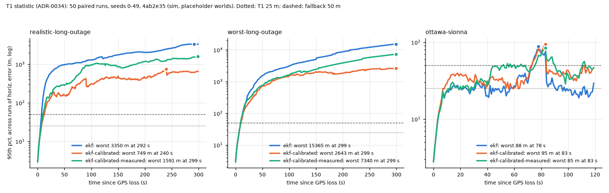
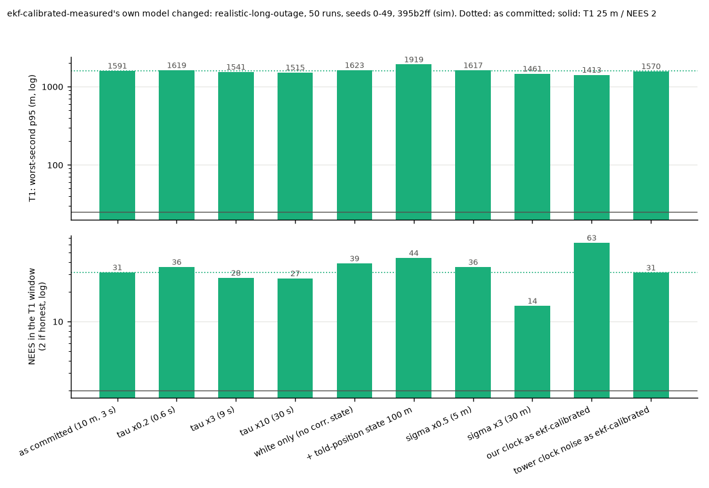

# ekf-calibrated-measured against ekf and ekf-calibrated (#118)

Evidence: **sim**, placeholder worlds (ADR-0015). The filter's correlated LTE error is measured (ADR-0036, 20261110 static sessions, at rest); the worlds it runs in are not. Paired: every estimator on the same generated run per seed. Seeds 0-49 (REPORT_SEEDS); tuning seeds 1000-1049 are declared and none of `CALIBRATED_MEASURED` was chosen on any seed (each value is from ADR-0036 or `EKF`'s default, ADR-0043).

- Paired results: `paired.json`, `t1-paired.png`, made at `4ab2e35`.
- Mismatch: `mismatch.json`, `mismatch-filter.png`, made at `395b2ff`.
- Code that computes the numbers is the same at both commits (later commits change the mismatch cases and plots only).

```bash
python analysis/calibrated_measured.py paired --runs 50 --jobs 3 --json paired.json
python analysis/calibrated_measured.py mismatch --runs 50 --jobs 3 --json mismatch.json
python analysis/calibrated_measured.py plot --json paired.json --mismatch mismatch.json --out-dir .
```

## Definitions

- NEES: horizontal, 2 if honest; mean over every epoch of every run, and over the T1 window.
- T1 (ADR-0034 amendment): at each second after GPS loss, the 95th percentile of horizontal error across the 50 runs; the worst second decides. Window 300 s on the long-outage sets; 120 s on `ottawa-sionna` (its outage, the fallback's window).
- HPL bound rate: epochs with HPL >= error, mean run and worst run.
- Misleading: error > HPL on epochs not flagged `unsafe` (`metrics.score`); an epoch the filter flags unsafe is not counted, so HPL bound below 100 % with zero misleading means every unbounded epoch was flagged.

## Paired, 50 runs

| Scenario | Estimator | NEES all / T1 window | T1: worst-second p95 (m), window | HPL >= error: mean run / worst run (all epochs) | same, T1 window | Misleading /run (total) | Time-misleading /run | Fault-window p95 (m, mean run) | Measured's lower window p95, seeds |
| --- | --- | --- | --- | --- | --- | --- | --- | --- | --- |
| realistic-long-outage | ekf | 5422.7 / 6505.1 | 3350 (0-300 s, worst at 292 s) | 24.1 / 18.9 % | 8.9 / 2.7 % | 0.0 (0) | 0.0 | 2351 | — |
| realistic-long-outage | ekf-calibrated | 3.1 / 3.3 | 749 (0-300 s, worst at 240 s) | 99.7 / 90.6 % | 99.6 / 88.7 % | 0.0 (0) | 0.0 | 370 | — |
| realistic-long-outage | ekf-calibrated-measured | 26.5 / 31.5 | 1591 (0-300 s, worst at 299 s) | 83.5 / 32.6 % | 80.2 / 19.1 % | 0.0 (0) | 151.7 | 711 | vs ekf: 50/50, vs ekf-calibrated: 9/50 |
| worst-long-outage | ekf | 14101.6 / 16916.9 | 15365 (0-300 s, worst at 299 s) | 59.0 / 21.7 % | 50.8 / 6.0 % | 0.0 (0) | 0.0 | 10404 | — |
| worst-long-outage | ekf-calibrated | 37.9 / 45.1 | 2643 (0-300 s, worst at 299 s) | 74.3 / 37.5 % | 69.1 / 25.0 % | 0.0 (0) | 16.9 | 1371 | — |
| worst-long-outage | ekf-calibrated-measured | 85.3 / 102.0 | 7340 (0-300 s, worst at 299 s) | 59.9 / 21.3 % | 51.9 / 5.6 % | 0.0 (0) | 92.3 | 2742 | vs ekf: 50/50, vs ekf-calibrated: 8/50 |
| ottawa-sionna | ekf | 1.9 / 2.6 | 88 (0-120 s, worst at 78 s) | 100.0 / 100.0 % | 100.0 / 100.0 % | 0.0 (0) | 0.0 | 42 | — |
| ottawa-sionna | ekf-calibrated | 1.3 / 0.7 | 95 (0-120 s, worst at 83 s) | 100.0 / 100.0 % | 100.0 / 100.0 % | 0.0 (0) | 0.0 | 49 | — |
| ottawa-sionna | ekf-calibrated-measured | 1.6 / 1.5 | 85 (0-120 s, worst at 83 s) | 100.0 / 100.0 % | 100.0 / 100.0 % | 0.0 (0) | 0.0 | 46 | vs ekf: 19/50, vs ekf-calibrated: 34/50 |



## Mismatch, 50 runs, realistic-long-outage

Filter side (ekf-calibrated-measured's model changed; the world as committed):

| Filter model | T1: worst-second p95 (m) | NEES all / T1 window | HPL >= error, T1 window: mean run | worst run, all epochs | Misleading /run | Time-misleading /run |
| --- | --- | --- | --- | --- | --- | --- |
| as committed (10 m, 3 s) | 1591 | 26.5 / 31.5 | 80.2 % | 32.6 % | 0.0 | 151.7 |
| tau x0.2 (0.6 s) | 1619 | 30.1 / 35.7 | 77.7 % | 28.2 % | 0.0 | 226.7 |
| tau x3 (9 s) | 1541 | 23.4 / 27.7 | 82.7 % | 33.3 % | 0.0 | 89.9 |
| tau x10 (30 s) | 1515 | 23.1 / 27.4 | 83.1 % | 33.3 % | 0.0 | 79.2 |
| white only (no corr. state) | 1623 | 32.6 / 38.8 | 76.6 % | 27.2 % | 0.0 | 251.2 |
| + told-position state 100 m | 1919 | 37.0 / 44.1 | 84.2 % | 32.6 % | 0.0 | 28.3 |
| sigma x0.5 (5 m) | 1617 | 30.0 / 35.7 | 77.5 % | 28.9 % | 0.0 | 225.8 |
| sigma x3 (30 m) | 1461 | 12.3 / 14.4 | 93.0 % | 40.7 % | 0.0 | 22.2 |
| our clock as ekf-calibrated | 1413 | 52.6 / 62.8 | 72.0 % | 28.6 % | 0.0 | 0.0 |
| tower clock noise as ekf-calibrated | 1570 | 26.4 / 31.3 | 80.3 % | 32.8 % | 0.0 | 149.5 |

World side (the world's multipath changed; the filters as committed):

| World multipath | Estimator | T1: worst-second p95 (m) | NEES all / T1 window | HPL >= error, T1 window: mean run | worst run, all epochs | Misleading /run | Time-misleading /run |
| --- | --- | --- | --- | --- | --- | --- | --- |
| as committed | ekf-calibrated | 749 | 3.1 / 3.3 | 99.6 % | 90.6 % | 0.0 | 0.0 |
| as committed | ekf-calibrated-measured | 1591 | 26.5 / 31.5 | 80.2 % | 32.6 % | 0.0 | 151.7 |
| multipath tau x0.2 | ekf-calibrated | 826 | 4.6 / 5.2 | 98.3 % | 56.4 % | 0.0 | 0.0 |
| multipath tau x0.2 | ekf-calibrated-measured | 1498 | 25.8 / 30.7 | 82.2 % | 32.5 % | 0.0 | 66.6 |
| multipath tau x5 | ekf-calibrated | 635 | 1.8 / 1.9 | 99.8 % | 93.6 % | 0.0 | 0.0 |
| multipath tau x5 | ekf-calibrated-measured | 818 | 10.7 / 12.5 | 95.3 % | 36.4 % | 0.0 | 45.5 |
| multipath white | ekf-calibrated | 694 | 2.4 / 2.5 | 99.5 % | 86.9 % | 0.0 | 0.0 |
| multipath white | ekf-calibrated-measured | 878 | 7.2 / 8.4 | 97.7 % | 73.5 % | 0.0 | 0.0 |
| multipath random-walk | ekf-calibrated | 756 | 5.0 / 5.7 | 98.4 % | 78.8 % | 0.0 | 0.0 |
| multipath random-walk | ekf-calibrated-measured | 1896 | 45.9 / 54.7 | 69.4 % | 35.5 % | 0.0 | 245.1 |
| multipath bias-step | ekf-calibrated | 712 | 3.1 / 3.4 | 99.4 % | 85.7 % | 0.0 | 0.0 |
| multipath bias-step | ekf-calibrated-measured | 1613 | 24.8 / 29.4 | 80.2 % | 38.1 % | 0.0 | 143.8 |



## Read with

- `ekf-calibrated`'s rows reproduce #118's numbers on `worst-long-outage` (NEES 37.9, worst run bounded on 37.5 % of epochs, 16.9 time-misleading epochs per run) and `ottawa-sionna` (fault-window p95 49 m against `ekf`'s 42 m).
- On the two sets whose LTE errors are the `realistic`/`worst` placeholders (50 to 100 m white, 50 to 100 m Gauss-Markov over 30 to 120 s, told position 100 to 300 m), the measured filter is overconfident: NEES 26.5 and 85.3. Its correlated part (10 m, 3 s, at rest) is a fifth to a tenth of the sets' multipath, its correlation time a tenth to a fortieth, and its told-position state is off. No change of the filter's correlation time (0.6 to 30 s) or form (white only; plus a told-position state) brings NEES below 23; only a 3x larger correlated part does (12.3). Whether the world or the filter is wrong waits on the moving capture with GPS (ADR-0036 (4)).
- Its time-misleading epochs (151.7 per run on `realistic-long-outage`) come from our clock: with `ekf-calibrated`'s clock values (the realistic set's 2 ns/sqrt(s)) they fall to 0, and NEES rises to 52.6. The tower clock noise does not matter (149.5). Our clock's real noise is not measured (ADR-0043: literature TCXO default).
- On `ottawa-sionna` (20 m white plus ray-traced excess delay, no Gauss-Markov multipath) the measured filter is honest (NEES 1.6) and has the lowest T1 statistic of the three (85 m, against 88 and 95 m); none meets T1 (25 m) or the fallback (50 m for 120 s).
- No estimator meets T1 or its fallback on any of the three sets.
