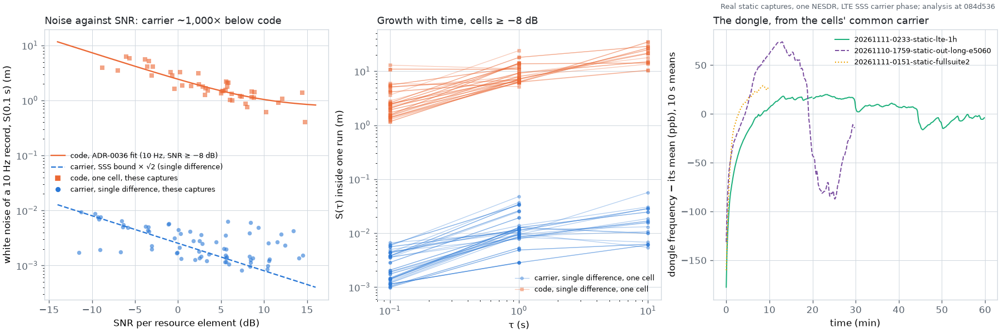

# LTE carrier phase on static captures: the dongle from the cells' common drift, and what is left (#277)

Evidence: **real static sessions** (one NESDR SMArt v5, `sdr_a`, recorded at the owner's home on 2026-11-10 and -11; each `meta.yaml` names the recorder's commit). No truth is used: nothing here needs a position, and nothing here gives one. Only noise, frequencies, slips and SNR are reported; sites are letters per capture (which cells share an eNB, by `lte-cells-ottawa.csv`), not identities. Front end at `de95c22` (`origin/main`, unchanged); analysis `analysis/lte_carrier_phase.py` at `354b27d`. Analysis only: no estimator or front-end change.



*Left: white noise of a 10 Hz record against SNR, carrier (single difference with the reference cell) and code (one cell), same epochs; lines are ADR-0036's code fit and the SSS phase bound. Middle: S(τ) of the single difference, every cell ≥ −8 dB. Right: the dongle's frequency from the cells' common carrier (10 s means). Real static sessions, all 17 captures; analysis at `354b27d`.*

## Short version

- **Go / no-go: no-go for carrier-phase ranging on this hardware as the front end stands.** The phase itself is good (mm noise, slips rare, the dongle's frequency read every second to about 0.1 ppb), but a run of continuous phase lasts a median 6 s: it ends at each new code arc and each missed stretch of epochs, and with code at metres against a 34 cm wavelength nothing here can recover the whole cycles after a break.
- **Carrier noise:** 0.9 to 11 mm per 10 ms sample (median 2.2 mm) over SNR −9 to +16 dB; 10 Hz single differences (cells ≥ −8 dB tracked 30 s or more) 1.0 to 6.1 mm (median 1.9 mm) against code 1.2 to 13 m (median 2.4 m) on the same cells: about 1,000 times lower. Growth inside a run (cells ≥ −8 dB tracked 30 s or more): carrier S(1 s) 2.8 to 37 mm (median 11 mm), S(10 s) 5.5 to 57 mm (median 16 mm); code S(1 s) 5.2 to 24 m, S(10 s) 10 to 35 m.
- **Slips:** 53 in all 49 cell tracks (0 to 4.1 per stream-minute, median 0); 25 of them on one cell (`1759`, PCI 492, −2 dB). What ends runs is the tracker, not the carrier: 618 new code arcs and 1,206 stretches of more than 50 ms without an accepted epoch, against 53 slips and 55 dropped-sample gaps.
- **Continuity:** runs of median 1.1 to 59 s per cell (median of cells 6.4 s), p90 2.6 to 144 s, longest 600 s (the chunk length; `1759` PCI 492). Share of tracked time in runs of 10 s or more: 0 to 100 % (median 69 %); of 60 s or more: median 0 %.
- **The dongle, disciplined:** +0.14 to +0.53 ppm fast (the carrier common to all cells), moving by up to 0.22 ppm within a capture (warm-up at the start of `0233` and `0151`, right panel). Read every second to about the towers' spread about their mean (±0.05 to ±0.4 ppb, below). Allan deviation 2.5e-10 to 2.6e-9 at 1 s, 1.0e-9 to 2.2e-8 at 10 s, 6.7e-9 to 1.7e-8 at 100 s: a carrier needs at least two cells at every moment so this cancels.
- **Towers against each other (common mode removed):** within ±0.02 ppb on the 1 h and 10 min captures (Rogers, four sites), +0.04 to −0.14 ppb on `1759` (5060), up to −0.86 to +1.6 ppb on the weak cells of one 60 s capture (`1623-…-e5205`, SNR −9 to +6 dB). Spread of 1 s values ±0.05 to ±0.41 ppb; Allan deviation of a tower against the rest 4.7e-11 to 4.1e-10 at 1 s, 8e-12 to 1.6e-10 at 10 s, 7.5e-12 to 4.4e-11 at 100 s. At 0.14 ppb a pair drifts 0.04 m/s: hundreds of times tighter than what code shows in ADR-0036 (inter-eNB drift `TBD`, up to 24 m/s seen); for the owners, not changed here.

## The 100 Hz alias: what it is and how it is resolved

- **Cause found: subframes 0 and 5 reach the dongle as different channels.** Per cell, subframe-5 minus subframe-0 phase δ is steady inside a run (1 s wander 0.03 to 0.64 rad, median of cells 0.08 rad) but not zero: δ is within 0.5 rad of 0 on 22 of 49 cells, of π on 12, elsewhere on the rest; and the two subframes' SSS power differs by more than 1 dB on 39 of 49 cells (−8.2 to +10.7 dB). That fits an eNB sending the sync signals of the two subframes through different antennas (TS 36.211 leaves the port to the eNB). δ near π is what makes a 5 ms series fit a frequency 100 Hz off as well as the true one.
- **A second, smaller term:** another cell's SSS leaks into ours through a cross-correlation that differs between subframes, so even δ = 0 on air is not constant at the receiver. On synthetic IQ (`tests/test_lte_carrier_phase.py`): one tower gives the phase bound; with a second tower 3 dB down the joined 5 ms series has 3 times the bound and each subframe alone is at it.
- **Resolution used here:** each subframe is its own 10 ms stream (unambiguous to ±50 Hz), unwrapped by an α-β loop. The loop is seeded by the cells' common carrier frequency (first pass seeded by the code rate), and each sub-run's alias is the one the common frequency gives. The code rate alone is not enough: it picks a different alias than the cells' consensus on 6 to 12 % of sub-runs on the long captures (`0233` 144 of 1,624, `0151` 21 of 320, `1759` 108 of 868) and up to 28 of 56 on one 60 s capture, because carrier and code disagree by −67 to +25 Hz (per-cell medians; mostly one sign per capture, −32 Hz on all three cells of `1759` at 734 MHz; cause `TBD`, a tuner LO offset would do it).
- **It does not block phase tracking**, but it costs: half the epochs per stream, two cells or a reference at all times, and on a moving receiver δ will change with the two antennas' multipath (not measured; static only).
- **The front end's own loop** sits on a non-zero 100 Hz alias of the carrier in 0 to 100 % of 10 s windows per cell (22 of 47 cells at least once): the doppler alias of ADR-0036's amendment (5), confirmed and now explained. `Config.doppler` stays off; this script changes nothing in `src/`.

## Per capture

| Capture | s | Dongle ppm mean (min to max) | σ_y 1 / 10 / 100 s | Carrier − code (Hz, median per cell) | Code alias wrong | Incoherent |
|---|---|---|---|---|---|---|
| `10-1305-lte-outside` (2460) | 60 | 0.290 (0.269 to 0.306) | 5.6e-10 / 5.2e-09 / – | +2 to +13 | 2 of 14 | 0.0 % |
| `10-1610-site1-e2460` (2460) | 60 | 0.333 (0.266 to 0.379) | 1.6e-09 / 1.3e-08 / – | +8 to +16 | 0 of 17 | 0.9 % |
| `10-1610-site1-e5060` (5060) | 60 | 0.522 (0.516 to 0.531) | 6.4e-10 / 1.2e-09 / – | -31 to -26 | 0 of 14 | 1.4 % |
| `10-1610-site1-e5145` (5145) | 60 | 0.481 (0.438 to 0.512) | 1.1e-09 / 9.2e-09 / – | -34 to -29 | 3 of 24 | 9.6 % |
| `10-1610-site1-e5205` (5205) | 59 | 0.500 (0.495 to 0.508) | 5.9e-10 / 1.0e-09 / – | -9 to +14 | 1 of 40 | 0.2 % |
| `10-1610-site1-e5255` (5255) | 60 | 0.466 (0.452 to 0.476) | 3.8e-10 / 3.5e-09 / – | +11 to +19 | 0 of 6 | 0.0 % |
| `10-1623-out-e2460` (2460) | 60 | 0.253 (0.221 to 0.277) | 8.1e-10 / 7.3e-09 / – | +13 to +13 | 4 of 20 | 27.6 % |
| `10-1623-out-e2560` (2560) | 59 | 0.388 (0.378 to 0.395) | 6.3e-10 / 1.9e-09 / – | -23 to -19 | 3 of 27 | 0.0 % |
| `10-1623-out-e5060` (5060) | 60 | 0.407 (0.393 to 0.418) | 7.5e-10 / 3.7e-09 / – | -33 to -32 | 4 of 31 | 1.0 % |
| `10-1623-out-e5145` (5145) | 60 | 0.356 (0.333 to 0.366) | 7.2e-10 / 4.6e-09 / – | -67 to -26 | 28 of 56 | 0.6 % |
| `10-1623-out-e5205` (5205) | 60 | 0.382 (0.372 to 0.386) | 6.1e-10 / 1.7e-09 / – | -22 to -6 | 6 of 57 | 1.2 % |
| `10-1623-out-e5255` (5255) | 60 | 0.308 (0.291 to 0.318) | 6.6e-10 / 3.2e-09 / – | +9 to +25 | 2 of 23 | 0.0 % |
| `10-1759-out-long-e5060` (5060) | 1800 | 0.397 (0.249 to 0.471) | 4.2e-10 / 2.8e-09 / 1.7e-08 | -32 to -31 | 108 of 868 | 3.5 % |
| `10-lte-outside-5145` (5145) | 29 | 0.270 (0.212 to 0.306) | 2.6e-09 / 2.2e-08 / – | -40 to -20 | 4 of 19 | 11.5 % |
| `10-lte-outside-5255` (5255) | 29 | 0.260 (0.238 to 0.275) | 1.1e-09 / 9.2e-09 / – | +12 to +14 | 0 of 6 | 0.0 % |
| `11-0151-fullsuite2` (2460) | 599 | 0.321 (0.149 to 0.348) | 5.4e-10 / 3.4e-09 / 6.7e-09 | +4 to +15 | 21 of 320 | 2.7 % |
| `11-0233-lte-1h` (2460) | 3600 | 0.346 (0.145 to 0.366) | 2.5e-10 / 1.9e-09 / 8.6e-09 | +5 to +18 | 144 of 1624 | 0.1 % |
*Dongle: weighted mean over cells of the 1 s carrier frequency, as a fractional offset (positive: fast; includes the towers' mean and any tuner LO offset, which a static capture cannot split off). "Code alias wrong": sub-runs where the code-rate slope chose another 100 Hz alias than the one the cells' common frequency gave. "Incoherent": stream time whose SSS phase is far above its bound (the tracker on another signal, e.g. after a first-path move), dropped.*

## Per cell, the three long captures

All 49 cell tracks of the 17 captures are in `summary.json`; the 60 s captures fall inside the ranges above.

| Capture | PCI | Op. | Site | SNR dB | Tracked s | Carrier white 10 ms, mm (× bound) | Carrier SD S(0.1 / 1 / 10 s), mm | Code white 10 Hz, m | Code SD S(1 / 10 s), m | Slips / stream-min | Runs: median / p90 / max s | ≥ 10 s |
|---|---|---|---|---|---|---|---|---|---|---|---|---|
| `11-0233-lte-1h` | 92 | Rogers | A | 7.9 | 3170 | 1.32 (0.67) | 1.5 / 12.7 / 24.7 | 0.66 | 6.3 / 27.0 | 0.00 | 5.8 / 14 / 425 | 60 % |
| `11-0233-lte-1h` | 268 | Rogers | B | 4.8 | 2857 | 1.53 (0.55) | 1.5 / 12.7 / 24.7 | 1.14 | 6.3 / 27.0 | 0.00 | 6.9 / 25 / 88 | 74 % |
| `11-0233-lte-1h` | 204 | Rogers | C | 3.5 | 1969 | 1.65 (0.51) | 1.3 / 9.6 / 28.9 | 0.94 | 6.4 / 34.6 | 0.02 | 4.9 / 18 / 177 | 61 % |
| `11-0233-lte-1h` | 244 | Rogers | D | 5.8 | 203 | 1.40 (0.55) | 1.2 / 10.2 / 56.9 | 1.14 | 6.2 / 35.1 | 0.00 | 8.0 / 24 / 69 | 82 % |
| `11-0233-lte-1h` | 220 | Rogers | C | 1.9 | 73 | 1.54 (0.39) | 1.2 / 8.9 / 10.7 | 1.39 | 9.2 / – | 0.00 | 9.4 / 46 / 60 | 94 % |
| `11-0151-fullsuite2` | 268 | Rogers | A | 4.4 | 506 | 1.48 (0.51) | 1.4 / 12.7 / 10.0 | 1.16 | 7.1 / 25.0 | 0.06 | 8.5 / 21 / 63 | 75 % |
| `11-0151-fullsuite2` | 92 | Rogers | B | 7.2 | 490 | 1.25 (0.58) | 1.4 / 12.7 / 10.0 | 0.75 | 7.1 / 25.0 | 0.06 | 4.5 / 11 / 56 | 38 % |
| `11-0151-fullsuite2` | 204 | Rogers | C | 3.9 | 195 | 1.49 (0.48) | 1.3 / 11.4 / 13.2 | 1.06 | 8.1 / 13.6 | 0.00 | 5.0 / 22 / 38 | 57 % |
| `11-0151-fullsuite2` | 244 | Rogers | D | 5.7 | 189 | 1.32 (0.52) | 1.4 / 9.8 / 5.5 | 1.24 | 9.3 / 17.8 | 0.00 | 5.7 / 18 / 41 | 63 % |
| `10-1759-out-long-e5060` | 492 | Vidéotron | A | -2.0 | 1725 | 6.83 (0.93) | 3.6 / 7.9 / 15.8 | 3.13 | 6.2 / 10.4 | 0.48 | 10.0 / 144 / 600 | 96 % |
| `10-1759-out-long-e5060` | 4 | Vidéotron | A | -0.9 | 1680 | 5.81 (0.90) | 3.5 / 9.4 / 15.7 | 2.41 | 6.3 / 10.5 | 0.04 | 5.5 / 15 / 95 | 42 % |
| `10-1759-out-long-e5060` | 204 | TBD | TBD | -3.4 | 1588 | 8.57 (0.99) | 4.3 / 13.8 / 30.6 | 4.21 | 8.0 / 21.7 | 0.31 | 6.3 / 19 / 79 | 63 % |

| Capture | PCI | Op. | Site | vs others, ppb (mean ± SD of 1 s) | σ_y 1 / 10 / 100 s | δ sf5 − sf0 (rad) | near π | sf5/sf0 power dB | Loop on 100 Hz alias | Breaks: arc / miss / gap / slip |
|---|---|---|---|---|---|---|---|---|---|---|
| `11-0233-lte-1h` | 92 | Rogers | A | +0.003 ± 0.07 | 7.3e-11 / 2.1e-11 / 7.5e-12 | +3.01 | 87 % | +2.7 | 6 % | 96 / 112 / 13 / 0 |
| `11-0233-lte-1h` | 268 | Rogers | B | +0.004 ± 0.08 | 8.8e-11 / 2.1e-11 / 1.2e-11 | -1.51 | 1 % | +7.0 | 1 % | 66 / 179 / 17 / 0 |
| `11-0233-lte-1h` | 204 | Rogers | C | -0.010 ± 0.08 | 7.5e-11 / 2.1e-11 / – | +3.08 | 83 % | +4.9 | 10 % | 44 / 400 / 7 / 1 |
| `11-0233-lte-1h` | 244 | Rogers | D | -0.015 ± 0.08 | 8.7e-11 / 2.5e-11 / – | -0.69 | 0 % | +1.2 | 0 % | 1 / 13 / 0 / 0 |
| `11-0233-lte-1h` | 220 | Rogers | C | -0.019 ± 0.05 | 4.7e-11 / 1.3e-11 / – | -1.06 | 0 % | -4.1 | 0 % | 0 / 4 / 0 / 0 |
| `11-0151-fullsuite2` | 268 | Rogers | A | +0.006 ± 0.11 | 1.2e-10 / 2.2e-11 / – | -1.60 | 0 % | +7.9 | 4 % | 10 / 25 / 2 / 1 |
| `11-0151-fullsuite2` | 92 | Rogers | B | +0.004 ± 0.11 | 1.2e-10 / 2.6e-11 / – | +2.98 | 84 % | +2.1 | 17 % | 29 / 40 / 4 / 1 |
| `11-0151-fullsuite2` | 204 | Rogers | C | -0.019 ± 0.14 | 1.4e-10 / 3.0e-11 / – | +3.00 | 86 % | +4.9 | 12 % | 10 / 32 / 1 / 0 |
| `11-0151-fullsuite2` | 244 | Rogers | D | -0.001 ± 0.08 | 8.8e-11 / 1.9e-11 / – | -0.85 | 0 % | +2.1 | 5 % | 2 / 22 / 2 / 0 |
| `10-1759-out-long-e5060` | 492 | Vidéotron | A | +0.038 ± 0.31 | 3.1e-10 / 8.6e-11 / 2.2e-11 | +0.76 | 0 % | -6.4 | 0 % | 5 / 2 / 2 / 25 |
| `10-1759-out-long-e5060` | 4 | Vidéotron | A | +0.061 ± 0.14 | 1.4e-10 / 4.1e-11 / 2.5e-11 | -2.15 | 3 % | +2.1 | 1 % | 181 / 53 / 4 / 2 |
| `10-1759-out-long-e5060` | 204 | TBD | TBD | -0.136 ± 0.17 | 1.5e-10 / 4.5e-11 / 4.4e-11 | +3.09 | 60 % | +7.1 | 31 % | 84 / 119 / 3 / 16 |

*SNR: the front end's per-resource-element SNR (`meta.snr_db` definition). "× bound": the measured 10 ms white phase noise over 1/√(2·62·SNR); below 1 means that SNR reads low for the SSS (0.39 to 0.95 on EARFCN 2460, 0.56 to 1.23 elsewhere; not investigated). Carrier and code S(τ) are of the single difference with the capture's reference cell (most epochs × SNR; the reference itself against the next), which cancels the dongle and includes the reference's own noise. "vs others": a cell's 1 s carrier frequency minus the weighted mean of the other cells'. Breaks are what started a new run before slips were looked for.*

## Method

`analysis/lte_carrier_phase.py`, implemented from the description of Calvo-Palomino et al., "LTESS-track: A Precise and Fast Frequency Offset Estimation for low-cost SDR Platforms", ACM WiNTECH 2017, DOI 10.1145/3131473.3131481 (dongle frequency from LTE sync; their GPL code was not downloaded or used). Here the carrier phase does the work the sync timing does there.

1. The front end runs unchanged, in 600 s chunks (the 1 h capture in six). A subclass of its tracker keeps, at every 5 ms epoch it accepted, the SSS correlation summed over the 62 subcarriers; its angle plus the tracker's derotation is the carrier phase at the SSS window's centre in the dongle's gap-corrected sample time. The PSS is not used (shared by every cell on its root).
2. Per cell and subframe, a 10 ms stream; runs break at a new code arc, a dropped-sample gap, or more than 50 ms without an epoch. Each run is unwrapped by an α-β loop (gains 0.5 and 0.1, `TBC`), split at cycle slips (a phase step of more than π after a local slope, the slope taken from the loop's 1 s median frequency) and frequency slips (the 0.1 s frequency jumping by more than 30 Hz: the loop moving to another alias).
3. Sub-runs of 0.4 s or more whose own 10 ms noise is above 0.6 rad and 3 times the bound are incoherent and dropped. The rest are put on the alias of the cells' common frequency (a weighted vote per 1 s window), and the loops are run again seeded from it.
4. Common mode: per 1 s window, each cell's carrier frequency (mean of its two streams); the weighted mean over cells is the dongle; a cell minus the others' mean is its tower against the rest.
5. Noise: S(τ) is the second-difference structure function of `lte_measured_noise.py` (robust version; σ for white noise). Code is measured the same way on the same epochs (the boundary detrended by the chunk's code rate; 10 Hz records of 18 or more epochs).

`tests/test_lte_carrier_phase.py` checks the maths on synthetic IQ (`pnt.frontends.lte.synth`): carrier frequency within 0.05 Hz of truth and phase noise within 1.4 times the bound for one tower; a 2.5 rad subframe-5 offset measured within 0.1 rad with no alias; two towers 2 ppb apart read 2 ppb apart; and on series: the loop following a 75 Hz drift from a seed 40 Hz off, the slip and frequency-slip detectors, the alias alignment.

## What a real attempt would need

- **Carrier that survives the code tracker:** a carrier loop per cell that keeps its count through new code arcs, first-path moves and missed epochs, bridging gaps with the disciplined dongle frequency (and the IMU when moving). Here 618 arcs and 1,206 misses ended runs against 53 slips.
- **Two subframe streams, or δ per antenna:** sf0 and sf5 behave as two channels; on a moving drone each has its own multipath. Not measured in motion.
- **Two or more cells at every moment** (common mode and alias vote), or a reference: a GPSDO on the dongle, or a shared reference across dongles, removes the 1e-8 dongle wander and the need for the vote. The tuner's carrier-minus-code offset (−67 to +25 Hz here) must be calibrated or estimated per carrier.
- **Cycle-slip handling with integer recovery:** only time-differenced carrier (delta range) is reachable; absolute integers need code good to well under λ/2 (17 cm), and code here is metres.
- **Tower frequency states:** small (≤ 0.14 ppb between eNBs here, static), but 0.04 m/s still builds metres over minutes.
- **A moving capture with GPS truth** to measure δ, run length and slips in motion.

## Commands

```bash
S=data/sessions; O=<npz dir>   # npz files are local only (per-epoch phases; not committed)
for s in 20261110-1305-lte-outside 20261110-lte-outside-{5145,5255} \
         20261110-1610-static-site1-e{2460,5060,5145,5205,5255} \
         20261110-1623-static-out-e{2460,2560,5060,5145,5205,5255} \
         20261111-0151-static-fullsuite2 20261110-1759-static-out-long-e5060 20261111-0233-static-lte-1h; do
  PYTHONPATH=src python analysis/lte_carrier_phase.py run $S/$s/sdr_a.cu8 $O/$s.npz
done
PYTHONPATH=src python analysis/lte_carrier_phase.py report $O/*.npz   # -> this folder
```

The `run` step was made with the branch's working copy before it was squashed to `354b27d`; its collection code (the `collect` section and the `wrap`/`cycles` it uses) is byte-identical to `354b27d`'s. `report` at `354b27d`, clean tree; `summary.json` was also identical, but for the commit, when made at the pre-squash commit. The front end on the 1 h capture took 78 to 186 s per 600 s chunk on the shared laptop. Not used: the `20261110` captures with no cell (as in `lte-measured-noise/NOTES.md`), `20261111-0216-static-lte-1h` (600 s on disk; not in the brief), the antenna comparison captures (`20261110-23*`), and every moving capture.
