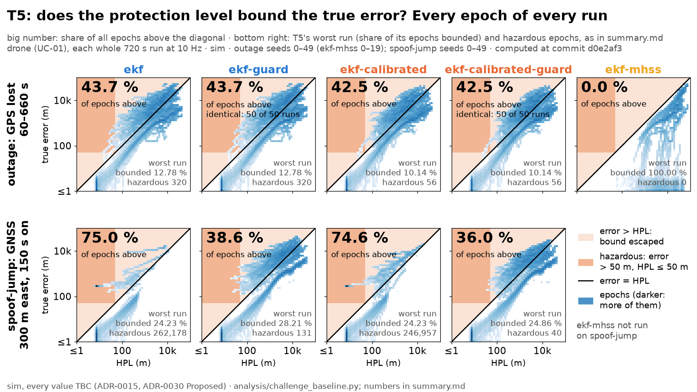

# Challenge baseline: every estimator on every `challenge` entry

The "before" table (#150, package 5 of #126). **sim, every value TBC (ADR-0015, ADR-0030 Proposed).** It becomes the presented result only once ADR-0030 is accepted.

- **Commit:** `927f25f`
- **Seeds:** 0–49 (`ekf-mhss`: 0–19)
- **Command:** `python analysis/challenge_baseline.py --seeds 50 --jobs 6`
- **Runtime:** 54.0 min wall, 6 worker(s)
- **Approach leg: synthetic geometry** (ADR-0030 point 3). Its towers are a synthetic ring, all ahead of the aircraft; its T1 slice does not measure LTE (in effect IMU and barometer dead reckoning).

**What was cut:**

- `ekf-mhss`: seeds 0–19 (not 50), and only the entries `nominal`, `outage`, `spoof-ramp`, `time-spoof`, `outage-tower-clock-step`, `outage-tower-holdover` of each leg. It takes 3 to 10 s a run against about 1 s for the others; its cells elsewhere read *not run*.
- `ekf-guard`, `ekf-calibrated-guard`, `ekf-imu-guard` (opt-in jump guard, ADR-0038 Proposed): seeds 0–49, only the entries `nominal`, `outage`, `spoof-jump`, `meaconing` of each leg (the held 300 m GNSS jump from 150 s and meaconing, and two entries without a jump); their cells elsewhere read *not run*.
- `ekf-base`: not run. It needs a reference station (ADR-0020) and these legs have none (no entry run has a `reference:` block, checked before running); without one `nav/base_rover.py` is `ekf` with the payload's clock in its tower readings.
- `ekf-base-imu`: not run. It needs a reference station (ADR-0020) and these legs have none (no entry run has a `reference:` block, checked before running); without one `nav/base_rover.py` is `ekf` with the payload's clock in its tower readings.

## Verdict per target

Targets from `systems/plan.md` and ADR-0034 (T1 Accepted, its value `TBC`; T3 to T5 Proposed). T3 is **met** by an estimator only if every seed meets it, T4 detection likewise, false alarms on the pooled rate. Cells read *mean / worst* over seeds; *of* counts seeds (or runs) meeting the target. An estimator that ran fewer seeds or entries than the row covers (`ekf-mhss`, the guard estimators) does not score it: where only such an estimator meets the target the row reads *partial / not scored*.

**T1 statistic** (ADR-0034's amendment of 2026-11-10, adf24d7 on `main`): at each second after GPS loss, the 95th percentile of the horizontal error across the runs; T1 holds only if that curve stays ≤ 25 m for every second of 0–300 s. The cell gives the worst second's value, that second, and the number of runs. The *T1 fallback* row is ADR-0034's declared fallback, the mentors' figure (≤ 50 m over 0–120 s), scored the same way. Each run's own p95 over the slice is shown after it in brackets: the amendment names it as not used, and no verdict rests on it.

| Target | Leg, entry | Measure | `baseline` | `ekf` | `ekf-calibrated` | `ekf-imu` | `ekf-mhss` | `ekf-guard` | `ekf-calibrated-guard` | `ekf-imu-guard` | Verdict |
|---|---|---|---|---|---|---|---|---|---|---|---|
| T1 | drone, `outage` | 95th percentile across runs at each second after GPS loss: worst second of 0–300 s (≤ 25 m to meet), its second, runs | **12,814 m** at 300 s; 50 runs (per-run 300 s p95, not the ADR's statistic: mean 5,055 m) | **12,507 m** at 300 s; 50 runs (per-run 300 s p95, not the ADR's statistic: mean 4,944 m) | **10,154 m** at 300 s; 50 runs (per-run 300 s p95, not the ADR's statistic: mean 4,284 m) | **24,308 m** at 300 s; 50 runs (per-run 300 s p95, not the ADR's statistic: mean 8,865 m) | **17,407 m** at 300 s; 20 runs (per-run 300 s p95, not the ADR's statistic: mean 5,356 m) | **12,507 m** at 300 s; 50 runs (per-run 300 s p95, not the ADR's statistic: mean 4,944 m) | **10,154 m** at 300 s; 50 runs (per-run 300 s p95, not the ADR's statistic: mean 4,284 m) | **24,308 m** at 300 s; 50 runs (per-run 300 s p95, not the ADR's statistic: mean 8,865 m) | **not met** |
| T1 fallback (ADR-0034) | drone, `outage` | 95th percentile across runs at each second after GPS loss: worst second of 0–120 s (≤ 50 m to meet), its second, runs | **3,537 m** at 113 s; 50 runs (per-run 120 s p95, not the ADR's statistic: mean 1,633 m) | **3,268 m** at 120 s; 50 runs (per-run 120 s p95, not the ADR's statistic: mean 1,580 m) | **3,418 m** at 117 s; 50 runs (per-run 120 s p95, not the ADR's statistic: mean 1,590 m) | **4,585 m** at 120 s; 50 runs (per-run 120 s p95, not the ADR's statistic: mean 1,717 m) | **2,901 m** at 120 s; 20 runs (per-run 120 s p95, not the ADR's statistic: mean 1,469 m) | **3,268 m** at 120 s; 50 runs (per-run 120 s p95, not the ADR's statistic: mean 1,580 m) | **3,418 m** at 117 s; 50 runs (per-run 120 s p95, not the ADR's statistic: mean 1,590 m) | **4,585 m** at 120 s; 50 runs (per-run 120 s p95, not the ADR's statistic: mean 1,717 m) | **not met** |
| T2 | approach, `outage` (**synthetic geometry**) | 300 s p95 mean / worst (not the T2 measure) | 2,344 / 4,984 m | 2,344 / 4,984 m | 1,313 / 3,148 m | 2,343 / 4,984 m | 2,235 / 2,979 m | 2,344 / 4,984 m | 1,313 / 3,148 m | 2,343 / 4,984 m | **not scored**: no field tests the 556 m alert limit |
| T3 | timing, `outage` | 600 s error mean / worst; σ bound mean / worst; seeds with ≤ 1.5 µs and ≥ 68 % | no clock state | 0.44 / 1.55 µs; σ bound 99.46 % / 92.58 %; 49 of 50 | 0.15 / 0.52 µs; σ bound 78.09 % / 0.42 %; 37 of 50 | 0.44 / 1.55 µs; σ bound 99.46 % / 92.58 %; 49 of 50 | 0.55 / 1.55 µs; σ bound 99.27 % / 92.58 %; 19 of 20 | 0.44 / 1.55 µs; σ bound 99.46 % / 92.58 %; 49 of 50 | 0.15 / 0.52 µs; σ bound 78.09 % / 0.42 %; 37 of 50 | 0.44 / 1.55 µs; σ bound 99.46 % / 92.58 %; 49 of 50 | **not met** |
| T4 | drone, `spoof-ramp` | 2 m/s ramp: seeds detected ≤ 30 s; median delay of those detected | 0 of 50; median — | 0 of 50; median — | 0 of 50; median — | 0 of 50; median — | 0 of 20; median — | not run | not run | not run | **not met** |
| T4 | timing, `time-spoof` | 50 ns/s time ramp: seeds detected ≤ 60 s; median delay of those detected | 0 of 50; median — | 50 of 50; median 3.3 s | 50 of 50; median 2.9 s | 50 of 50; median 3.3 s | 20 of 20; median 3.1 s | not run | not run | not run | **met** by `ekf`, `ekf-calibrated`, `ekf-imu`; `ekf-mhss` meets it on a partial run (seeds 0–19, not 50) |
| T4 (jump) | drone (UC-01), `spoof-jump` | seeds detected, median delay; hazardous epochs per run, runs with any; fault-window p95 mean | 50 of 50, 1.1 s; 5,231 /run, 50 of 50; 885 m | 50 of 50, 1.1 s; 5,244 /run, 49 of 50; 646 m | 50 of 50, 1.1 s; 4,939 /run, 47 of 50; 1,103 m | 50 of 50, 1.1 s; 3,117 /run, 49 of 50; 12,292 m | not run | 50 of 50, 1.1 s; 3 /run, 3 of 50; 14,014 m | 50 of 50, 1.1 s; 1 /run, 2 of 50; 10,808 m | 50 of 50, 1.1 s; 7 /run, 5 of 50; 20,071 m | **not scored**: jump target `TBD` (plan.md T4) |
| T4 (jump) | drone (UC-01), `meaconing` | seeds detected, median delay; hazardous epochs per run, runs with any; fault-window p95 mean | 50 of 50, 1.1 s; 0 /run, 0 of 50; 41.9 m | 50 of 50, 1.1 s; 0 /run, 0 of 50; 41.9 m | 50 of 50, 1.1 s; 0 /run, 0 of 50; 41.9 m | 50 of 50, 1.1 s; 7 /run, 9 of 50; 55.4 m | not run | 50 of 50, 1.1 s; 3 /run, 3 of 50; 14,014 m | 50 of 50, 1.1 s; 1 /run, 2 of 50; 10,808 m | 50 of 50, 1.1 s; 7 /run, 5 of 50; 20,071 m | **not scored**: no T4 target for meaconing |
| T4 (jump) | timing (UC-03), `spoof-jump` | seeds detected, median delay; hazardous epochs per run, runs with any; fault-window p95 mean | 50 of 50, 1.1 s; 5,435 /run, 50 of 50; 302 m | 50 of 50, 1.1 s; 5,317 /run, 50 of 50; 455 m | 50 of 50, 1.1 s; 5,233 /run, 49 of 50; 530 m | 50 of 50, 1.1 s; 5,101 /run, 50 of 50; 2,633 m | not run | 50 of 50, 1.1 s; 4 /run, 6 of 50; 8,647 m | 50 of 50, 1.1 s; 2 /run, 5 of 50; 8,622 m | 50 of 50, 1.1 s; 2 /run, 3 of 50; 11,847 m | **not scored**: jump target `TBD` (plan.md T4) |
| T4 (jump) | timing (UC-03), `meaconing` | seeds detected, median delay; hazardous epochs per run, runs with any; fault-window p95 mean | 0 of 50, —; 0 /run, 0 of 50; 2.8 m | 50 of 50, 1.1 s; 0 /run, 0 of 50; 2.8 m | 50 of 50, 1.1 s; 0 /run, 0 of 50; 2.8 m | 50 of 50, 1.1 s; 0 /run, 0 of 50; 2.5 m | not run | 50 of 50, 1.1 s; 0 /run, 0 of 50; 2.8 m | 50 of 50, 1.1 s; 0 /run, 0 of 50; 2.8 m | 50 of 50, 1.1 s; 0 /run, 0 of 50; 2.5 m | **not scored**: no T4 target for meaconing |
| T4 (jump) | approach (UC-02, synthetic geometry), `spoof-jump` | seeds detected, median delay; hazardous epochs per run, runs with any; fault-window p95 mean | 50 of 50, 1.1 s; 5,237 /run, 48 of 50; 546 m | 50 of 50, 1.1 s; 5,237 /run, 48 of 50; 546 m | 50 of 50, 1.1 s; 4,856 /run, 50 of 50; 307 m | 50 of 50, 1.1 s; 4,908 /run, 48 of 50; 781 m | not run | 50 of 50, 1.1 s; 0 /run, 0 of 50; 4,339 m | 50 of 50, 1.1 s; 0 /run, 0 of 50; 1,296 m | 50 of 50, 1.1 s; 0 /run, 0 of 50; 4,340 m | **not scored**: jump target `TBD` (plan.md T4) |
| T4 (jump) | approach (UC-02, synthetic geometry), `meaconing` | seeds detected, median delay; hazardous epochs per run, runs with any; fault-window p95 mean | 50 of 50, 1.1 s; 924 /run, 48 of 50; 3,529 m | 50 of 50, 1.1 s; 924 /run, 48 of 50; 3,529 m | 50 of 50, 1.1 s; 1,234 /run, 33 of 50; 1,189 m | 50 of 50, 1.1 s; 825 /run, 48 of 50; 4,028 m | not run | 50 of 50, 1.1 s; 0 /run, 0 of 50; 4,339 m | 50 of 50, 1.1 s; 0 /run, 0 of 50; 1,302 m | 50 of 50, 1.1 s; 0 /run, 0 of 50; 4,340 m | **not scored**: no T4 target for meaconing |
| T4 | drone (UC-01), `nominal` | false alarms per hour, pooled; worst run (target ≤ 1 /h) | 0.0 /h; worst run 0 /h | 0.0 /h; worst run 0 /h | 0.0 /h; worst run 0 /h | 0.0 /h; worst run 0 /h | 0.8 /h; worst run 5 /h | 0.0 /h; worst run 0 /h | 0.0 /h; worst run 0 /h | 0.0 /h; worst run 0 /h | **met** by `baseline`, `ekf`, `ekf-calibrated`, `ekf-imu`, `ekf-guard`, `ekf-calibrated-guard`, `ekf-imu-guard`; `ekf-mhss` meets it on a partial run (seeds 0–19, not 50) |
| T4 | timing (UC-03), `nominal` | false alarms per hour, pooled; worst run (target ≤ 1 /h) | 0.0 /h; worst run 0 /h | 0.0 /h; worst run 0 /h | 0.0 /h; worst run 0 /h | 0.0 /h; worst run 0 /h | 1.3 /h; worst run 5 /h | 0.0 /h; worst run 0 /h | 0.0 /h; worst run 0 /h | 0.0 /h; worst run 0 /h | **met** by `baseline`, `ekf`, `ekf-calibrated`, `ekf-imu`, `ekf-guard`, `ekf-calibrated-guard`, `ekf-imu-guard` |
| T4 | approach (UC-02, synthetic geometry), `nominal` | false alarms per hour, pooled; worst run (target ≤ 1 /h) | 0.0 /h; worst run 0 /h | 0.0 /h; worst run 0 /h | 0.0 /h; worst run 0 /h | 0.0 /h; worst run 0 /h | 0.0 /h; worst run 0 /h | 0.0 /h; worst run 0 /h | 0.0 /h; worst run 0 /h | 0.0 /h; worst run 0 /h | **met** by `baseline`, `ekf`, `ekf-calibrated`, `ekf-imu`, `ekf-guard`, `ekf-calibrated-guard`, `ekf-imu-guard`; `ekf-mhss` meets it on a partial run (seeds 0–19, not 50) |
| T5 | drone (UC-01), every entry | HPL bound, worst run; runs ≥ 99.9 %; hazardous epochs on fault entries (sum) | worst 0.22 %; 188 of 550 runs; 536,709 hazardous | worst 12.78 %; 166 of 550 runs; 536,683 hazardous | worst 10.14 %; 171 of 550 runs; 519,861 hazardous | worst 11.96 %; 172 of 550 runs; 429,440 hazardous | worst 84.55 %; 100 of 120 runs; 0 hazardous (6 of 11 entries, seeds 0–19, not 50) | worst 12.78 %; 70 of 200 runs; 582 hazardous (4 of 11 entries) | worst 10.14 %; 71 of 200 runs; 136 hazardous (4 of 11 entries) | worst 17.22 %; 70 of 200 runs; 773 hazardous (4 of 11 entries) | **not met** |
| T5 | timing (UC-03), every entry | HPL bound, worst run; runs ≥ 99.9 %; hazardous epochs on fault entries (sum) | worst 18.18 %; 230 of 500 runs; 548,185 hazardous | worst 13.79 %; 185 of 500 runs; 538,421 hazardous | worst 12.32 %; 190 of 500 runs; 534,607 hazardous | worst 13.79 %; 182 of 500 runs; 527,643 hazardous | worst 77.89 %; 100 of 120 runs; 0 hazardous (6 of 10 entries, seeds 0–19, not 50) | worst 14.03 %; 116 of 200 runs; 229 hazardous (4 of 10 entries) | worst 20.03 %; 118 of 200 runs; 205 hazardous (4 of 10 entries) | worst 14.03 %; 116 of 200 runs; 137 hazardous (4 of 10 entries) | **not met** |
| T5 | approach (UC-02, synthetic geometry), every entry | HPL bound, worst run; runs ≥ 99.9 %; hazardous epochs on fault entries (sum) | worst 11.88 %; 150 of 550 runs; 580,516 hazardous | worst 11.88 %; 150 of 550 runs; 580,516 hazardous | worst 21.18 %; 344 of 550 runs; 576,988 hazardous | worst 11.88 %; 148 of 550 runs; 559,103 hazardous | worst 100.00 %; 120 of 120 runs; 0 hazardous (6 of 11 entries, seeds 0–19, not 50) | worst 11.88 %; 50 of 200 runs; 0 hazardous (4 of 11 entries) | worst 65.73 %; 176 of 200 runs; 0 hazardous (4 of 11 entries) | worst 11.88 %; 50 of 200 runs; 0 hazardous (4 of 11 entries) | **partial / not scored**: `ekf-mhss` meets it on a partial run (6 of 11 entries, seeds 0–19, not 50) |

T2 asks for a 556 m horizontal alert limit (RNP 0.3) in the terminal phase. No field of `pnt.metrics.RunMetrics` scores it (the alert limit used is `ALERT_LIMIT_M` = 50 m), so its 300 s error is given only for reference, and it is synthetic geometry.

## Jump guard: default against guard

The opt-in guard estimators (ADR-0038, Proposed) beside the default filter they guard, paired on the same runs. `spoof-jump` holds a 300 m GNSS jump east from 150 s to the end; `meaconing` replays GNSS 5 s late from 150 s to the end. Each cell: runs with a hazardously misleading epoch (error over the 50 m alert limit with HPL under it); hazardous epochs per run (mean); misleading epochs per run (mean); fault-window p95 (m, mean); HPL bound, worst run. *Identical*: runs whose metrics and error curve equal the default's exactly.

| Leg | Entry | Default → guard | Default | Guard | Identical |
|---|---|---|---|---|---|
| drone (UC-01) | `nominal` | `ekf` → `ekf-guard` | 0 of 50; 0; 0; —; 100.00 % | 0 of 50; 0; 0; —; 100.00 % | 50 of 50 |
| drone (UC-01) | `nominal` | `ekf-calibrated` → `ekf-calibrated-guard` | 0 of 50; 0; 0; —; 100.00 % | 0 of 50; 0; 0; —; 100.00 % | 50 of 50 |
| drone (UC-01) | `nominal` | `ekf-imu` → `ekf-imu-guard` | 0 of 50; 0; 0; —; 100.00 % | 0 of 50; 0; 0; —; 100.00 % | 50 of 50 |
| drone (UC-01) | `outage` | `ekf` → `ekf-guard` | 7 of 50; 6; 7; 14,176; 12.78 % | 7 of 50; 6; 7; 14,176; 12.78 % | 50 of 50 |
| drone (UC-01) | `outage` | `ekf-calibrated` → `ekf-calibrated-guard` | 1 of 50; 1; 2; 11,270; 10.14 % | 1 of 50; 1; 2; 11,270; 10.14 % | 50 of 50 |
| drone (UC-01) | `outage` | `ekf-imu` → `ekf-imu-guard` | 3 of 50; 2; 3; 25,995; 17.22 % | 3 of 50; 2; 3; 25,995; 17.22 % | 50 of 50 |
| drone (UC-01) | `spoof-jump` | `ekf` → `ekf-guard` | 49 of 50; 5,244; 5,244; 646; 24.23 % | 3 of 50; 3; 3; 14,014; 28.21 % | 1 of 50 |
| drone (UC-01) | `spoof-jump` | `ekf-calibrated` → `ekf-calibrated-guard` | 47 of 50; 4,939; 4,939; 1,103; 24.23 % | 2 of 50; 1; 1; 10,808; 24.86 % | 3 of 50 |
| drone (UC-01) | `spoof-jump` | `ekf-imu` → `ekf-imu-guard` | 49 of 50; 3,117; 3,117; 12,292; 24.81 % | 5 of 50; 7; 7; 20,071; 26.53 % | 1 of 50 |
| drone (UC-01) | `meaconing` | `ekf` → `ekf-guard` | 0 of 50; 0; 5,650; 41.9; 21.34 % | 3 of 50; 3; 3; 14,014; 28.21 % | 0 of 50 |
| drone (UC-01) | `meaconing` | `ekf-calibrated` → `ekf-calibrated-guard` | 0 of 50; 0; 5,649; 41.9; 21.34 % | 2 of 50; 1; 1; 10,808; 24.86 % | 0 of 50 |
| drone (UC-01) | `meaconing` | `ekf-imu` → `ekf-imu-guard` | 9 of 50; 7; 5,566; 55.4; 21.92 % | 5 of 50; 7; 7; 20,071; 26.53 % | 0 of 50 |
| timing (UC-03) | `nominal` | `ekf` → `ekf-guard` | 0 of 50; 0; 0; —; 100.00 % | 0 of 50; 0; 0; —; 100.00 % | 50 of 50 |
| timing (UC-03) | `nominal` | `ekf-calibrated` → `ekf-calibrated-guard` | 0 of 50; 0; 0; —; 100.00 % | 0 of 50; 0; 0; —; 100.00 % | 50 of 50 |
| timing (UC-03) | `nominal` | `ekf-imu` → `ekf-imu-guard` | 0 of 50; 0; 0; —; 100.00 % | 0 of 50; 0; 0; —; 100.00 % | 50 of 50 |
| timing (UC-03) | `outage` | `ekf` → `ekf-guard` | 3 of 50; 0; 0; 11,041; 14.03 % | 3 of 50; 0; 0; 11,041; 14.03 % | 50 of 50 |
| timing (UC-03) | `outage` | `ekf-calibrated` → `ekf-calibrated-guard` | 3 of 50; 2; 2; 8,906; 20.03 % | 3 of 50; 2; 2; 8,906; 20.03 % | 50 of 50 |
| timing (UC-03) | `outage` | `ekf-imu` → `ekf-imu-guard` | 3 of 50; 0; 0; 11,893; 14.03 % | 3 of 50; 0; 0; 11,893; 14.03 % | 50 of 50 |
| timing (UC-03) | `spoof-jump` | `ekf` → `ekf-guard` | 50 of 50; 5,317; 5,317; 455; 23.70 % | 6 of 50; 4; 4; 8,647; 30.91 % | 0 of 50 |
| timing (UC-03) | `spoof-jump` | `ekf-calibrated` → `ekf-calibrated-guard` | 49 of 50; 5,233; 5,233; 530; 23.98 % | 5 of 50; 2; 2; 8,622; 24.89 % | 1 of 50 |
| timing (UC-03) | `spoof-jump` | `ekf-imu` → `ekf-imu-guard` | 50 of 50; 5,101; 5,101; 2,633; 23.70 % | 3 of 50; 2; 2; 11,847; 30.91 % | 0 of 50 |
| timing (UC-03) | `meaconing` | `ekf` → `ekf-guard` | 0 of 50; 0; 0; 2.8; 100.00 % | 0 of 50; 0; 0; 2.8; 100.00 % | 50 of 50 |
| timing (UC-03) | `meaconing` | `ekf-calibrated` → `ekf-calibrated-guard` | 0 of 50; 0; 0; 2.8; 100.00 % | 0 of 50; 0; 0; 2.8; 100.00 % | 50 of 50 |
| timing (UC-03) | `meaconing` | `ekf-imu` → `ekf-imu-guard` | 0 of 50; 0; 0; 2.5; 100.00 % | 0 of 50; 0; 0; 2.5; 100.00 % | 50 of 50 |
| approach (UC-02, synthetic geometry) | `nominal` | `ekf` → `ekf-guard` | 0 of 50; 0; 0; —; 100.00 % | 0 of 50; 0; 0; —; 100.00 % | 50 of 50 |
| approach (UC-02, synthetic geometry) | `nominal` | `ekf-calibrated` → `ekf-calibrated-guard` | 0 of 50; 0; 0; —; 100.00 % | 0 of 50; 0; 0; —; 100.00 % | 50 of 50 |
| approach (UC-02, synthetic geometry) | `nominal` | `ekf-imu` → `ekf-imu-guard` | 0 of 50; 0; 0; —; 100.00 % | 0 of 50; 0; 0; —; 100.00 % | 50 of 50 |
| approach (UC-02, synthetic geometry) | `outage` | `ekf` → `ekf-guard` | 0 of 50; 0; 0; 3,724; 11.88 % | 0 of 50; 0; 0; 3,724; 11.88 % | 50 of 50 |
| approach (UC-02, synthetic geometry) | `outage` | `ekf-calibrated` → `ekf-calibrated-guard` | 0 of 50; 0; 0; 1,715; 65.73 % | 0 of 50; 0; 0; 1,715; 65.73 % | 50 of 50 |
| approach (UC-02, synthetic geometry) | `outage` | `ekf-imu` → `ekf-imu-guard` | 0 of 50; 0; 0; 3,724; 11.88 % | 0 of 50; 0; 0; 3,724; 11.88 % | 50 of 50 |
| approach (UC-02, synthetic geometry) | `spoof-jump` | `ekf` → `ekf-guard` | 48 of 50; 5,237; 5,237; 546; 23.98 % | 0 of 50; 0; 0; 4,339; 27.23 % | 2 of 50 |
| approach (UC-02, synthetic geometry) | `spoof-jump` | `ekf-calibrated` → `ekf-calibrated-guard` | 50 of 50; 4,856; 4,856; 307; 24.86 % | 0 of 50; 0; 0; 1,296; 67.55 % | 0 of 50 |
| approach (UC-02, synthetic geometry) | `spoof-jump` | `ekf-imu` → `ekf-imu-guard` | 48 of 50; 4,908; 4,908; 781; 23.98 % | 0 of 50; 0; 0; 4,340; 27.23 % | 2 of 50 |
| approach (UC-02, synthetic geometry) | `meaconing` | `ekf` → `ekf-guard` | 48 of 50; 924; 924; 3,529; 24.67 % | 0 of 50; 0; 0; 4,339; 27.23 % | 2 of 50 |
| approach (UC-02, synthetic geometry) | `meaconing` | `ekf-calibrated` → `ekf-calibrated-guard` | 33 of 50; 1,234; 1,234; 1,189; 39.73 % | 0 of 50; 0; 0; 1,302; 67.19 % | 17 of 50 |
| approach (UC-02, synthetic geometry) | `meaconing` | `ekf-imu` → `ekf-imu-guard` | 48 of 50; 825; 825; 4,028; 24.67 % | 0 of 50; 0; 0; 4,340; 27.23 % | 2 of 50 |

## Full table

Means over seeds unless marked; *worst* is the worst seed. Slices count from GPS loss (60 s); a slice is — when the entry has no GPS loss. The 60, 120 and 300 s p95 are each run's own; *across-run p95* is ADR-0034's statistic (the worst second of the per-second 95th percentile across runs). HPL bound worst: the worst run's share of epochs with HPL ≥ error. Hazardous and misleading: epochs summed over seeds. Detected: seeds with a sustained alarm after a spoof starts, and the median delay. False alarms: alarms outside spoof windows per hour.

### drone (UC-01)

| Entry | Estimator | seeds | 60 s p95 (m) | 120 s p95 (m) | 300 s p95 mean / worst (m; per run, not ADR-0034's statistic) | across-run p95, worst second of 0–300 s (m, at s) | fault p95 (m) | HPL bound worst | hazardous | misleading | detected / median delay | false alarms /h | 600 s time err mean / worst (µs) | 600 s σ bound mean |
|---|---|---|---|---|---|---|---|---|---|---|---|---|---|---|
| `nominal` | `baseline` | 50 | — | — | — | — | — | 100.00 % | 0 | 0 | — | 0.0 | — | — |
| `nominal` | `ekf` | 50 | — | — | — | — | — | 100.00 % | 0 | 0 | — | 0.0 | — | — |
| `nominal` | `ekf-calibrated` | 50 | — | — | — | — | — | 100.00 % | 0 | 0 | — | 0.0 | — | — |
| `nominal` | `ekf-imu` | 50 | — | — | — | — | — | 100.00 % | 0 | 0 | — | 0.0 | — | — |
| `nominal` | `ekf-mhss` | 20 | — | — | — | — | — | 100.00 % | 0 | 0 | — | 0.8 | — | — |
| `nominal` | `ekf-guard` | 50 | — | — | — | — | — | 100.00 % | 0 | 0 | — | 0.0 | — | — |
| `nominal` | `ekf-calibrated-guard` | 50 | — | — | — | — | — | 100.00 % | 0 | 0 | — | 0.0 | — | — |
| `nominal` | `ekf-imu-guard` | 50 | — | — | — | — | — | 100.00 % | 0 | 0 | — | 0.0 | — | — |
| `outage` | `baseline` | 50 | 645 | 1,633 | 5,055 / 13,871 | 12,814 at 300 s | 12,280 | 10.97 % | 498 | 537 | — | 2.9 | — | — |
| `outage` | `ekf` | 50 | 626 | 1,580 | 4,944 / 16,639 | 12,507 at 300 s | 14,176 | 12.78 % | 320 | 358 | — | 4.1 | 0.44 / 1.55 | 99.46 % |
| `outage` | `ekf-calibrated` | 50 | 602 | 1,590 | 4,284 / 12,059 | 10,154 at 300 s | 11,270 | 10.14 % | 56 | 84 | — | 3.9 | 0.15 / 0.52 | 78.09 % |
| `outage` | `ekf-imu` | 50 | 407 | 1,717 | 8,865 / 28,427 | 24,308 at 300 s | 25,995 | 17.22 % | 119 | 169 | — | 4.1 | 0.44 / 1.55 | 99.46 % |
| `outage` | `ekf-mhss` | 20 | 577 | 1,469 | 5,356 / 16,639 | 17,407 at 300 s | 18,035 | 100.00 % | 0 | 0 | — | 4.3 | 0.55 / 1.55 | 99.27 % |
| `outage` | `ekf-guard` | 50 | 626 | 1,580 | 4,944 / 16,639 | 12,507 at 300 s | 14,176 | 12.78 % | 320 | 358 | — | 4.1 | 0.44 / 1.55 | 99.46 % |
| `outage` | `ekf-calibrated-guard` | 50 | 602 | 1,590 | 4,284 / 12,059 | 10,154 at 300 s | 11,270 | 10.14 % | 56 | 84 | — | 3.9 | 0.15 / 0.52 | 78.09 % |
| `outage` | `ekf-imu-guard` | 50 | 407 | 1,717 | 8,865 / 28,427 | 24,308 at 300 s | 25,995 | 17.22 % | 119 | 169 | — | 4.1 | 0.44 / 1.55 | 99.46 % |
| `spoof-ramp` | `baseline` | 50 | — | — | — | — | 1,083 | 21.24 % | 272,440 | 283,114 | 0 of 50 | 0.0 | — | — |
| `spoof-ramp` | `ekf` | 50 | — | — | — | — | 1,083 | 21.24 % | 272,437 | 283,114 | 0 of 50 | 0.0 | — | — |
| `spoof-ramp` | `ekf-calibrated` | 50 | — | — | — | — | 1,083 | 21.24 % | 272,438 | 283,114 | 0 of 50 | 0.0 | — | — |
| `spoof-ramp` | `ekf-imu` | 50 | — | — | — | — | 1,083 | 21.14 % | 272,414 | 283,403 | 0 of 50 | 0.0 | — | — |
| `spoof-ramp` | `ekf-mhss` | 20 | — | — | — | — | 1,083 | 84.55 % | 0 | 0 | 0 of 20 | 3.6 | — | — |
| `spoof-jump` | `baseline` | 50 | — | — | — | — | 885 | 24.23 % | 261,546 | 261,546 | 50 of 50 / 1.1 s | 0.0 | — | — |
| `spoof-jump` | `ekf` | 50 | — | — | — | — | 646 | 24.23 % | 262,178 | 262,178 | 50 of 50 / 1.1 s | 0.0 | — | — |
| `spoof-jump` | `ekf-calibrated` | 50 | — | — | — | — | 1,103 | 24.23 % | 246,957 | 246,957 | 50 of 50 / 1.1 s | 0.0 | — | — |
| `spoof-jump` | `ekf-imu` | 50 | — | — | — | — | 12,292 | 24.81 % | 155,868 | 155,868 | 50 of 50 / 1.1 s | 0.0 | — | — |
| `spoof-jump` | `ekf-guard` | 50 | — | — | — | — | 14,014 | 28.21 % | 131 | 131 | 50 of 50 / 1.1 s | 0.0 | — | — |
| `spoof-jump` | `ekf-calibrated-guard` | 50 | — | — | — | — | 10,808 | 24.86 % | 40 | 40 | 50 of 50 / 1.1 s | 0.0 | — | — |
| `spoof-jump` | `ekf-imu-guard` | 50 | — | — | — | — | 20,071 | 26.53 % | 327 | 327 | 50 of 50 / 1.1 s | 0.0 | — | — |
| `time-spoof` | `baseline` | 50 | — | — | — | — | 2.9 | 100.00 % | 0 | 0 | 0 of 50 | 0.0 | — | — |
| `time-spoof` | `ekf` | 50 | — | — | — | — | 2.9 | 100.00 % | 0 | 0 | 50 of 50 / 3.3 s | 0.0 | — | — |
| `time-spoof` | `ekf-calibrated` | 50 | — | — | — | — | 2.9 | 100.00 % | 0 | 0 | 50 of 50 / 2.9 s | 0.0 | — | — |
| `time-spoof` | `ekf-imu` | 50 | — | — | — | — | 2.1 | 100.00 % | 0 | 0 | 50 of 50 / 3.3 s | 0.0 | — | — |
| `time-spoof` | `ekf-mhss` | 20 | — | — | — | — | 2.9 | 100.00 % | 0 | 0 | 20 of 20 / 3.1 s | 3.6 | — | — |
| `meaconing` | `baseline` | 50 | — | — | — | — | 41.9 | 21.34 % | 0 | 282,480 | 50 of 50 / 1.1 s | 0.0 | — | — |
| `meaconing` | `ekf` | 50 | — | — | — | — | 41.9 | 21.34 % | 0 | 282,492 | 50 of 50 / 1.1 s | 0.0 | — | — |
| `meaconing` | `ekf-calibrated` | 50 | — | — | — | — | 41.9 | 21.34 % | 0 | 282,428 | 50 of 50 / 1.1 s | 0.0 | — | — |
| `meaconing` | `ekf-imu` | 50 | — | — | — | — | 55.4 | 21.92 % | 339 | 278,297 | 50 of 50 / 1.1 s | 0.0 | — | — |
| `meaconing` | `ekf-guard` | 50 | — | — | — | — | 14,014 | 28.21 % | 131 | 131 | 50 of 50 / 1.1 s | 0.0 | — | — |
| `meaconing` | `ekf-calibrated-guard` | 50 | — | — | — | — | 10,808 | 24.86 % | 40 | 40 | 50 of 50 / 1.1 s | 0.0 | — | — |
| `meaconing` | `ekf-imu-guard` | 50 | — | — | — | — | 20,071 | 26.53 % | 327 | 327 | 50 of 50 / 1.1 s | 0.0 | — | — |
| `jamming-zone` | `baseline` | 50 | — | — | — | — | 2,794 | 0.22 % | 411 | 656 | — | 1.4 | — | — |
| `jamming-zone` | `ekf` | 50 | — | — | — | — | 402 | 62.58 % | 475 | 1,136 | — | 0.6 | — | — |
| `jamming-zone` | `ekf-calibrated` | 50 | — | — | — | — | 591 | 15.67 % | 166 | 442 | — | 1.3 | — | — |
| `jamming-zone` | `ekf-imu` | 50 | — | — | — | — | 669 | 22.49 % | 246 | 752 | — | 0.4 | — | — |
| `outage-tower-clock-step` | `baseline` | 50 | 645 | 1,633 | 4,977 / 15,237 | 12,578 at 300 s | 11,816 | 10.97 % | 321 | 360 | — | 2.8 | — | — |
| `outage-tower-clock-step` | `ekf` | 50 | 626 | 1,580 | 4,853 / 15,085 | 11,681 at 300 s | 15,092 | 12.78 % | 306 | 330 | — | 3.9 | 0.44 / 1.55 | 99.46 % |
| `outage-tower-clock-step` | `ekf-calibrated` | 50 | 602 | 1,590 | 4,415 / 10,891 | 10,311 at 300 s | 12,295 | 10.14 % | 76 | 104 | — | 3.7 | 0.15 / 0.52 | 78.09 % |
| `outage-tower-clock-step` | `ekf-imu` | 50 | 407 | 1,717 | 8,606 / 28,577 | 24,310 at 300 s | 29,961 | 12.50 % | 119 | 169 | — | 4.1 | 0.44 / 1.55 | 99.46 % |
| `outage-tower-clock-step` | `ekf-mhss` | 20 | 577 | 1,469 | 5,277 / 15,085 | 9,789 at 289 s | 19,224 | 100.00 % | 0 | 0 | — | 4.3 | 0.55 / 1.55 | 99.27 % |
| `outage-tower-holdover` | `baseline` | 50 | 645 | 1,633 | 5,029 / 13,979 | 12,825 at 300 s | 13,378 | 10.97 % | 497 | 536 | — | 2.9 | — | — |
| `outage-tower-holdover` | `ekf` | 50 | 626 | 1,580 | 4,929 / 16,141 | 12,510 at 300 s | 16,109 | 12.78 % | 354 | 378 | — | 3.9 | 0.44 / 1.55 | 99.46 % |
| `outage-tower-holdover` | `ekf-calibrated` | 50 | 602 | 1,590 | 4,341 / 12,073 | 10,624 at 300 s | 13,825 | 10.28 % | 56 | 84 | — | 4.0 | 0.15 / 0.52 | 78.09 % |
| `outage-tower-holdover` | `ekf-imu` | 50 | 407 | 1,717 | 8,848 / 28,428 | 24,294 at 300 s | 30,105 | 17.22 % | 119 | 169 | — | 4.1 | 0.44 / 1.55 | 99.46 % |
| `outage-tower-holdover` | `ekf-mhss` | 20 | 577 | 1,469 | 5,368 / 16,141 | 15,128 at 300 s | 21,078 | 100.00 % | 0 | 0 | — | 4.3 | 0.55 / 1.55 | 99.27 % |
| `outage-imu-bias` | `baseline` | 50 | 645 | 1,633 | 5,055 / 13,871 | 12,814 at 300 s | 13,290 | 10.97 % | 498 | 537 | — | 2.9 | — | — |
| `outage-imu-bias` | `ekf` | 50 | 626 | 1,580 | 4,944 / 16,639 | 12,507 at 300 s | 16,140 | 12.78 % | 320 | 358 | — | 4.1 | 0.44 / 1.55 | 99.46 % |
| `outage-imu-bias` | `ekf-calibrated` | 50 | 602 | 1,590 | 4,284 / 12,059 | 10,154 at 300 s | 12,819 | 10.14 % | 56 | 84 | — | 3.9 | 0.15 / 0.52 | 78.09 % |
| `outage-imu-bias` | `ekf-imu` | 50 | 407 | 1,717 | 77,243 / 97,631 | 104,143 at 300 s | 706,247 | 12.10 % | 104 | 144 | — | 5.0 | 0.44 / 1.55 | 99.46 % |
| `outage-baro-drift` | `baseline` | 50 | 645 | 1,633 | 5,055 / 13,871 | 12,814 at 300 s | 13,637 | 10.97 % | 498 | 537 | — | 5.0 | — | — |
| `outage-baro-drift` | `ekf` | 50 | 626 | 1,580 | 4,944 / 16,636 | 12,536 at 300 s | 16,517 | 12.78 % | 293 | 317 | — | 5.0 | 0.44 / 1.55 | 99.46 % |
| `outage-baro-drift` | `ekf-calibrated` | 50 | 602 | 1,590 | 4,298 / 12,073 | 10,160 at 300 s | 13,264 | 10.14 % | 56 | 84 | — | 5.0 | 0.15 / 0.52 | 78.09 % |
| `outage-baro-drift` | `ekf-imu` | 50 | 407 | 1,717 | 8,846 / 25,707 | 20,652 at 300 s | 32,660 | 11.96 % | 112 | 152 | — | 5.0 | 0.44 / 1.55 | 99.46 % |

### timing (UC-03)

| Entry | Estimator | seeds | 60 s p95 (m) | 120 s p95 (m) | 300 s p95 mean / worst (m; per run, not ADR-0034's statistic) | across-run p95, worst second of 0–300 s (m, at s) | fault p95 (m) | HPL bound worst | hazardous | misleading | detected / median delay | false alarms /h | 600 s time err mean / worst (µs) | 600 s σ bound mean |
|---|---|---|---|---|---|---|---|---|---|---|---|---|---|---|
| `nominal` | `baseline` | 50 | — | — | — | — | — | 100.00 % | 0 | 0 | — | 0.0 | — | — |
| `nominal` | `ekf` | 50 | — | — | — | — | — | 100.00 % | 0 | 0 | — | 0.0 | — | — |
| `nominal` | `ekf-calibrated` | 50 | — | — | — | — | — | 100.00 % | 0 | 0 | — | 0.0 | — | — |
| `nominal` | `ekf-imu` | 50 | — | — | — | — | — | 100.00 % | 0 | 0 | — | 0.0 | — | — |
| `nominal` | `ekf-mhss` | 20 | — | — | — | — | — | 100.00 % | 0 | 0 | — | 1.3 | — | — |
| `nominal` | `ekf-guard` | 50 | — | — | — | — | — | 100.00 % | 0 | 0 | — | 0.0 | — | — |
| `nominal` | `ekf-calibrated-guard` | 50 | — | — | — | — | — | 100.00 % | 0 | 0 | — | 0.0 | — | — |
| `nominal` | `ekf-imu-guard` | 50 | — | — | — | — | — | 100.00 % | 0 | 0 | — | 0.0 | — | — |
| `outage` | `baseline` | 50 | 145 | 582 | 2,796 / 12,124 | 11,427 at 300 s | 9,294 | 18.18 % | 916 | 931 | — | 3.0 | — | — |
| `outage` | `ekf` | 50 | 178 | 574 | 3,552 / 10,685 | 9,036 at 274 s | 11,041 | 14.03 % | 19 | 19 | — | 3.2 | 0.44 / 1.55 | 99.46 % |
| `outage` | `ekf-calibrated` | 50 | 182 | 627 | 3,025 / 14,250 | 8,466 at 300 s | 8,906 | 20.03 % | 87 | 104 | — | 3.4 | 0.15 / 0.52 | 78.09 % |
| `outage` | `ekf-imu` | 50 | 184 | 692 | 3,872 / 18,556 | 10,459 at 300 s | 11,893 | 14.03 % | 19 | 19 | — | 3.3 | 0.44 / 1.55 | 99.46 % |
| `outage` | `ekf-mhss` | 20 | 152 | 703 | 3,548 / 10,685 | 9,709 at 274 s | 11,919 | 100.00 % | 0 | 0 | — | 3.8 | 0.55 / 1.55 | 99.27 % |
| `outage` | `ekf-guard` | 50 | 178 | 574 | 3,552 / 10,685 | 9,036 at 274 s | 11,041 | 14.03 % | 19 | 19 | — | 3.2 | 0.44 / 1.55 | 99.46 % |
| `outage` | `ekf-calibrated-guard` | 50 | 182 | 627 | 3,025 / 14,250 | 8,466 at 300 s | 8,906 | 20.03 % | 87 | 104 | — | 3.4 | 0.15 / 0.52 | 78.09 % |
| `outage` | `ekf-imu-guard` | 50 | 184 | 692 | 3,872 / 18,556 | 10,459 at 300 s | 11,893 | 14.03 % | 19 | 19 | — | 3.3 | 0.44 / 1.55 | 99.46 % |
| `spoof-ramp` | `baseline` | 50 | — | — | — | — | 1,083 | 21.18 % | 272,485 | 283,206 | 0 of 50 | 0.0 | — | — |
| `spoof-ramp` | `ekf` | 50 | — | — | — | — | 1,083 | 21.18 % | 272,488 | 283,198 | 0 of 50 | 0.0 | — | — |
| `spoof-ramp` | `ekf-calibrated` | 50 | — | — | — | — | 1,083 | 21.18 % | 272,490 | 283,198 | 0 of 50 | 0.0 | — | — |
| `spoof-ramp` | `ekf-imu` | 50 | — | — | — | — | 1,083 | 21.18 % | 272,486 | 283,223 | 0 of 50 | 0.0 | — | — |
| `spoof-ramp` | `ekf-mhss` | 20 | — | — | — | — | 1,083 | 77.89 % | 0 | 0 | 0 of 20 | 3.6 | — | — |
| `spoof-jump` | `baseline` | 50 | — | — | — | — | 302 | 23.98 % | 271,764 | 271,764 | 50 of 50 / 1.1 s | 0.0 | — | — |
| `spoof-jump` | `ekf` | 50 | — | — | — | — | 455 | 23.70 % | 265,846 | 265,846 | 50 of 50 / 1.1 s | 0.0 | — | — |
| `spoof-jump` | `ekf-calibrated` | 50 | — | — | — | — | 530 | 23.98 % | 261,663 | 261,663 | 50 of 50 / 1.1 s | 0.0 | — | — |
| `spoof-jump` | `ekf-imu` | 50 | — | — | — | — | 2,633 | 23.70 % | 255,065 | 255,065 | 50 of 50 / 1.1 s | 0.0 | — | — |
| `spoof-jump` | `ekf-guard` | 50 | — | — | — | — | 8,647 | 30.91 % | 210 | 210 | 50 of 50 / 1.1 s | 0.0 | — | — |
| `spoof-jump` | `ekf-calibrated-guard` | 50 | — | — | — | — | 8,622 | 24.89 % | 118 | 118 | 50 of 50 / 1.1 s | 0.0 | — | — |
| `spoof-jump` | `ekf-imu-guard` | 50 | — | — | — | — | 11,847 | 30.91 % | 118 | 118 | 50 of 50 / 1.1 s | 0.0 | — | — |
| `time-spoof` | `baseline` | 50 | — | — | — | — | 2.8 | 100.00 % | 0 | 0 | 0 of 50 | 0.0 | — | — |
| `time-spoof` | `ekf` | 50 | — | — | — | — | 2.8 | 100.00 % | 0 | 0 | 50 of 50 / 3.3 s | 0.0 | — | — |
| `time-spoof` | `ekf-calibrated` | 50 | — | — | — | — | 2.8 | 100.00 % | 0 | 0 | 50 of 50 / 2.9 s | 0.0 | — | — |
| `time-spoof` | `ekf-imu` | 50 | — | — | — | — | 2.5 | 100.00 % | 0 | 0 | 50 of 50 / 3.3 s | 0.0 | — | — |
| `time-spoof` | `ekf-mhss` | 20 | — | — | — | — | 2.8 | 100.00 % | 0 | 0 | 20 of 20 / 3.1 s | 3.6 | — | — |
| `meaconing` | `baseline` | 50 | — | — | — | — | 2.8 | 100.00 % | 0 | 0 | 0 of 50 | 0.0 | — | — |
| `meaconing` | `ekf` | 50 | — | — | — | — | 2.8 | 100.00 % | 0 | 0 | 50 of 50 / 1.1 s | 0.0 | — | — |
| `meaconing` | `ekf-calibrated` | 50 | — | — | — | — | 2.8 | 100.00 % | 0 | 0 | 50 of 50 / 1.1 s | 0.0 | — | — |
| `meaconing` | `ekf-imu` | 50 | — | — | — | — | 2.5 | 100.00 % | 0 | 0 | 50 of 50 / 1.1 s | 0.0 | — | — |
| `meaconing` | `ekf-guard` | 50 | — | — | — | — | 2.8 | 100.00 % | 0 | 0 | 50 of 50 / 1.1 s | 0.0 | — | — |
| `meaconing` | `ekf-calibrated-guard` | 50 | — | — | — | — | 2.8 | 100.00 % | 0 | 0 | 50 of 50 / 1.1 s | 0.0 | — | — |
| `meaconing` | `ekf-imu-guard` | 50 | — | — | — | — | 2.5 | 100.00 % | 0 | 0 | 50 of 50 / 1.1 s | 0.0 | — | — |
| `outage-tower-clock-step` | `baseline` | 50 | 145 | 582 | 2,820 / 11,624 | 10,553 at 282 s | 10,747 | 18.18 % | 682 | 703 | — | 3.1 | — | — |
| `outage-tower-clock-step` | `ekf` | 50 | 178 | 574 | 3,458 / 10,267 | 8,758 at 284 s | 12,396 | 13.79 % | 10 | 10 | — | 3.2 | 0.44 / 1.55 | 99.46 % |
| `outage-tower-clock-step` | `ekf-calibrated` | 50 | 182 | 627 | 3,051 / 14,250 | 9,549 at 300 s | 10,790 | 12.32 % | 121 | 129 | — | 3.4 | 0.15 / 0.52 | 78.09 % |
| `outage-tower-clock-step` | `ekf-imu` | 50 | 184 | 692 | 3,787 / 18,556 | 9,283 at 274 s | 13,780 | 13.79 % | 10 | 10 | — | 3.3 | 0.44 / 1.55 | 99.46 % |
| `outage-tower-clock-step` | `ekf-mhss` | 20 | 152 | 703 | 3,438 / 9,064 | 9,071 at 284 s | 12,770 | 100.00 % | 0 | 0 | — | 3.5 | 0.55 / 1.55 | 99.27 % |
| `outage-tower-holdover` | `baseline` | 50 | 145 | 582 | 2,774 / 12,124 | 11,423 at 300 s | 10,084 | 18.18 % | 905 | 916 | — | 2.9 | — | — |
| `outage-tower-holdover` | `ekf` | 50 | 178 | 574 | 3,646 / 12,441 | 10,804 at 300 s | 12,364 | 18.95 % | 19 | 19 | — | 3.2 | 0.44 / 1.55 | 99.46 % |
| `outage-tower-holdover` | `ekf-calibrated` | 50 | 182 | 627 | 3,044 / 14,251 | 8,464 at 300 s | 10,234 | 20.03 % | 86 | 104 | — | 3.4 | 0.15 / 0.52 | 78.09 % |
| `outage-tower-holdover` | `ekf-imu` | 50 | 184 | 692 | 3,952 / 18,556 | 12,967 at 300 s | 13,705 | 18.95 % | 19 | 19 | — | 3.3 | 0.44 / 1.55 | 99.46 % |
| `outage-tower-holdover` | `ekf-mhss` | 20 | 152 | 703 | 3,699 / 12,441 | 13,447 at 300 s | 12,857 | 100.00 % | 0 | 0 | — | 3.5 | 0.55 / 1.55 | 99.27 % |
| `outage-imu-bias` | `baseline` | 50 | 145 | 582 | 2,796 / 12,124 | 11,427 at 300 s | 10,422 | 18.18 % | 916 | 931 | — | 3.0 | — | — |
| `outage-imu-bias` | `ekf` | 50 | 178 | 574 | 3,552 / 10,685 | 9,036 at 274 s | 12,600 | 14.03 % | 19 | 19 | — | 3.2 | 0.44 / 1.55 | 99.46 % |
| `outage-imu-bias` | `ekf-calibrated` | 50 | 182 | 627 | 3,025 / 14,250 | 8,466 at 300 s | 10,156 | 20.03 % | 87 | 104 | — | 3.4 | 0.15 / 0.52 | 78.09 % |
| `outage-imu-bias` | `ekf-imu` | 50 | 184 | 692 | 6,361 / 74,569 | 12,124 at 300 s | 39,656 | 14.03 % | 24 | 123 | — | 5.1 | 0.44 / 1.55 | 99.46 % |
| `outage-baro-drift` | `baseline` | 50 | 145 | 582 | 2,783 / 12,124 | 11,125 at 300 s | 11,272 | 18.18 % | 517 | 517 | — | 5.0 | — | — |
| `outage-baro-drift` | `ekf` | 50 | 178 | 574 | 3,720 / 12,284 | 10,183 at 300 s | 13,340 | 14.03 % | 20 | 20 | — | 5.0 | 0.44 / 1.55 | 99.46 % |
| `outage-baro-drift` | `ekf-calibrated` | 50 | 182 | 627 | 3,050 / 14,250 | 8,336 at 275 s | 10,267 | 20.03 % | 73 | 73 | — | 5.0 | 0.15 / 0.52 | 78.09 % |
| `outage-baro-drift` | `ekf-imu` | 50 | 184 | 692 | 3,978 / 18,592 | 12,146 at 300 s | 14,410 | 14.03 % | 20 | 20 | — | 5.0 | 0.44 / 1.55 | 99.46 % |

### approach (UC-02, synthetic geometry)

| Entry | Estimator | seeds | 60 s p95 (m) | 120 s p95 (m) | 300 s p95 mean / worst (m; per run, not ADR-0034's statistic) | across-run p95, worst second of 0–300 s (m, at s) | fault p95 (m) | HPL bound worst | hazardous | misleading | detected / median delay | false alarms /h | 600 s time err mean / worst (µs) | 600 s σ bound mean |
|---|---|---|---|---|---|---|---|---|---|---|---|---|---|---|
| `nominal` | `baseline` | 50 | — | — | — | — | — | 100.00 % | 0 | 0 | — | 0.0 | — | — |
| `nominal` | `ekf` | 50 | — | — | — | — | — | 100.00 % | 0 | 0 | — | 0.0 | — | — |
| `nominal` | `ekf-calibrated` | 50 | — | — | — | — | — | 100.00 % | 0 | 0 | — | 0.0 | — | — |
| `nominal` | `ekf-imu` | 50 | — | — | — | — | — | 100.00 % | 0 | 0 | — | 0.0 | — | — |
| `nominal` | `ekf-mhss` | 20 | — | — | — | — | — | 100.00 % | 0 | 0 | — | 0.0 | — | — |
| `nominal` | `ekf-guard` | 50 | — | — | — | — | — | 100.00 % | 0 | 0 | — | 0.0 | — | — |
| `nominal` | `ekf-calibrated-guard` | 50 | — | — | — | — | — | 100.00 % | 0 | 0 | — | 0.0 | — | — |
| `nominal` | `ekf-imu-guard` | 50 | — | — | — | — | — | 100.00 % | 0 | 0 | — | 0.0 | — | — |
| `outage` | `baseline` | 50 | 781 | 1,552 | 2,344 / 4,984 | 2,938 at 199 s | 3,724 | 11.88 % | 0 | 0 | — | 5.0 | — | — |
| `outage` | `ekf` | 50 | 781 | 1,552 | 2,344 / 4,984 | 2,938 at 199 s | 3,724 | 11.88 % | 0 | 0 | — | 5.0 | 0.44 / 1.55 | 99.46 % |
| `outage` | `ekf-calibrated` | 50 | 68.8 | 249 | 1,313 / 3,148 | 2,907 at 294 s | 1,715 | 65.73 % | 0 | 0 | — | 1.5 | 0.15 / 0.51 | 78.11 % |
| `outage` | `ekf-imu` | 50 | 795 | 1,560 | 2,343 / 4,984 | 2,938 at 199 s | 3,724 | 11.88 % | 0 | 0 | — | 5.0 | 0.44 / 1.55 | 99.46 % |
| `outage` | `ekf-mhss` | 20 | 717 | 1,248 | 2,235 / 2,979 | 2,891 at 199 s | 3,697 | 100.00 % | 0 | 0 | — | 5.0 | 0.55 / 1.55 | 99.27 % |
| `outage` | `ekf-guard` | 50 | 781 | 1,552 | 2,344 / 4,984 | 2,938 at 199 s | 3,724 | 11.88 % | 0 | 0 | — | 5.0 | 0.44 / 1.55 | 99.46 % |
| `outage` | `ekf-calibrated-guard` | 50 | 68.8 | 249 | 1,313 / 3,148 | 2,907 at 294 s | 1,715 | 65.73 % | 0 | 0 | — | 1.5 | 0.15 / 0.51 | 78.11 % |
| `outage` | `ekf-imu-guard` | 50 | 795 | 1,560 | 2,343 / 4,984 | 2,938 at 199 s | 3,724 | 11.88 % | 0 | 0 | — | 5.0 | 0.44 / 1.55 | 99.46 % |
| `spoof-ramp` | `baseline` | 50 | — | — | — | — | 1,083 | 21.18 % | 272,485 | 283,199 | 0 of 50 | 0.0 | — | — |
| `spoof-ramp` | `ekf` | 50 | — | — | — | — | 1,083 | 21.18 % | 272,485 | 283,199 | 0 of 50 | 0.0 | — | — |
| `spoof-ramp` | `ekf-calibrated` | 50 | — | — | — | — | 1,083 | 21.18 % | 272,485 | 283,202 | 0 of 50 | 0.0 | — | — |
| `spoof-ramp` | `ekf-imu` | 50 | — | — | — | — | 1,083 | 21.18 % | 272,478 | 283,220 | 0 of 50 | 0.0 | — | — |
| `spoof-ramp` | `ekf-mhss` | 20 | — | — | — | — | 1,083 | 100.00 % | 0 | 0 | 0 of 20 | 0.0 | — | — |
| `spoof-jump` | `baseline` | 50 | — | — | — | — | 546 | 23.98 % | 261,830 | 261,830 | 50 of 50 / 1.1 s | 0.0 | — | — |
| `spoof-jump` | `ekf` | 50 | — | — | — | — | 546 | 23.98 % | 261,830 | 261,830 | 50 of 50 / 1.1 s | 0.0 | — | — |
| `spoof-jump` | `ekf-calibrated` | 50 | — | — | — | — | 307 | 24.86 % | 242,812 | 242,812 | 50 of 50 / 1.1 s | 0.0 | — | — |
| `spoof-jump` | `ekf-imu` | 50 | — | — | — | — | 781 | 23.98 % | 245,386 | 245,386 | 50 of 50 / 1.1 s | 0.0 | — | — |
| `spoof-jump` | `ekf-guard` | 50 | — | — | — | — | 4,339 | 27.23 % | 0 | 0 | 50 of 50 / 1.1 s | 0.0 | — | — |
| `spoof-jump` | `ekf-calibrated-guard` | 50 | — | — | — | — | 1,296 | 67.55 % | 0 | 0 | 50 of 50 / 1.1 s | 0.0 | — | — |
| `spoof-jump` | `ekf-imu-guard` | 50 | — | — | — | — | 4,340 | 27.23 % | 0 | 0 | 50 of 50 / 1.1 s | 0.0 | — | — |
| `time-spoof` | `baseline` | 50 | — | — | — | — | 2.8 | 100.00 % | 0 | 0 | 0 of 50 | 0.0 | — | — |
| `time-spoof` | `ekf` | 50 | — | — | — | — | 2.8 | 100.00 % | 0 | 0 | 50 of 50 / 3.3 s | 0.0 | — | — |
| `time-spoof` | `ekf-calibrated` | 50 | — | — | — | — | 2.8 | 100.00 % | 0 | 0 | 50 of 50 / 2.9 s | 0.0 | — | — |
| `time-spoof` | `ekf-imu` | 50 | — | — | — | — | 2.5 | 100.00 % | 0 | 0 | 50 of 50 / 3.3 s | 0.0 | — | — |
| `time-spoof` | `ekf-mhss` | 20 | — | — | — | — | 2.8 | 100.00 % | 0 | 0 | 20 of 20 / 3.1 s | 0.0 | — | — |
| `meaconing` | `baseline` | 50 | — | — | — | — | 3,529 | 24.67 % | 46,201 | 46,201 | 50 of 50 / 1.1 s | 0.0 | — | — |
| `meaconing` | `ekf` | 50 | — | — | — | — | 3,529 | 24.67 % | 46,201 | 46,201 | 50 of 50 / 1.1 s | 0.0 | — | — |
| `meaconing` | `ekf-calibrated` | 50 | — | — | — | — | 1,189 | 39.73 % | 61,691 | 61,691 | 50 of 50 / 1.1 s | 0.0 | — | — |
| `meaconing` | `ekf-imu` | 50 | — | — | — | — | 4,028 | 24.67 % | 41,239 | 41,239 | 50 of 50 / 1.1 s | 0.0 | — | — |
| `meaconing` | `ekf-guard` | 50 | — | — | — | — | 4,339 | 27.23 % | 0 | 0 | 50 of 50 / 1.1 s | 0.0 | — | — |
| `meaconing` | `ekf-calibrated-guard` | 50 | — | — | — | — | 1,302 | 67.19 % | 0 | 0 | 50 of 50 / 1.1 s | 0.0 | — | — |
| `meaconing` | `ekf-imu-guard` | 50 | — | — | — | — | 4,340 | 27.23 % | 0 | 0 | 50 of 50 / 1.1 s | 0.0 | — | — |
| `jamming-zone` | `baseline` | 50 | — | — | — | — | 70.1 | 100.00 % | 0 | 0 | — | 0.0 | — | — |
| `jamming-zone` | `ekf` | 50 | — | — | — | — | 70.1 | 100.00 % | 0 | 0 | — | 0.0 | — | — |
| `jamming-zone` | `ekf-calibrated` | 50 | — | — | — | — | 85.6 | 100.00 % | 0 | 0 | — | 0.0 | — | — |
| `jamming-zone` | `ekf-imu` | 50 | — | — | — | — | 131 | 95.15 % | 0 | 0 | — | 0.2 | — | — |
| `outage-tower-clock-step` | `baseline` | 50 | 781 | 1,552 | 2,842 / 6,432 | 4,482 at 210 s | 4,252 | 11.88 % | 0 | 0 | — | 5.0 | — | — |
| `outage-tower-clock-step` | `ekf` | 50 | 781 | 1,552 | 2,842 / 6,432 | 4,482 at 210 s | 4,252 | 11.88 % | 0 | 0 | — | 5.0 | 0.44 / 1.55 | 99.46 % |
| `outage-tower-clock-step` | `ekf-calibrated` | 50 | 68.8 | 249 | 1,735 / 3,921 | 3,402 at 258 s | 2,036 | 53.20 % | 0 | 0 | — | 1.7 | 0.15 / 0.51 | 78.18 % |
| `outage-tower-clock-step` | `ekf-imu` | 50 | 795 | 1,560 | 2,843 / 6,432 | 4,482 at 210 s | 4,252 | 11.88 % | 0 | 0 | — | 5.0 | 0.44 / 1.55 | 99.46 % |
| `outage-tower-clock-step` | `ekf-mhss` | 20 | 717 | 1,248 | 3,030 / 6,432 | 5,642 at 279 s | 4,431 | 100.00 % | 0 | 0 | — | 5.0 | 0.55 / 1.55 | 99.27 % |
| `outage-tower-holdover` | `baseline` | 50 | 781 | 1,552 | 2,356 / 4,944 | 2,972 at 194 s | 4,047 | 11.88 % | 0 | 0 | — | 5.0 | — | — |
| `outage-tower-holdover` | `ekf` | 50 | 781 | 1,552 | 2,356 / 4,944 | 2,972 at 194 s | 4,047 | 11.88 % | 0 | 0 | — | 5.0 | 0.44 / 1.55 | 99.46 % |
| `outage-tower-holdover` | `ekf-calibrated` | 50 | 68.8 | 249 | 1,329 / 3,204 | 2,933 at 294 s | 1,729 | 55.24 % | 0 | 0 | — | 1.4 | 0.15 / 0.51 | 78.11 % |
| `outage-tower-holdover` | `ekf-imu` | 50 | 795 | 1,560 | 2,354 / 4,944 | 2,972 at 194 s | 4,046 | 11.88 % | 0 | 0 | — | 5.0 | 0.44 / 1.55 | 99.46 % |
| `outage-tower-holdover` | `ekf-mhss` | 20 | 717 | 1,248 | 2,264 / 3,125 | 3,005 at 290 s | 4,031 | 100.00 % | 0 | 0 | — | 5.0 | 0.55 / 1.55 | 99.27 % |
| `outage-imu-bias` | `baseline` | 50 | 781 | 1,552 | 2,344 / 4,984 | 2,938 at 199 s | 4,042 | 11.88 % | 0 | 0 | — | 5.0 | — | — |
| `outage-imu-bias` | `ekf` | 50 | 781 | 1,552 | 2,344 / 4,984 | 2,938 at 199 s | 4,042 | 11.88 % | 0 | 0 | — | 5.0 | 0.44 / 1.55 | 99.46 % |
| `outage-imu-bias` | `ekf-calibrated` | 50 | 68.8 | 249 | 1,313 / 3,148 | 2,907 at 294 s | 1,706 | 65.73 % | 0 | 0 | — | 1.5 | 0.15 / 0.51 | 78.11 % |
| `outage-imu-bias` | `ekf-imu` | 50 | 795 | 1,560 | 4,980 / 79,618 | 4,681 at 197 s | 28,599 | 11.88 % | 0 | 0 | — | 5.0 | 0.44 / 1.55 | 99.46 % |
| `outage-baro-drift` | `baseline` | 50 | 781 | 1,552 | 2,343 / 4,984 | 2,937 at 199 s | 4,041 | 11.88 % | 0 | 0 | — | 5.0 | — | — |
| `outage-baro-drift` | `ekf` | 50 | 781 | 1,552 | 2,343 / 4,984 | 2,937 at 199 s | 4,041 | 11.88 % | 0 | 0 | — | 5.0 | 0.44 / 1.55 | 99.46 % |
| `outage-baro-drift` | `ekf-calibrated` | 50 | 68.8 | 249 | 1,313 / 3,148 | 2,906 at 294 s | 1,708 | 65.73 % | 0 | 0 | — | 5.0 | 0.15 / 0.51 | 78.11 % |
| `outage-baro-drift` | `ekf-imu` | 50 | 795 | 1,560 | 2,338 / 4,984 | 2,937 at 199 s | 4,041 | 11.88 % | 0 | 0 | — | 5.0 | 0.44 / 1.55 | 99.46 % |

## Figures

*t5_bound.png*: the drone leg's true horizontal error against HPL at every 0.1 s epoch of each whole run (the epochs T5 scores). Above the diagonal the error escaped the bound. Per panel: the share of all epochs above it (pooled over runs); the worst run's share with HPL ≥ error (the *HPL bound worst* column above); hazardous epochs (summed, the *hazardous* column). Computed at `d0e2af3` (`python analysis/challenge_baseline.py --bound --jobs 3`, the runs' metrics checked equal to `runs.json`); every table and the other figures are from `927f25f`.

| Entry | Estimator | runs | epochs above HPL | worst run bounded | hazardous |
|---|---|---|---|---|---|
| `outage` | `ekf` | 50 | 43.71 % | 12.78 % | 320 |
| `outage` | `ekf-guard` | 50 | 43.71 % | 12.78 % | 320 |
| `outage` | `ekf-calibrated` | 50 | 42.54 % | 10.14 % | 56 |
| `outage` | `ekf-calibrated-guard` | 50 | 42.54 % | 10.14 % | 56 |
| `outage` | `ekf-mhss` | 20 | 0.00 % | 100.00 % | 0 |
| `spoof-jump` | `ekf` | 50 | 75.04 % | 24.23 % | 262,178 |
| `spoof-jump` | `ekf-guard` | 50 | 38.57 % | 28.21 % | 131 |
| `spoof-jump` | `ekf-calibrated` | 50 | 74.64 % | 24.23 % | 246,957 |
| `spoof-jump` | `ekf-calibrated-guard` | 50 | 35.97 % | 24.86 % | 40 |

## Reproduce

From commit `927f25f`, a clean tree: `python analysis/challenge_baseline.py --seeds 50 --jobs 6`. The per-run data (`runs.json`: metrics, and each run's error at every second after GPS loss) goes to the git-ignored `analysis/results/runs/challenge-baseline/`; it is not committed. `--redraw` rewrites this file and the figures from it without running.
