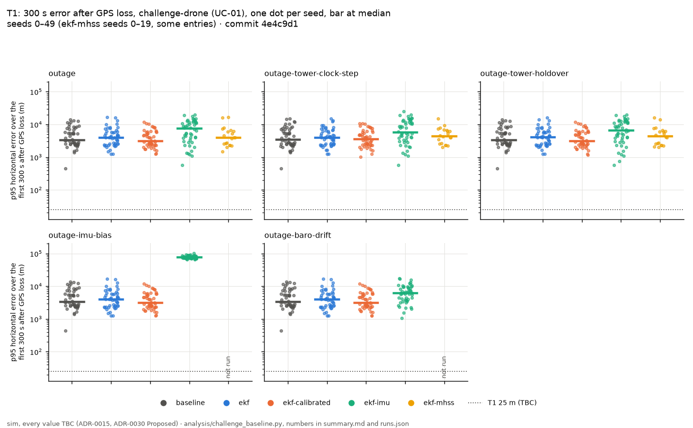
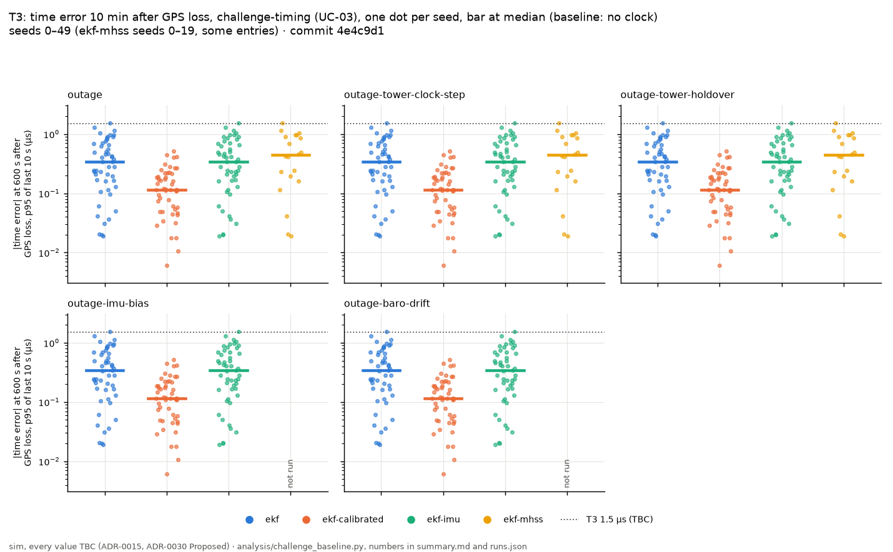
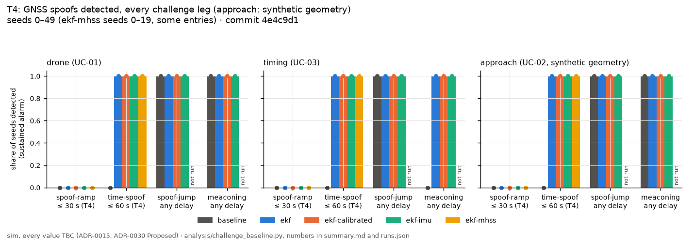

# Challenge baseline: every estimator on every `challenge` entry

The "before" table (#150, package 5 of #126). **sim, every value TBC (ADR-0015, ADR-0030 Proposed).** It becomes the presented result only once ADR-0030 is accepted.

- **Commit:** `4e4c9d1`
- **Seeds:** 0–49 (`ekf-mhss`: 0–19)
- **Command:** `python analysis/challenge_baseline.py --seeds 50 --jobs 3`
- **Runtime:** 75.8 min wall, 3 worker(s)
- **Approach leg: synthetic geometry** (ADR-0030 point 3). Its towers are a synthetic ring, all ahead of the aircraft; its T1 slice does not measure LTE (in effect IMU and barometer dead reckoning).

**What was cut:**

- `ekf-mhss`: seeds 0–19 (not 50), and only the entries `nominal`, `outage`, `spoof-ramp`, `time-spoof`, `outage-tower-clock-step`, `outage-tower-holdover` of each leg. It takes 3 to 10 s a run against about 1 s for the others; its cells elsewhere read *not run*.
- `ekf-base`: not run. It needs a reference station (ADR-0020) and these legs have none (no entry run has a `reference:` block, checked before running); without one `nav/base_rover.py` is `ekf` with the payload's clock in its tower readings.
- `ekf-base-imu`: not run. It needs a reference station (ADR-0020) and these legs have none (no entry run has a `reference:` block, checked before running); without one `nav/base_rover.py` is `ekf` with the payload's clock in its tower readings.

## Verdict per target

Targets from `systems/plan.md`, all `TBC`. A target is **met** by an estimator only if every seed meets it (false alarms: the pooled rate). Cells read *mean / worst* over seeds; *of* counts seeds (or runs) meeting the target.

| Target | Leg, entry | Measure | `baseline` | `ekf` | `ekf-calibrated` | `ekf-imu` | `ekf-mhss` | Verdict |
|---|---|---|---|---|---|---|---|---|
| T1 | drone, `outage` | 300 s p95 mean / worst; seeds ≤ 25 m | 5,055 / 13,871 m; 0 of 50 | 4,944 / 16,639 m; 0 of 50 | 4,284 / 12,059 m; 0 of 50 | 7,837 / 19,640 m; 0 of 50 | 5,356 / 16,639 m; 0 of 20 | **not met** |
| T2 | approach, `outage` (**synthetic geometry**) | 300 s p95 mean / worst (not the T2 measure) | 2,344 / 4,984 m | 2,344 / 4,984 m | 1,313 / 3,148 m | 2,467 / 5,737 m | 2,235 / 2,979 m | **not scored**: no field tests the 556 m alert limit |
| T3 | timing, `outage` | 600 s error mean / worst; σ bound mean / worst; seeds with ≤ 1.5 µs and ≥ 68 % | no clock state | 0.44 / 1.55 µs; σ bound 99.46 % / 92.58 %; 49 of 50 | 0.15 / 0.52 µs; σ bound 78.09 % / 0.42 %; 37 of 50 | 0.44 / 1.55 µs; σ bound 99.46 % / 92.58 %; 49 of 50 | 0.55 / 1.55 µs; σ bound 99.27 % / 92.58 %; 19 of 20 | **not met** |
| T4 | drone, `spoof-ramp` | 2 m/s ramp: seeds detected ≤ 30 s; median delay of those detected | 0 of 50; median — | 0 of 50; median — | 0 of 50; median — | 0 of 50; median — | 0 of 20; median — | **not met** |
| T4 | timing, `time-spoof` | 50 ns/s time ramp: seeds detected ≤ 60 s; median delay of those detected | 0 of 50; median — | 50 of 50; median 3.3 s | 50 of 50; median 2.9 s | 50 of 50; median 3.3 s | 20 of 20; median 3.1 s | **met** by `ekf`, `ekf-calibrated`, `ekf-imu`, `ekf-mhss` |
| T4 | drone (UC-01), `nominal` | false alarms per hour, pooled; worst run (target ≤ 1 /h) | 0.0 /h; worst run 0 /h | 0.0 /h; worst run 0 /h | 0.0 /h; worst run 0 /h | 0.0 /h; worst run 0 /h | 0.8 /h; worst run 5 /h | **met** by `baseline`, `ekf`, `ekf-calibrated`, `ekf-imu`, `ekf-mhss` |
| T4 | timing (UC-03), `nominal` | false alarms per hour, pooled; worst run (target ≤ 1 /h) | 0.0 /h; worst run 0 /h | 0.0 /h; worst run 0 /h | 0.0 /h; worst run 0 /h | 0.0 /h; worst run 0 /h | 1.3 /h; worst run 5 /h | **met** by `baseline`, `ekf`, `ekf-calibrated`, `ekf-imu` |
| T4 | approach (UC-02, synthetic geometry), `nominal` | false alarms per hour, pooled; worst run (target ≤ 1 /h) | 0.0 /h; worst run 0 /h | 0.0 /h; worst run 0 /h | 0.0 /h; worst run 0 /h | 0.0 /h; worst run 0 /h | 0.0 /h; worst run 0 /h | **met** by `baseline`, `ekf`, `ekf-calibrated`, `ekf-imu`, `ekf-mhss` |
| T5 | drone (UC-01), every entry | HPL bound, worst run; runs ≥ 99.9 %; hazardous epochs on fault entries (sum) | worst 0.22 %; 188 of 550 runs; 536,709 hazardous | worst 12.78 %; 166 of 550 runs; 536,683 hazardous | worst 10.14 %; 171 of 550 runs; 519,861 hazardous | worst 12.96 %; 166 of 550 runs; 455,861 hazardous | worst 84.55 %; 100 of 120 runs; 0 hazardous (its entries only) | **not met** |
| T5 | timing (UC-03), every entry | HPL bound, worst run; runs ≥ 99.9 %; hazardous epochs on fault entries (sum) | worst 18.18 %; 230 of 500 runs; 548,185 hazardous | worst 13.79 %; 185 of 500 runs; 538,421 hazardous | worst 12.32 %; 190 of 500 runs; 534,607 hazardous | worst 16.81 %; 170 of 500 runs; 425,779 hazardous | worst 77.89 %; 100 of 120 runs; 0 hazardous (its entries only) | **not met** |
| T5 | approach (UC-02, synthetic geometry), every entry | HPL bound, worst run; runs ≥ 99.9 %; hazardous epochs on fault entries (sum) | worst 11.88 %; 150 of 550 runs; 580,516 hazardous | worst 11.88 %; 150 of 550 runs; 580,516 hazardous | worst 21.18 %; 344 of 550 runs; 576,988 hazardous | worst 10.63 %; 150 of 550 runs; 287,649 hazardous | worst 100.00 %; 120 of 120 runs; 0 hazardous (its entries only) | **met** by `ekf-mhss` (on its entries only) |

T2 asks for a 556 m horizontal alert limit (RNP 0.3) in the terminal phase. No field of `pnt.metrics.RunMetrics` scores it (the alert limit used is `ALERT_LIMIT_M` = 50 m), so its 300 s error is given only for reference, and it is synthetic geometry.

## Full table

Means over seeds unless marked; *worst* is the worst seed. Slices count from GPS loss (60 s); a slice is — when the entry has no GPS loss. HPL bound worst: the worst run's share of epochs with HPL ≥ error. Hazardous and misleading: epochs summed over seeds. Detected: seeds with a sustained alarm after a spoof starts, and the median delay. False alarms: alarms outside spoof windows per hour.

### drone (UC-01)

| Entry | Estimator | seeds | 60 s p95 (m) | 120 s p95 (m) | 300 s p95 mean / worst (m) | fault p95 (m) | HPL bound worst | hazardous | misleading | detected / median delay | false alarms /h | 600 s time err mean / worst (µs) | 600 s σ bound mean |
|---|---|---|---|---|---|---|---|---|---|---|---|---|---|
| `nominal` | `baseline` | 50 | — | — | — | — | 100.00 % | 0 | 0 | — | 0.0 | — | — |
| `nominal` | `ekf` | 50 | — | — | — | — | 100.00 % | 0 | 0 | — | 0.0 | — | — |
| `nominal` | `ekf-calibrated` | 50 | — | — | — | — | 100.00 % | 0 | 0 | — | 0.0 | — | — |
| `nominal` | `ekf-imu` | 50 | — | — | — | — | 100.00 % | 0 | 0 | — | 0.0 | — | — |
| `nominal` | `ekf-mhss` | 20 | — | — | — | — | 100.00 % | 0 | 0 | — | 0.8 | — | — |
| `outage` | `baseline` | 50 | 645 | 1,633 | 5,055 / 13,871 | 12,280 | 10.97 % | 498 | 537 | — | 2.9 | — | — |
| `outage` | `ekf` | 50 | 626 | 1,580 | 4,944 / 16,639 | 14,176 | 12.78 % | 320 | 358 | — | 4.1 | 0.44 / 1.55 | 99.46 % |
| `outage` | `ekf-calibrated` | 50 | 602 | 1,590 | 4,284 / 12,059 | 11,270 | 10.14 % | 56 | 84 | — | 3.9 | 0.15 / 0.52 | 78.09 % |
| `outage` | `ekf-imu` | 50 | 340 | 1,482 | 7,837 / 19,640 | 24,702 | 12.96 % | 117 | 122 | — | 4.1 | 0.44 / 1.55 | 99.46 % |
| `outage` | `ekf-mhss` | 20 | 577 | 1,469 | 5,356 / 16,639 | 18,035 | 100.00 % | 0 | 0 | — | 4.3 | 0.55 / 1.55 | 99.27 % |
| `spoof-ramp` | `baseline` | 50 | — | — | — | 1,083 | 21.24 % | 272,440 | 283,114 | 0 of 50 | 0.0 | — | — |
| `spoof-ramp` | `ekf` | 50 | — | — | — | 1,083 | 21.24 % | 272,437 | 283,114 | 0 of 50 | 0.0 | — | — |
| `spoof-ramp` | `ekf-calibrated` | 50 | — | — | — | 1,083 | 21.24 % | 272,438 | 283,114 | 0 of 50 | 0.0 | — | — |
| `spoof-ramp` | `ekf-imu` | 50 | — | — | — | 1,083 | 21.13 % | 272,403 | 283,418 | 0 of 50 | 0.0 | — | — |
| `spoof-ramp` | `ekf-mhss` | 20 | — | — | — | 1,083 | 84.55 % | 0 | 0 | 0 of 20 | 3.6 | — | — |
| `spoof-jump` | `baseline` | 50 | — | — | — | 885 | 24.23 % | 261,546 | 261,546 | 50 of 50 / 1.1 s | 0.0 | — | — |
| `spoof-jump` | `ekf` | 50 | — | — | — | 646 | 24.23 % | 262,178 | 262,178 | 50 of 50 / 1.1 s | 0.0 | — | — |
| `spoof-jump` | `ekf-calibrated` | 50 | — | — | — | 1,103 | 24.23 % | 246,957 | 246,957 | 50 of 50 / 1.1 s | 0.0 | — | — |
| `spoof-jump` | `ekf-imu` | 50 | — | — | — | 8,261 | 24.92 % | 181,762 | 181,762 | 50 of 50 / 1.1 s | 0.0 | — | — |
| `time-spoof` | `baseline` | 50 | — | — | — | 2.9 | 100.00 % | 0 | 0 | 0 of 50 | 0.0 | — | — |
| `time-spoof` | `ekf` | 50 | — | — | — | 2.9 | 100.00 % | 0 | 0 | 50 of 50 / 3.3 s | 0.0 | — | — |
| `time-spoof` | `ekf-calibrated` | 50 | — | — | — | 2.9 | 100.00 % | 0 | 0 | 50 of 50 / 2.9 s | 0.0 | — | — |
| `time-spoof` | `ekf-imu` | 50 | — | — | — | 2.1 | 100.00 % | 0 | 0 | 50 of 50 / 3.3 s | 0.0 | — | — |
| `time-spoof` | `ekf-mhss` | 20 | — | — | — | 2.9 | 100.00 % | 0 | 0 | 20 of 20 / 3.1 s | 3.6 | — | — |
| `meaconing` | `baseline` | 50 | — | — | — | 41.9 | 21.34 % | 0 | 282,480 | 50 of 50 / 1.1 s | 0.0 | — | — |
| `meaconing` | `ekf` | 50 | — | — | — | 41.9 | 21.34 % | 0 | 282,492 | 50 of 50 / 1.1 s | 0.0 | — | — |
| `meaconing` | `ekf-calibrated` | 50 | — | — | — | 41.9 | 21.34 % | 0 | 282,428 | 50 of 50 / 1.1 s | 0.0 | — | — |
| `meaconing` | `ekf-imu` | 50 | — | — | — | 46.7 | 21.89 % | 450 | 278,145 | 50 of 50 / 1.1 s | 0.0 | — | — |
| `jamming-zone` | `baseline` | 50 | — | — | — | 2,794 | 0.22 % | 411 | 656 | — | 1.4 | — | — |
| `jamming-zone` | `ekf` | 50 | — | — | — | 402 | 62.58 % | 475 | 1,136 | — | 0.6 | — | — |
| `jamming-zone` | `ekf-calibrated` | 50 | — | — | — | 591 | 15.67 % | 166 | 442 | — | 1.3 | — | — |
| `jamming-zone` | `ekf-imu` | 50 | — | — | — | 225 | 62.58 % | 306 | 824 | — | 0.2 | — | — |
| `outage-tower-clock-step` | `baseline` | 50 | 645 | 1,633 | 4,977 / 15,237 | 11,816 | 10.97 % | 321 | 360 | — | 2.8 | — | — |
| `outage-tower-clock-step` | `ekf` | 50 | 626 | 1,580 | 4,853 / 15,085 | 15,092 | 12.78 % | 306 | 330 | — | 3.9 | 0.44 / 1.55 | 99.46 % |
| `outage-tower-clock-step` | `ekf-calibrated` | 50 | 602 | 1,590 | 4,415 / 10,891 | 12,295 | 10.14 % | 76 | 104 | — | 3.7 | 0.15 / 0.52 | 78.09 % |
| `outage-tower-clock-step` | `ekf-imu` | 50 | 340 | 1,482 | 8,099 / 24,860 | 28,053 | 12.96 % | 406 | 423 | — | 4.2 | 0.44 / 1.55 | 99.46 % |
| `outage-tower-clock-step` | `ekf-mhss` | 20 | 577 | 1,469 | 5,277 / 15,085 | 19,224 | 100.00 % | 0 | 0 | — | 4.3 | 0.55 / 1.55 | 99.27 % |
| `outage-tower-holdover` | `baseline` | 50 | 645 | 1,633 | 5,029 / 13,979 | 13,378 | 10.97 % | 497 | 536 | — | 2.9 | — | — |
| `outage-tower-holdover` | `ekf` | 50 | 626 | 1,580 | 4,929 / 16,141 | 16,109 | 12.78 % | 354 | 378 | — | 3.9 | 0.44 / 1.55 | 99.46 % |
| `outage-tower-holdover` | `ekf-calibrated` | 50 | 602 | 1,590 | 4,341 / 12,073 | 13,825 | 10.28 % | 56 | 84 | — | 4.0 | 0.15 / 0.52 | 78.09 % |
| `outage-tower-holdover` | `ekf-imu` | 50 | 340 | 1,482 | 7,771 / 19,640 | 29,205 | 12.96 % | 114 | 120 | — | 4.2 | 0.44 / 1.55 | 99.46 % |
| `outage-tower-holdover` | `ekf-mhss` | 20 | 577 | 1,469 | 5,368 / 16,141 | 21,078 | 100.00 % | 0 | 0 | — | 4.3 | 0.55 / 1.55 | 99.27 % |
| `outage-imu-bias` | `baseline` | 50 | 645 | 1,633 | 5,055 / 13,871 | 13,290 | 10.97 % | 498 | 537 | — | 2.9 | — | — |
| `outage-imu-bias` | `ekf` | 50 | 626 | 1,580 | 4,944 / 16,639 | 16,140 | 12.78 % | 320 | 358 | — | 4.1 | 0.44 / 1.55 | 99.46 % |
| `outage-imu-bias` | `ekf-calibrated` | 50 | 602 | 1,590 | 4,284 / 12,059 | 12,819 | 10.14 % | 56 | 84 | — | 3.9 | 0.15 / 0.52 | 78.09 % |
| `outage-imu-bias` | `ekf-imu` | 50 | 340 | 1,482 | 78,112 / 104,033 | 708,226 | 12.96 % | 110 | 110 | — | 5.0 | 0.44 / 1.55 | 99.46 % |
| `outage-baro-drift` | `baseline` | 50 | 645 | 1,633 | 5,055 / 13,871 | 13,637 | 10.97 % | 498 | 537 | — | 5.0 | — | — |
| `outage-baro-drift` | `ekf` | 50 | 626 | 1,580 | 4,944 / 16,636 | 16,517 | 12.78 % | 293 | 317 | — | 5.0 | 0.44 / 1.55 | 99.46 % |
| `outage-baro-drift` | `ekf-calibrated` | 50 | 602 | 1,590 | 4,298 / 12,073 | 13,264 | 10.14 % | 56 | 84 | — | 5.0 | 0.15 / 0.52 | 78.09 % |
| `outage-baro-drift` | `ekf-imu` | 50 | 340 | 1,482 | 6,843 / 17,154 | 24,430 | 12.96 % | 193 | 193 | — | 5.0 | 0.44 / 1.55 | 99.46 % |

### timing (UC-03)

| Entry | Estimator | seeds | 60 s p95 (m) | 120 s p95 (m) | 300 s p95 mean / worst (m) | fault p95 (m) | HPL bound worst | hazardous | misleading | detected / median delay | false alarms /h | 600 s time err mean / worst (µs) | 600 s σ bound mean |
|---|---|---|---|---|---|---|---|---|---|---|---|---|---|
| `nominal` | `baseline` | 50 | — | — | — | — | 100.00 % | 0 | 0 | — | 0.0 | — | — |
| `nominal` | `ekf` | 50 | — | — | — | — | 100.00 % | 0 | 0 | — | 0.0 | — | — |
| `nominal` | `ekf-calibrated` | 50 | — | — | — | — | 100.00 % | 0 | 0 | — | 0.0 | — | — |
| `nominal` | `ekf-imu` | 50 | — | — | — | — | 100.00 % | 0 | 0 | — | 0.0 | — | — |
| `nominal` | `ekf-mhss` | 20 | — | — | — | — | 100.00 % | 0 | 0 | — | 1.3 | — | — |
| `outage` | `baseline` | 50 | 145 | 582 | 2,796 / 12,124 | 9,294 | 18.18 % | 916 | 931 | — | 3.0 | — | — |
| `outage` | `ekf` | 50 | 178 | 574 | 3,552 / 10,685 | 11,041 | 14.03 % | 19 | 19 | — | 3.2 | 0.44 / 1.55 | 99.46 % |
| `outage` | `ekf-calibrated` | 50 | 182 | 627 | 3,025 / 14,250 | 8,906 | 20.03 % | 87 | 104 | — | 3.4 | 0.15 / 0.52 | 78.09 % |
| `outage` | `ekf-imu` | 50 | 234 | 1,768 | 13,752 / 35,580 | 47,319 | 16.81 % | 296 | 310 | — | 4.8 | 0.44 / 1.55 | 99.46 % |
| `outage` | `ekf-mhss` | 20 | 152 | 703 | 3,548 / 10,685 | 11,919 | 100.00 % | 0 | 0 | — | 3.8 | 0.55 / 1.55 | 99.27 % |
| `spoof-ramp` | `baseline` | 50 | — | — | — | 1,083 | 21.18 % | 272,485 | 283,206 | 0 of 50 | 0.0 | — | — |
| `spoof-ramp` | `ekf` | 50 | — | — | — | 1,083 | 21.18 % | 272,488 | 283,198 | 0 of 50 | 0.0 | — | — |
| `spoof-ramp` | `ekf-calibrated` | 50 | — | — | — | 1,083 | 21.18 % | 272,490 | 283,198 | 0 of 50 | 0.0 | — | — |
| `spoof-ramp` | `ekf-imu` | 50 | — | — | — | 1,083 | 21.17 % | 272,452 | 283,332 | 0 of 50 | 0.0 | — | — |
| `spoof-ramp` | `ekf-mhss` | 20 | — | — | — | 1,083 | 77.89 % | 0 | 0 | 0 of 20 | 3.6 | — | — |
| `spoof-jump` | `baseline` | 50 | — | — | — | 302 | 23.98 % | 271,764 | 271,764 | 50 of 50 / 1.1 s | 0.0 | — | — |
| `spoof-jump` | `ekf` | 50 | — | — | — | 455 | 23.70 % | 265,846 | 265,846 | 50 of 50 / 1.1 s | 0.0 | — | — |
| `spoof-jump` | `ekf-calibrated` | 50 | — | — | — | 530 | 23.98 % | 261,663 | 261,663 | 50 of 50 / 1.1 s | 0.0 | — | — |
| `spoof-jump` | `ekf-imu` | 50 | — | — | — | 11,898 | 25.42 % | 152,134 | 152,134 | 50 of 50 / 1.1 s | 0.0 | — | — |
| `time-spoof` | `baseline` | 50 | — | — | — | 2.8 | 100.00 % | 0 | 0 | 0 of 50 | 0.0 | — | — |
| `time-spoof` | `ekf` | 50 | — | — | — | 2.8 | 100.00 % | 0 | 0 | 50 of 50 / 3.3 s | 0.0 | — | — |
| `time-spoof` | `ekf-calibrated` | 50 | — | — | — | 2.8 | 100.00 % | 0 | 0 | 50 of 50 / 2.9 s | 0.0 | — | — |
| `time-spoof` | `ekf-imu` | 50 | — | — | — | 2.0 | 100.00 % | 0 | 0 | 50 of 50 / 3.3 s | 0.0 | — | — |
| `time-spoof` | `ekf-mhss` | 20 | — | — | — | 2.8 | 100.00 % | 0 | 0 | 20 of 20 / 3.1 s | 3.6 | — | — |
| `meaconing` | `baseline` | 50 | — | — | — | 2.8 | 100.00 % | 0 | 0 | 0 of 50 | 0.0 | — | — |
| `meaconing` | `ekf` | 50 | — | — | — | 2.8 | 100.00 % | 0 | 0 | 50 of 50 / 1.1 s | 0.0 | — | — |
| `meaconing` | `ekf-calibrated` | 50 | — | — | — | 2.8 | 100.00 % | 0 | 0 | 50 of 50 / 1.1 s | 0.0 | — | — |
| `meaconing` | `ekf-imu` | 50 | — | — | — | 2.0 | 100.00 % | 0 | 0 | 50 of 50 / 1.1 s | 0.0 | — | — |
| `outage-tower-clock-step` | `baseline` | 50 | 145 | 582 | 2,820 / 11,624 | 10,747 | 18.18 % | 682 | 703 | — | 3.1 | — | — |
| `outage-tower-clock-step` | `ekf` | 50 | 178 | 574 | 3,458 / 10,267 | 12,396 | 13.79 % | 10 | 10 | — | 3.2 | 0.44 / 1.55 | 99.46 % |
| `outage-tower-clock-step` | `ekf-calibrated` | 50 | 182 | 627 | 3,051 / 14,250 | 10,790 | 12.32 % | 121 | 129 | — | 3.4 | 0.15 / 0.52 | 78.09 % |
| `outage-tower-clock-step` | `ekf-imu` | 50 | 234 | 1,768 | 13,592 / 35,960 | 51,497 | 16.81 % | 300 | 313 | — | 4.8 | 0.44 / 1.55 | 99.46 % |
| `outage-tower-clock-step` | `ekf-mhss` | 20 | 152 | 703 | 3,438 / 9,064 | 12,770 | 100.00 % | 0 | 0 | — | 3.5 | 0.55 / 1.55 | 99.27 % |
| `outage-tower-holdover` | `baseline` | 50 | 145 | 582 | 2,774 / 12,124 | 10,084 | 18.18 % | 905 | 916 | — | 2.9 | — | — |
| `outage-tower-holdover` | `ekf` | 50 | 178 | 574 | 3,646 / 12,441 | 12,364 | 18.95 % | 19 | 19 | — | 3.2 | 0.44 / 1.55 | 99.46 % |
| `outage-tower-holdover` | `ekf-calibrated` | 50 | 182 | 627 | 3,044 / 14,251 | 10,234 | 20.03 % | 86 | 104 | — | 3.4 | 0.15 / 0.52 | 78.09 % |
| `outage-tower-holdover` | `ekf-imu` | 50 | 234 | 1,768 | 13,780 / 35,579 | 54,080 | 16.81 % | 311 | 336 | — | 4.7 | 0.44 / 1.55 | 99.46 % |
| `outage-tower-holdover` | `ekf-mhss` | 20 | 152 | 703 | 3,699 / 12,441 | 12,857 | 100.00 % | 0 | 0 | — | 3.5 | 0.55 / 1.55 | 99.27 % |
| `outage-imu-bias` | `baseline` | 50 | 145 | 582 | 2,796 / 12,124 | 10,422 | 18.18 % | 916 | 931 | — | 3.0 | — | — |
| `outage-imu-bias` | `ekf` | 50 | 178 | 574 | 3,552 / 10,685 | 12,600 | 14.03 % | 19 | 19 | — | 3.2 | 0.44 / 1.55 | 99.46 % |
| `outage-imu-bias` | `ekf-calibrated` | 50 | 182 | 627 | 3,025 / 14,250 | 10,156 | 20.03 % | 87 | 104 | — | 3.4 | 0.15 / 0.52 | 78.09 % |
| `outage-imu-bias` | `ekf-imu` | 50 | 234 | 1,768 | 76,393 / 136,195 | 675,229 | 16.81 % | 130 | 130 | — | 5.0 | 0.44 / 1.55 | 99.46 % |
| `outage-baro-drift` | `baseline` | 50 | 145 | 582 | 2,783 / 12,124 | 11,272 | 18.18 % | 517 | 517 | — | 5.0 | — | — |
| `outage-baro-drift` | `ekf` | 50 | 178 | 574 | 3,720 / 12,284 | 13,340 | 14.03 % | 20 | 20 | — | 5.0 | 0.44 / 1.55 | 99.46 % |
| `outage-baro-drift` | `ekf-calibrated` | 50 | 182 | 627 | 3,050 / 14,250 | 10,267 | 20.03 % | 73 | 73 | — | 5.0 | 0.15 / 0.52 | 78.09 % |
| `outage-baro-drift` | `ekf-imu` | 50 | 234 | 1,768 | 14,374 / 39,386 | 50,740 | 18.56 % | 156 | 156 | — | 5.0 | 0.44 / 1.55 | 99.46 % |

### approach (UC-02, synthetic geometry)

| Entry | Estimator | seeds | 60 s p95 (m) | 120 s p95 (m) | 300 s p95 mean / worst (m) | fault p95 (m) | HPL bound worst | hazardous | misleading | detected / median delay | false alarms /h | 600 s time err mean / worst (µs) | 600 s σ bound mean |
|---|---|---|---|---|---|---|---|---|---|---|---|---|---|
| `nominal` | `baseline` | 50 | — | — | — | — | 100.00 % | 0 | 0 | — | 0.0 | — | — |
| `nominal` | `ekf` | 50 | — | — | — | — | 100.00 % | 0 | 0 | — | 0.0 | — | — |
| `nominal` | `ekf-calibrated` | 50 | — | — | — | — | 100.00 % | 0 | 0 | — | 0.0 | — | — |
| `nominal` | `ekf-imu` | 50 | — | — | — | — | 100.00 % | 0 | 0 | — | 0.0 | — | — |
| `nominal` | `ekf-mhss` | 20 | — | — | — | — | 100.00 % | 0 | 0 | — | 0.0 | — | — |
| `outage` | `baseline` | 50 | 781 | 1,552 | 2,344 / 4,984 | 3,724 | 11.88 % | 0 | 0 | — | 5.0 | — | — |
| `outage` | `ekf` | 50 | 781 | 1,552 | 2,344 / 4,984 | 3,724 | 11.88 % | 0 | 0 | — | 5.0 | 0.44 / 1.55 | 99.46 % |
| `outage` | `ekf-calibrated` | 50 | 68.8 | 249 | 1,313 / 3,148 | 1,715 | 65.73 % | 0 | 0 | — | 1.5 | 0.15 / 0.51 | 78.11 % |
| `outage` | `ekf-imu` | 50 | 1,115 | 1,778 | 2,467 / 5,737 | 3,729 | 11.47 % | 0 | 0 | — | 5.0 | 0.44 / 1.55 | 99.46 % |
| `outage` | `ekf-mhss` | 20 | 717 | 1,248 | 2,235 / 2,979 | 3,697 | 100.00 % | 0 | 0 | — | 5.0 | 0.55 / 1.55 | 99.27 % |
| `spoof-ramp` | `baseline` | 50 | — | — | — | 1,083 | 21.18 % | 272,485 | 283,199 | 0 of 50 | 0.0 | — | — |
| `spoof-ramp` | `ekf` | 50 | — | — | — | 1,083 | 21.18 % | 272,485 | 283,199 | 0 of 50 | 0.0 | — | — |
| `spoof-ramp` | `ekf-calibrated` | 50 | — | — | — | 1,083 | 21.18 % | 272,485 | 283,202 | 0 of 50 | 0.0 | — | — |
| `spoof-ramp` | `ekf-imu` | 50 | — | — | — | 1,083 | 21.17 % | 272,453 | 283,331 | 0 of 50 | 0.0 | — | — |
| `spoof-ramp` | `ekf-mhss` | 20 | — | — | — | 1,083 | 100.00 % | 0 | 0 | 0 of 20 | 0.0 | — | — |
| `spoof-jump` | `baseline` | 50 | — | — | — | 546 | 23.98 % | 261,830 | 261,830 | 50 of 50 / 1.1 s | 0.0 | — | — |
| `spoof-jump` | `ekf` | 50 | — | — | — | 546 | 23.98 % | 261,830 | 261,830 | 50 of 50 / 1.1 s | 0.0 | — | — |
| `spoof-jump` | `ekf-calibrated` | 50 | — | — | — | 307 | 24.86 % | 242,812 | 242,812 | 50 of 50 / 1.1 s | 0.0 | — | — |
| `spoof-jump` | `ekf-imu` | 50 | — | — | — | 4,638 | 25.00 % | 13,334 | 13,334 | 50 of 50 / 1.1 s | 0.0 | — | — |
| `time-spoof` | `baseline` | 50 | — | — | — | 2.8 | 100.00 % | 0 | 0 | 0 of 50 | 0.0 | — | — |
| `time-spoof` | `ekf` | 50 | — | — | — | 2.8 | 100.00 % | 0 | 0 | 50 of 50 / 3.3 s | 0.0 | — | — |
| `time-spoof` | `ekf-calibrated` | 50 | — | — | — | 2.8 | 100.00 % | 0 | 0 | 50 of 50 / 2.9 s | 0.0 | — | — |
| `time-spoof` | `ekf-imu` | 50 | — | — | — | 2.0 | 100.00 % | 0 | 0 | 50 of 50 / 3.3 s | 0.0 | — | — |
| `time-spoof` | `ekf-mhss` | 20 | — | — | — | 2.8 | 100.00 % | 0 | 0 | 20 of 20 / 3.1 s | 0.0 | — | — |
| `meaconing` | `baseline` | 50 | — | — | — | 3,529 | 24.67 % | 46,201 | 46,201 | 50 of 50 / 1.1 s | 0.0 | — | — |
| `meaconing` | `ekf` | 50 | — | — | — | 3,529 | 24.67 % | 46,201 | 46,201 | 50 of 50 / 1.1 s | 0.0 | — | — |
| `meaconing` | `ekf-calibrated` | 50 | — | — | — | 1,189 | 39.73 % | 61,691 | 61,691 | 50 of 50 / 1.1 s | 0.0 | — | — |
| `meaconing` | `ekf-imu` | 50 | — | — | — | 5,731 | 25.56 % | 1,862 | 1,862 | 50 of 50 / 1.1 s | 0.0 | — | — |
| `jamming-zone` | `baseline` | 50 | — | — | — | 70.1 | 100.00 % | 0 | 0 | — | 0.0 | — | — |
| `jamming-zone` | `ekf` | 50 | — | — | — | 70.1 | 100.00 % | 0 | 0 | — | 0.0 | — | — |
| `jamming-zone` | `ekf-calibrated` | 50 | — | — | — | 85.6 | 100.00 % | 0 | 0 | — | 0.0 | — | — |
| `jamming-zone` | `ekf-imu` | 50 | — | — | — | 108 | 100.00 % | 0 | 0 | — | 0.0 | — | — |
| `outage-tower-clock-step` | `baseline` | 50 | 781 | 1,552 | 2,842 / 6,432 | 4,252 | 11.88 % | 0 | 0 | — | 5.0 | — | — |
| `outage-tower-clock-step` | `ekf` | 50 | 781 | 1,552 | 2,842 / 6,432 | 4,252 | 11.88 % | 0 | 0 | — | 5.0 | 0.44 / 1.55 | 99.46 % |
| `outage-tower-clock-step` | `ekf-calibrated` | 50 | 68.8 | 249 | 1,735 / 3,921 | 2,036 | 53.20 % | 0 | 0 | — | 1.7 | 0.15 / 0.51 | 78.18 % |
| `outage-tower-clock-step` | `ekf-imu` | 50 | 1,115 | 1,778 | 2,962 / 6,720 | 4,239 | 10.63 % | 0 | 0 | — | 5.0 | 0.44 / 1.55 | 99.46 % |
| `outage-tower-clock-step` | `ekf-mhss` | 20 | 717 | 1,248 | 3,030 / 6,432 | 4,431 | 100.00 % | 0 | 0 | — | 5.0 | 0.55 / 1.55 | 99.27 % |
| `outage-tower-holdover` | `baseline` | 50 | 781 | 1,552 | 2,356 / 4,944 | 4,047 | 11.88 % | 0 | 0 | — | 5.0 | — | — |
| `outage-tower-holdover` | `ekf` | 50 | 781 | 1,552 | 2,356 / 4,944 | 4,047 | 11.88 % | 0 | 0 | — | 5.0 | 0.44 / 1.55 | 99.46 % |
| `outage-tower-holdover` | `ekf-calibrated` | 50 | 68.8 | 249 | 1,329 / 3,204 | 1,729 | 55.24 % | 0 | 0 | — | 1.4 | 0.15 / 0.51 | 78.11 % |
| `outage-tower-holdover` | `ekf-imu` | 50 | 1,115 | 1,778 | 2,469 / 5,660 | 4,052 | 11.47 % | 0 | 0 | — | 5.0 | 0.44 / 1.55 | 99.46 % |
| `outage-tower-holdover` | `ekf-mhss` | 20 | 717 | 1,248 | 2,264 / 3,125 | 4,031 | 100.00 % | 0 | 0 | — | 5.0 | 0.55 / 1.55 | 99.27 % |
| `outage-imu-bias` | `baseline` | 50 | 781 | 1,552 | 2,344 / 4,984 | 4,042 | 11.88 % | 0 | 0 | — | 5.0 | — | — |
| `outage-imu-bias` | `ekf` | 50 | 781 | 1,552 | 2,344 / 4,984 | 4,042 | 11.88 % | 0 | 0 | — | 5.0 | 0.44 / 1.55 | 99.46 % |
| `outage-imu-bias` | `ekf-calibrated` | 50 | 68.8 | 249 | 1,313 / 3,148 | 1,706 | 65.73 % | 0 | 0 | — | 1.5 | 0.15 / 0.51 | 78.11 % |
| `outage-imu-bias` | `ekf-imu` | 50 | 1,115 | 1,778 | 61,323 / 85,471 | 593,670 | 10.63 % | 0 | 0 | — | 5.0 | 0.44 / 1.55 | 99.46 % |
| `outage-baro-drift` | `baseline` | 50 | 781 | 1,552 | 2,343 / 4,984 | 4,041 | 11.88 % | 0 | 0 | — | 5.0 | — | — |
| `outage-baro-drift` | `ekf` | 50 | 781 | 1,552 | 2,343 / 4,984 | 4,041 | 11.88 % | 0 | 0 | — | 5.0 | 0.44 / 1.55 | 99.46 % |
| `outage-baro-drift` | `ekf-calibrated` | 50 | 68.8 | 249 | 1,313 / 3,148 | 1,708 | 65.73 % | 0 | 0 | — | 5.0 | 0.15 / 0.51 | 78.11 % |
| `outage-baro-drift` | `ekf-imu` | 50 | 1,115 | 1,778 | 2,489 / 5,529 | 4,045 | 11.47 % | 0 | 0 | — | 5.0 | 0.44 / 1.55 | 99.46 % |

## Figures

## Reproduce

From commit `4e4c9d1`, a clean tree: `python analysis/challenge_baseline.py --seeds 50 --jobs 3`. `--redraw` rewrites this file and the figures from `runs.json` without running.
