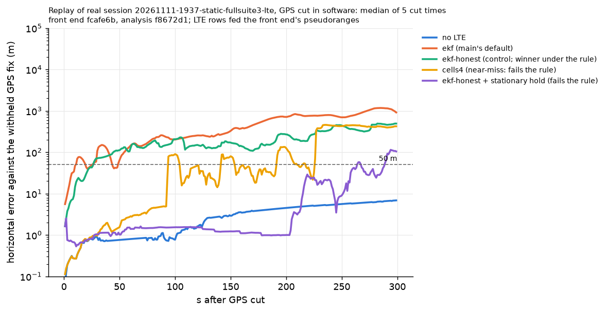

# Filter A/B on real cuts and the sim drone leg (#286)

The protocol, the selection rule, the tuning tables and the choice of held-out rows were committed before the held-out data was opened (`69cadc7`, `26c402b`); the held-out results, the bars and the stress rows follow them.

## Protocol (fixed in advance)

- **Tuning data:** real session `20261111-0040-static-fullsuite` (GPS cut in software at 99, 149, 199, 249, 299 s; scored 300 s against the withheld 1 Hz fixes) and sim seeds 100–109 on `challenge-drone-outage` (1 carrier, `1c`) and `challenge-drone-hop-outage` (13 carriers, `13c`).
- **Held out, not run while choosing:** real session `20261111-1937-static-fullsuite3` and sim seeds 0–49 on both legs. Read before choosing: #283's committed summary and `diagnosis.json` of `1937` (cells heard, double-difference spreads, the existing filters' numbers), which the issue already quoted. No arm of this study was run on `1937` or on seeds 0–49 before the selection below was committed.
- **Control:** `ekf-honest` as registered on this branch. Always shown: no LTE, `main`'s default `ekf`, `ekf-learned-noise`.
- **Harness:** `analysis/filter_ab.py` (scoring from `real_gps_cut.py` and `stacked_fixes.py`; tightness as `honest_bound.py`, #226). Real error at an instant: the withheld fix on it, else the nearest within 0.5 s (`25e712e`); on `0040` every row of #283's table reproduces exactly.

## Selection rule (fixed before held-out data)

Among arms and combinations, prefer the one that on tuning data
(a) keeps error above HPL at 1 % or less of withheld fixes (real) and of epochs from GPS loss (sim, both legs), then
(b) minimises real error at 300 s (median over cuts), subject to
(c) sim worst-second p95 on seeds 100–109 no more than 5 % worse than the control on both legs (both windows, 0–120 and 0–300 s) and 0 hazardous epochs.
Ties: fewer new settings. If no arm passes, the control stays the winner.

## Tuning: single arms (commit `ea410c2`)

Real `0040`: error median (worst) over the five cuts, m; HPL median, m.

| Row | 60 s | 120 s | 300 s | p95 0–300 s (worst cut) | Error > HPL | HPL 120 s | HPL 300 s | LTE after cut: accepted / unchecked / rejected | Speed after cut (m/s) |
|---|---|---|---|---|---|---|---|---|---|
| no-lte | 0.2 (0.6) | 0.4 (2.0) | 1.7 (3.2) | 3.1 | 0.0% (0 of 1,505) | 4,241 | 16,298 | – | 0.01 |
| ekf | 126 (225) | 1,001 (1,616) | 4,689 (5,193) | 4,917 | 41.3% (622 of 1,505) | 830 | 1,260 | 43,554 / 122 / 342 | 10.54 |
| ekf-learned-noise | 126 (226) | 701 (1,349) | 2,046 (3,323) | 2,947 | 33.3% (501 of 1,505) | 831 | 1,473 | 36,223 / 122 / 252 | 10.20 |
| control | 73.0 (114) | 381 (849) | 1,229 (3,262) | 3,046 | 0.0% (0 of 1,505) | 3,177 | 9,443 | 7,502 / 122 / 2 | 4.61 |
| slow50-tau60 | 81.6 (163) | 484 (1,349) | 1,266 (2,096) | 2,806 | 13.5% (203 of 1,505) | 1,374 | 7,656 | 14,693 / 122 / 63 | 4.83 |
| slow50-tau300 | 96.3 (206) | 510 (1,364) | 1,698 (3,132) | 2,711 | 26.5% (399 of 1,505) | 873 | 1,453 | 35,630 / 122 / 252 | 7.47 |
| slow100-tau60 | 82.7 (128) | 400 (1,380) | 1,249 (2,470) | 2,596 | 10.4% (156 of 1,505) | 2,876 | 8,465 | 13,622 / 122 / 63 | 5.19 |
| slow100-tau300 | 86.0 (168) | 503 (1,378) | 1,324 (2,047) | 2,838 | 13.5% (203 of 1,505) | 1,387 | 7,507 | 14,835 / 122 / 63 | 5.88 |
| slow150-tau60 | 71.1 (130) | 397 (931) | 1,248 (4,040) | 3,764 | 0.0% (0 of 1,505) | 3,309 | 9,542 | 7,335 / 122 / 2 | 5.24 |
| slow150-tau300 | 88.0 (142) | 480 (1,396) | 1,019 (2,308) | 2,738 | 12.4% (187 of 1,505) | 1,539 | 8,129 | 14,487 / 122 / 63 | 3.45 |
| imu | 73.0 (114) | 381 (849) | 1,229 (3,262) | 3,046 | 0.0% (0 of 1,505) | 3,177 | 9,443 | 7,502 / 122 / 2 | 4.61 |
| q0.3 | 26.0 (32.6) | 144 (426) | 583 (2,498) | 2,348 | 6.2% (94 of 1,505) | 1,196 | 1,562 | 38,133 / 122 / 254 | 1.63 |
| q0.1 | 5.1 (6.9) | 23.9 (50.9) | 155 (383) | 338 | 0.0% (0 of 1,505) | 442 | 1,226 | 43,581 / 122 / 315 | 0.33 |
| cells3 | 0.6 (74.4) | 1.3 (153) | 4.0 (440) | 414 | 0.0% (0 of 1,505) | 4,184 | 11,153 | 2,673 / 52 / 0 | 0.02 |
| cells4 | 0.2 (0.6) | 0.4 (2.0) | 1.7 (3.2) | 3.1 | 0.0% (0 of 1,505) | 4,241 | 14,162 | 0 / 35 / 0 | 0.01 |
| hdop3 | 0.6 (74.4) | 1.3 (153) | 4.0 (440) | 414 | 0.0% (0 of 1,505) | 4,184 | 11,153 | 2,673 / 52 / 0 | 0.02 |
| cells3-clock | 0.6 (74.8) | 42.1 (220) | 682 (917) | 860 | 0.0% (0 of 1,505) | 4,182 | 10,937 | 23,650 / 122 / 315 | 1.87 |
| huber1.5 | 73.0 (114) | 381 (847) | 1,229 (3,253) | 3,037 | 0.0% (0 of 1,505) | 3,179 | 9,443 | 7,502 / 122 / 2 | 4.61 |
| huber2.5 | 73.0 (114) | 381 (849) | 1,229 (3,262) | 3,046 | 0.0% (0 of 1,505) | 3,177 | 9,443 | 7,502 / 122 / 2 | 4.61 |
| freeze | 63.9 (113) | 381 (1,218) | 1,200 (2,998) | 2,889 | 5.2% (78 of 1,505) | 2,985 | 8,599 | 13,584 / 122 / 63 | 4.56 |
| common-step | 70.4 (119) | 378 (851) | 1,244 (3,262) | 3,046 | 0.0% (0 of 1,505) | 3,170 | 9,440 | 7,498 / 120 / 2 | 4.54 |

Sim seeds 100–109 (sim, every value `TBC`): worst-second p95 of the across-run 95th percentile, m; share of epochs above HPL from GPS loss; hazardous epochs; tightness (median HPL / p95 error, median over 0–300 s).

| Row | 1c: worst-second p95 0–120 / 0–300 s (m) | 1c: above HPL | 1c: hazardous | 1c: tightness | 13c: worst-second p95 0–120 / 0–300 s (m) | 13c: above HPL | 13c: hazardous | 13c: tightness |
|---|---|---|---|---|---|---|---|---|
| ekf | 3,137 / 8,189 | 39.03% | 59 | 0.69 | 3,359 / 9,911 | 57.70% | 168 | 0.30 |
| ekf-learned-noise | 648 / 1,780 | 2.69% | 0 | 0.92 | 145 / 145 | 0.00% | 0 | 2.04 |
| control | 505 / 1,256 | 0.00% | 0 | 1.25 | 141 / 141 | 0.02% | 0 | 1.95 |
| slow50-tau60 | 665 / 1,668 | 1.64% | 0 | 1.21 | 129 / 149 | 0.00% | 0 | 2.25 |
| slow50-tau300 | 736 / 1,865 | 2.84% | 0 | 1.02 | 128 / 132 | 0.00% | 0 | 2.35 |
| slow100-tau60 | 704 / 2,036 | 0.00% | 0 | 2.81 | 103 / 132 | 0.00% | 0 | 3.09 |
| slow100-tau300 | 704 / 1,445 | 1.56% | 0 | 1.64 | 116 / 155 | 0.00% | 0 | 2.67 |
| slow150-tau60 | 715 / 1,638 | 0.00% | 0 | 4.23 | 91.3 / 141 | 0.00% | 0 | 3.98 |
| slow150-tau300 | 613 / 1,729 | 0.00% | 0 | 2.23 | 116 / 151 | 0.00% | 0 | 2.94 |
| imu | 625 / 1,307 | 1.37% | 0 | 1.40 | 120 / 120 | 0.13% | 0 | 1.84 |
| q0.3 | 811 / 2,140 | 25.50% | 33 | 0.63 | 182 / 249 | 10.84% | 54 | 1.02 |
| q0.1 | 1,203 / 2,450 | 87.59% | 1,519 | 0.28 | 350 / 350 | 80.48% | 1,669 | 0.51 |
| cells3 | 1,681 / 5,765 | 0.00% | 0 | 0.89 | 142 / 149 | 0.01% | 0 | 1.89 |
| cells4 | 1,103 / 2,378 | 0.00% | 0 | 3.76 | 140 / 145 | 0.01% | 0 | 1.91 |
| hdop3 | 1,176 / 2,566 | 0.00% | 0 | 3.39 | 785 / 1,911 | 0.00% | 0 | 0.20 |
| cells3-clock | 1,411 / 2,564 | 14.98% | 0 | 0.73 | 145 / 145 | 0.02% | 0 | 1.95 |
| huber1.5 | 582 / 3,298 | 5.03% | 0 | 0.63 | 126 / 127 | 0.00% | 0 | 2.11 |
| huber2.5 | 563 / 1,656 | 2.43% | 0 | 0.95 | 136 / 136 | 0.00% | 0 | 2.04 |
| freeze | 439 / 1,336 | 0.18% | 0 | 1.17 | 127 / 142 | 0.03% | 0 | 1.92 |
| common-step | 505 / 1,256 | 0.00% | 0 | 1.25 | 141 / 141 | 0.02% | 0 | 1.95 |
| no-lte | 1,258 / 2,729 | 0.00% | 0 | 4.18 | 1,258 / 2,729 | 0.00% | 0 | 4.18 |

## Tuning: combination round (commit `c8b357d`)

Arms dropped from combinations after the single-arm table: IMU propagation (never aligns on a static receiver: identical to the control on real data), Huber (no effect: the control rejects 2 updates), the shared reset (no effect), lower `q_accel` (error above HPL 25–88 % on sim). Added: a per-cell consistency gate (a cell whose normalised innovations over the last 30/60/120 s of trusted GNSS have an RMS above 2/3/4 model sigmas may update position only with 3 cells heard, `cells3`, or not at all, `skip`); the cell gate counted over 3 and 5 s; curvature inflation (a range too curved for the linear update is kept with R grown by the term instead of dropped).

| Row | 60 s | 120 s | 300 s | p95 0–300 s (worst cut) | Error > HPL | HPL 120 s | HPL 300 s | LTE after cut: accepted / unchecked / rejected | Speed after cut (m/s) |
|---|---|---|---|---|---|---|---|---|---|
| control | 73.0 (114) | 381 (849) | 1,229 (3,262) | 3,046 | 0.0% (0 of 1,505) | 3,177 | 9,443 | 7,502 / 122 / 2 | 4.61 |
| cells3 | 0.6 (74.4) | 1.3 (153) | 4.0 (440) | 414 | 0.0% (0 of 1,505) | 4,184 | 11,153 | 2,673 / 52 / 0 | 0.02 |
| consist30-k2-cells3 | 81.7 (114) | 385 (534) | 971 (1,283) | 1,205 | 0.0% (0 of 1,505) | 3,311 | 8,740 | 7,469 / 112 / 0 | 4.43 |
| consist30-k2-skip | 81.7 (350) | 422 (708) | 1,219 (3,114) | 2,914 | 0.0% (0 of 1,505) | 3,319 | 10,095 | 7,082 / 100 / 0 | 4.43 |
| consist30-k3-cells3 | 81.7 (114) | 385 (534) | 971 (1,283) | 1,205 | 0.0% (0 of 1,505) | 3,311 | 8,740 | 7,469 / 112 / 0 | 4.43 |
| consist30-k3-skip | 81.7 (350) | 422 (708) | 1,219 (3,114) | 2,914 | 0.0% (0 of 1,505) | 3,319 | 10,095 | 7,082 / 100 / 0 | 4.43 |
| consist30-k4-cells3 | 81.7 (114) | 385 (534) | 971 (1,283) | 1,205 | 0.0% (0 of 1,505) | 3,311 | 8,740 | 7,469 / 112 / 0 | 4.43 |
| consist30-k4-skip | 81.7 (350) | 422 (708) | 1,219 (3,114) | 2,914 | 0.0% (0 of 1,505) | 3,319 | 10,095 | 7,082 / 100 / 0 | 4.43 |
| consist60-k2-cells3 | 81.7 (114) | 385 (534) | 971 (1,283) | 1,205 | 0.0% (0 of 1,505) | 3,311 | 8,740 | 7,469 / 112 / 0 | 4.43 |
| consist60-k2-skip | 81.7 (350) | 422 (708) | 1,219 (3,114) | 2,914 | 0.0% (0 of 1,505) | 3,319 | 10,095 | 7,082 / 100 / 0 | 4.43 |
| consist60-k3-cells3 | 81.7 (114) | 385 (534) | 971 (1,283) | 1,205 | 0.0% (0 of 1,505) | 3,311 | 8,740 | 7,469 / 112 / 0 | 4.43 |
| consist60-k3-skip | 81.7 (350) | 422 (708) | 1,219 (3,114) | 2,914 | 0.0% (0 of 1,505) | 3,319 | 10,095 | 7,082 / 100 / 0 | 4.43 |
| consist60-k4-cells3 | 81.7 (114) | 385 (534) | 971 (1,283) | 1,205 | 0.0% (0 of 1,505) | 3,311 | 8,740 | 7,469 / 112 / 0 | 4.43 |
| consist60-k4-skip | 81.7 (350) | 422 (708) | 1,219 (3,114) | 2,914 | 0.0% (0 of 1,505) | 3,319 | 10,095 | 7,082 / 100 / 0 | 4.43 |
| consist120-k2-cells3 | 81.7 (114) | 385 (534) | 971 (1,283) | 1,205 | 0.0% (0 of 1,505) | 3,311 | 8,740 | 7,469 / 112 / 0 | 4.43 |
| consist120-k2-skip | 81.7 (350) | 422 (708) | 1,219 (3,114) | 2,914 | 0.0% (0 of 1,505) | 3,319 | 10,095 | 7,082 / 100 / 0 | 4.43 |
| consist120-k3-cells3 | 81.7 (114) | 385 (534) | 971 (1,283) | 1,205 | 0.0% (0 of 1,505) | 3,311 | 8,740 | 7,469 / 112 / 0 | 4.43 |
| consist120-k3-skip | 81.7 (350) | 422 (708) | 1,219 (3,114) | 2,914 | 0.0% (0 of 1,505) | 3,319 | 10,095 | 7,082 / 100 / 0 | 4.43 |
| consist120-k4-cells3 | 81.7 (114) | 385 (534) | 971 (1,283) | 1,205 | 0.0% (0 of 1,505) | 3,311 | 8,740 | 7,469 / 112 / 0 | 4.43 |
| consist120-k4-skip | 81.7 (350) | 422 (708) | 1,219 (3,114) | 2,914 | 0.0% (0 of 1,505) | 3,319 | 10,095 | 7,082 / 100 / 0 | 4.43 |
| cells3-w3 | 0.6 (74.4) | 36.4 (153) | 122 (440) | 414 | 0.0% (0 of 1,505) | 4,173 | 11,153 | 2,689 / 52 / 0 | 0.48 |
| cells3-w5 | 0.6 (74.4) | 115 (638) | 137 (2,166) | 2,030 | 0.0% (0 of 1,505) | 4,166 | 11,153 | 2,696 / 52 / 0 | 1.01 |
| cells4-w3 | 0.2 (0.6) | 0.4 (2.0) | 1.7 (3.2) | 3.1 | 0.0% (0 of 1,505) | 4,241 | 14,162 | 0 / 35 / 0 | 0.01 |
| cells4-w5 | 0.2 (0.6) | 0.4 (2.0) | 1.7 (3.2) | 3.1 | 0.0% (0 of 1,505) | 4,241 | 14,162 | 0 / 35 / 0 | 0.01 |
| curv | 73.0 (114) | 489 (1,228) | 2,349 (2,998) | 2,903 | 18.4% (277 of 1,505) | 1,360 | 2,623 | 43,581 / 122 / 315 | 5.50 |
| cells3+slow150-tau60 | 0.6 (64.7) | 1.3 (116) | 3.9 (317) | 299 | 0.0% (0 of 1,505) | 4,184 | 11,168 | 2,673 / 52 / 0 | 0.02 |
| cells3+freeze | 0.6 (74.4) | 1.3 (162) | 4.0 (467) | 440 | 0.0% (0 of 1,505) | 4,184 | 11,153 | 2,673 / 52 / 0 | 0.02 |
| cells3+curv | 0.6 (74.4) | 1.1 (153) | 950 (1,882) | 1,830 | 2.7% (40 of 1,505) | 4,184 | 3,168 | 22,594 / 52 / 7,545 | 1.01 |
| cells3-w3+curv | 0.6 (74.4) | 38.2 (153) | 1,003 (1,812) | 1,773 | 3.6% (54 of 1,505) | 4,164 | 3,146 | 22,774 / 52 / 7,545 | 1.01 |
| cells3-w5+curv | 0.6 (74.4) | 115 (604) | 1,677 (2,371) | 2,217 | 8.2% (123 of 1,505) | 3,846 | 3,831 | 22,909 / 52 / 7,545 | 1.60 |

| Row | 1c: worst-second p95 0–120 / 0–300 s (m) | 1c: above HPL | 1c: hazardous | 1c: tightness | 13c: worst-second p95 0–120 / 0–300 s (m) | 13c: above HPL | 13c: hazardous | 13c: tightness |
|---|---|---|---|---|---|---|---|---|
| control | 505 / 1,256 | 0.00% | 0 | 1.25 | 141 / 141 | 0.02% | 0 | 1.95 |
| cells3 | 1,681 / 5,765 | 0.00% | 0 | 0.89 | 142 / 149 | 0.01% | 0 | 1.89 |
| consist30-k2-cells3 | 695 / 1,751 | 0.00% | 0 | 1.37 | 143 / 150 | 0.00% | 0 | 1.93 |
| consist30-k2-skip | 782 / 2,109 | 0.00% | 0 | 4.02 | 1,261 / 2,736 | 0.00% | 0 | 4.17 |
| consist30-k3-cells3 | 695 / 1,751 | 0.00% | 0 | 1.37 | 143 / 150 | 0.00% | 0 | 1.93 |
| consist30-k3-skip | 782 / 2,109 | 0.00% | 0 | 4.02 | 1,261 / 2,736 | 0.00% | 0 | 4.17 |
| consist30-k4-cells3 | 695 / 1,751 | 0.00% | 0 | 1.37 | 143 / 150 | 0.00% | 0 | 1.93 |
| consist30-k4-skip | 782 / 2,109 | 0.00% | 0 | 4.02 | 1,261 / 2,736 | 0.00% | 0 | 4.17 |
| consist60-k2-cells3 | 695 / 1,751 | 0.00% | 0 | 1.32 | 143 / 151 | 0.00% | 0 | 1.93 |
| consist60-k2-skip | 781 / 2,109 | 0.00% | 0 | 4.02 | 787 / 2,136 | 0.09% | 0 | 2.27 |
| consist60-k3-cells3 | 695 / 1,751 | 0.00% | 0 | 1.32 | 143 / 151 | 0.00% | 0 | 1.93 |
| consist60-k3-skip | 781 / 2,109 | 0.00% | 0 | 4.02 | 787 / 2,136 | 0.09% | 0 | 2.27 |
| consist60-k4-cells3 | 695 / 1,751 | 0.00% | 0 | 1.32 | 143 / 151 | 0.00% | 0 | 1.93 |
| consist60-k4-skip | 781 / 2,109 | 0.00% | 0 | 4.02 | 787 / 2,136 | 0.09% | 0 | 2.27 |
| consist120-k2-cells3 | 695 / 1,751 | 0.00% | 0 | 1.32 | 143 / 151 | 0.00% | 0 | 1.93 |
| consist120-k2-skip | 781 / 2,109 | 0.00% | 0 | 4.02 | 787 / 2,136 | 0.09% | 0 | 2.27 |
| consist120-k3-cells3 | 695 / 1,751 | 0.00% | 0 | 1.32 | 143 / 151 | 0.00% | 0 | 1.93 |
| consist120-k3-skip | 781 / 2,109 | 0.00% | 0 | 4.02 | 787 / 2,136 | 0.09% | 0 | 2.27 |
| consist120-k4-cells3 | 695 / 1,751 | 0.00% | 0 | 1.32 | 143 / 151 | 0.00% | 0 | 1.93 |
| consist120-k4-skip | 781 / 2,109 | 0.00% | 0 | 4.02 | 787 / 2,136 | 0.09% | 0 | 2.27 |
| cells3-w3 | 1,617 / 4,052 | 0.00% | 0 | 1.18 | 137 / 137 | 0.00% | 0 | 1.96 |
| cells3-w5 | 1,876 / 5,519 | 0.00% | 0 | 0.61 | 137 / 137 | 0.00% | 0 | 1.96 |
| cells4-w3 | 1,155 / 3,036 | 0.00% | 0 | 2.82 | 134 / 134 | 0.00% | 0 | 1.97 |
| cells4-w5 | 1,103 / 2,695 | 0.00% | 0 | 2.26 | 134 / 134 | 0.00% | 0 | 1.97 |
| curv | 547 / 1,382 | 2.40% | 0 | 1.15 | 141 / 141 | 0.02% | 0 | 1.95 |
| cells3+slow150-tau60 | 1,572 / 6,297 | 0.00% | 0 | 1.63 | 109 / 140 | 0.00% | 0 | 3.89 |
| cells3+freeze | 1,681 / 5,765 | 0.00% | 0 | 0.90 | 147 / 155 | 0.19% | 0 | 1.86 |
| cells3+curv | 1,610 / 4,119 | 6.76% | 0 | 0.42 | 142 / 149 | 0.01% | 0 | 1.89 |
| cells3-w3+curv | 1,004 / 1,471 | 0.00% | 0 | 0.96 | 137 / 137 | 0.00% | 0 | 1.96 |
| cells3-w5+curv | 1,637 / 3,927 | 7.24% | 0 | 0.44 | 137 / 137 | 0.00% | 0 | 1.96 |


### Applying the rule

- (a) passed by: control; every `cells*` arm without curvature inflation; every `consist*` arm; `cells3+slow150-tau60`; `cells3+freeze`. Failed by: `curv` (real 18.4 %), `cells3+curv` (real 2.7 %, sim 6.8 %), `cells3-w3+curv` (real 3.6 %), `cells3-w5+curv`, the slow-error arms other than `slow150-tau60`, `freeze` (real 5.2 %), `huber1.5` (sim 5.0 %), `huber2.5`, `ekf-learned-noise`, `imu` (sim 1.37 %), `q0.3`, `q0.1`.
- (c) on the 1-carrier leg (control 505 / 1,256 m, 5 % = 530 / 1,319 m): no arm that passes (a) other than the control and `common-step` stays within it. Closest: `consist*-cells3` 695 / 1,751 m (+38 % / +39 %; 13 carriers 143–150 m, +7 %); `cells4` 1,103 / 2,378 m (+118 % / +89 %); `cells3` 1,681 / 5,765 m.
- `common-step` passes (a) and (c) but its real 300 s error is 1,244 m against the control's 1,229 m.
- **Winner under the rule: the control (`ekf-honest`).**
- **Best near-miss, chosen by a rule fixed here before held-out data:** among arms passing (a) with 0 hazardous epochs, the lowest real 300 s error; ties broken by the smaller miss of (c), then fewer settings. `cells4`, `cells4-w3` and `cells4-w5` tie at 1.7 m (no LTE's value: with 4 cells needed, `0040` makes no LTE update after any cut); `cells4` has the smallest miss of (c) (1-carrier +118 % / +89 %; 13 carriers within 5 %) and one setting. **Near-miss for the held-out run: `cells4` (`lte_min_cells=4`), labelled as not passing the rule.**

## Stationary aiding (kept apart; not a candidate)

Zero-velocity update when the IMU's 2 s variance is at its noise level (thresholds from `0040`). The test cannot tell the sim drone in flight from a still receiver (2 s IMU standard deviations overlap: `0040` 0.018–0.022 m/s² and 0.0006–0.0009 rad/s, sim drone 0.016–0.019 m/s² and 0.0006–0.0026 rad/s), so it fires in flight: not usable as is.

| Row | 60 s | 120 s | 300 s | p95 0–300 s (worst cut) | Error > HPL | HPL 120 s | HPL 300 s | LTE after cut: accepted / unchecked / rejected | Speed after cut (m/s) |
|---|---|---|---|---|---|---|---|---|---|
| no-lte | 0.2 (0.6) | 0.4 (2.0) | 1.7 (3.2) | 3.1 | 0.0% (0 of 1,505) | 4,241 | 16,298 | – | 0.01 |
| control | 73.0 (114) | 381 (849) | 1,229 (3,262) | 3,046 | 0.0% (0 of 1,505) | 3,177 | 9,443 | 7,502 / 122 / 2 | 4.61 |
| zupt | 0.5 (1.3) | 1.4 (1.8) | 1.1 (1.8) | 1.9 | 0.0% (0 of 1,505) | 42.3 | 48.2 | 43,581 / 122 / 315 | 0.00 |

| Row | 1c: worst-second p95 0–120 / 0–300 s (m) | 1c: above HPL | 1c: hazardous | 1c: tightness | 13c: worst-second p95 0–120 / 0–300 s (m) | 13c: above HPL | 13c: hazardous | 13c: tightness |
|---|---|---|---|---|---|---|---|---|
| control | 505 / 1,256 | 0.00% | 0 | 1.25 | 141 / 141 | 0.02% | 0 | 1.95 |
| zupt | 478 / 478 | 74.18% | 1,245 | 0.47 | 364 / 364 | 72.18% | 2,403 | 0.38 |
| no-lte | 1,258 / 2,729 | 0.00% | 0 | 4.18 | 1,258 / 2,729 | 0.00% | 0 | 4.18 |

## Stationary hold with a relative trigger (round 3, commit `aeb44b5`; tuning data)

`hold<N>-v<limit>-k<k>`: arms at GNSS loss only if the GNSS fixes of the last N s (20, 30) moved no faster than the limit (0.3, 0.5 m/s; displacement of the mean of the first and last 5 s of fixes); while armed, a zero-velocity update (sigma 0.1 m/s, gated) each second as long as every IMU axis's 1 s standard deviation stays within k (2, 3) times its rest-window value and the mean specific-force magnitude within k rest standard deviations; the first exceedance disarms it until GNSS returns. Not armed, it changes nothing.

Real `0040` (with LTE, and with LTE withheld, `@nolte`):

| Row | 60 s | 120 s | 300 s | p95 0–300 s (worst cut) | Error > HPL | HPL 120 s | HPL 300 s | LTE after cut: accepted / unchecked / rejected | Speed after cut (m/s) |
|---|---|---|---|---|---|---|---|---|---|
| no-lte | 0.2 (0.6) | 0.4 (2.0) | 1.7 (3.2) | 3.1 | 0.0% (0 of 1,505) | 4,241 | 16,298 | – | 0.01 |
| control | 73.0 (114) | 381 (849) | 1,229 (3,262) | 3,046 | 0.0% (0 of 1,505) | 3,177 | 9,443 | 7,502 / 122 / 2 | 4.61 |
| hold30-v0.5-k2 | 1.0 (74.5) | 57.4 (1,335) | 1,033 (3,188) | 3,086 | 12.6% (189 of 1,505) | 1,412 | 6,770 | 21,515 / 122 / 126 | 4.25 |
| hold30-v0.5-k3 | 1.0 (74.5) | 3.2 (1,335) | 2,757 (3,188) | 3,086 | 16.3% (245 of 1,505) | 207 | 2,349 | 43,536 / 122 / 315 | 1.62 |
| hold20-v0.3-k2 | 1.0 (74.5) | 57.4 (1,335) | 1,033 (3,188) | 3,086 | 12.6% (189 of 1,505) | 1,412 | 6,770 | 21,515 / 122 / 126 | 4.25 |
| hold30-v0.5-k2@nolte | 0.2 (1.3) | 1.3 (1.7) | 1.1 (1.6) | 1.7 | 0.0% (0 of 1,505) | 1,850 | 12,254 | – | 0.00 |
| hold30-v0.5-k3@nolte | 0.2 (1.3) | 1.3 (1.7) | 1.1 (1.6) | 1.7 | 0.0% (0 of 1,505) | 208 | 8,474 | – | 0.00 |

- N (20, 30 s) and the speed limit (0.3, 0.5 m/s) give identical results; it armed at every cut. (A first version took the rest speed from the filter's velocity; on the sim's static timing leg that wanders 0.3–1.8 m/s, so it never armed there. The committed version uses the fixes' displacement.)
- **It disarms on a receiver that does not move**, after 3 to 200 s: in one 1 s window one gyro axis's standard deviation reaches 3.9 to 4.6 times its rest value (cut 299: at +4 s; cut 99: at +204 s), with the accelerometer and the magnitude unchanged. A real MPU-6050 glitch the sim IMU does not have.
- **With LTE the hold makes the bound dishonest**: 12.6 % (k = 2) and 16.3 % (k = 3) of withheld fixes above HPL, against 0 % for the control. The held velocity shrinks the covariance, LTE then pulls the position with a tight velocity, and after the disarm the error grows to 1–2.8 km at 300 s.
- **With LTE withheld** the same hold gives 1.1 m (worst 1.6) at 300 s, 0 % above HPL and a 300 s HPL of 8.5–12 km (no LTE: 16 km). So on this session LTE, with the hold active, loosens nothing and tightens nothing usefully: it moves the position by kilometres and breaks the bound. LTE updates still used with the hold: 21,515 (k = 2) and 43,536 (k = 3) accepted after the cuts.

Sim drone legs, seeds 100–109: **every hold arm never arms; each of the 20 runs per arm hashes identical to the control** (`tune-sim-hold.json`, per-run sha256 of every estimate). The 2 s-variance zero-velocity update (`zupt`) fires in flight (above). Sim static leg `challenge-timing-outage` (static throughout, so it shows arming, not disarming):

| Row | challenge-timing-outage: worst-second p95 0–120 / 0–300 s (m) | challenge-timing-outage: above HPL | challenge-timing-outage: hazardous | challenge-timing-outage: tightness |
|---|---|---|---|---|
| ekf | 2,251 / 6,569 | 41.89% | 108 | 0.71 |
| ekf-learned-noise | 414 / 1,156 | 0.00% | 0 | 8.54 |
| control | 409 / 918 | 0.00% | 0 | 11.39 |
| hold30-v0.5-k2 | 4.7 / 4.7 | 0.00% | 0 | 7.64 |
| hold30-v0.5-k3 | 4.7 / 4.7 | 0.00% | 0 | 7.64 |
| zupt | 1.2 / 2.2 | 0.00% | 0 | 13.75 |

The disarm path (rest, then motion after the loss) exists in no committed scenario; it is covered only by `tests/test_ekf_field_options.py` with a synthetic IMU (disarms within 2 s of a walk starting, does not re-arm without GNSS; a platform moving at the loss never arms and is the control exactly). A walk-away cannot be injected into the real session: `pnt replay --inject` and the attack hooks change records but cannot add a truth-consistent IMU motion without fabricating it.

### Rule re-applied with the hold (fixed rule, unchanged)

Every hold arm with LTE fails (a) on real data (12.6–16.3 % above HPL). The `@nolte` rows are not LTE filters and not arms of this protocol (they are no LTE plus the hold). **Winner under the rule: still the control.** Held-out runs, fixed now before opening held-out data: the control; the labelled near-miss `cells4`; `hold30-v0.5-k2` with LTE (the hold arm with the lowest share above HPL on real; N and limit gave identical results, the longer window and looser limit kept) and the same with LTE withheld; no LTE; `main`'s `ekf`; `ekf-learned-noise`.

## Findings from the tuning data

- **The consistency test passes every real cell.** Before each cut the real cells' normalised innovation RMS (1 Hz) is 0.09–0.29 over 30–120 s, the sim cells' 0.96–2.33: while GNSS steers, the tower clock and slow-error states absorb the real slow error, so the innovations look better than the model, not worse. Every threshold (2, 3, 4) and window gives the same result on `0040`; what the arm holds back is only cells first heard after the loss (no evidence). With threshold 2 some sim cells fail, none real. A test on innovations cannot see this error; it is not a finding about the sim's realism.
- **LTE held back cannot come back** without curvature inflation: once the position sigma has grown, the curvature check drops nearly every record (`cells4`: 0 LTE updates after any cut). Inflating instead lets it back in, and then the HPL stops holding on real data (18.4 % above HPL alone, 2.7 % with `cells3`).

## Held-out evaluation (run once)

**Real, session `20261111-1937-static-fullsuite3`** (replay, GPS cut in software at 99, 149, 199, 249, 299 s; 1,500 withheld fixes; commit `3614d2e`, clean; front end recorded in the session's meta as the pre-rebase twin of `a6c28c9`). The first held-out run (`26c402b`) had no value at +300 s: the fix that stands for it is 2.6 ms past the 300 s horizon. The scorer was fixed to let the instants look up to 0.5 s past the horizon (`3614d2e`, test added; `0040`'s 200 per-run values are unchanged) and the same rows were run again on the same data. The filters, settings and rows did not change; only the 300 s column (and the 300 s HPL) was empty before.

| Row | 60 s | 120 s | 300 s | p95 0–300 s (worst cut) | Error > HPL | HPL 120 s | HPL 300 s | LTE after cut: accepted / unchecked / rejected | Speed after cut (m/s) |
|---|---|---|---|---|---|---|---|---|---|
| no-lte | 0.8 (5.7) | 1.6 (9.6) | 6.9 (20.3) | 19.3 | 0.0% (0 of 1,500) | 4,406 | 16,556 | – | 0.03 |
| ekf | 145 (344) | 255 (1,246) | 857 (1,569) | 2,586 | 26.9% (403 of 1,500) | 395 | 589 | 69,193 / 95 / 50 | 5.35 |
| ekf-learned-noise | 145 (344) | 255 (1,247) | 865 (1,575) | 2,589 | 26.7% (401 of 1,500) | 396 | 591 | 69,193 / 95 / 50 | 5.38 |
| control | 128 (227) | 150 (326) | 492 (705) | 696 | 0.0% (0 of 1,500) | 1,705 | 970 | 68,905 / 95 / 0 | 1.96 |
| cells4 | 2.8 (369) | 47.2 (1,078) | 422 (4,416) | 3,971 | 1.0% (15 of 1,500) | 1,831 | 4,303 | 34,538 / 66 / 0 | 1.49 |
| hold30-v0.5-k2 | 1.4 (2.4) | 1.5 (3.7) | 101 (298) | 277 | 0.0% (0 of 1,500) | 57.3 | 838 | 69,243 / 95 / 0 | 0.00 |
| hold30-v0.5-k2@nolte | 1.9 (2.3) | 2.0 (3.9) | 1.2 (4.2) | 4.2 | 0.0% (0 of 1,500) | 58.2 | 3,220 | – | 0.00 |



Control per cut (300 s error, m): 339, 231, 705, 524, 492; 0 of 300 withheld fixes above HPL at every cut; median speed after the cut 1.6–2.9 m/s.

**Sim, seeds 0–49** (sim, every value `TBC`; `analysis/filter_ab.py sim --seeds 0-49 --arms control cells4 hold30-v0.5-k2 --jobs 8` at `5836f8b`, clean, on the Linux box; the same rows on the Mac at `3614d2e` gave identical tables; per-run estimate hashes differ between the two machines, Python 3.12 against 3.14):

| Row | 1c: worst-second p95 0–120 / 0–300 s (m) | 1c: above HPL | 1c: hazardous | 1c: tightness | 13c: worst-second p95 0–120 / 0–300 s (m) | 13c: above HPL | 13c: hazardous | 13c: tightness |
|---|---|---|---|---|---|---|---|---|
| ekf | 3,268 / 12,507 | 35.43% | 285 | 1.12 | 3,628 / 11,894 | 48.58% | 1,072 | 0.30 |
| ekf-learned-noise | 813 / 2,474 | 4.34% | 0 | 0.98 | 132 / 132 | 0.13% | 0 | 1.75 |
| control | 705 / 2,249 | 1.39% | 0 | 1.91 | 129 / 129 | 0.38% | 0 | 1.70 |
| cells4 | 1,330 / 3,149 | 0.53% | 0 | 2.89 | 136 / 148 | 1.91% | 0 | 1.54 |
| hold30-v0.5-k2 | 705 / 2,249 | 1.39% | 0 | 1.91 | 129 / 129 | 0.38% | 0 | 1.70 |
| no-lte | 1,329 / 2,909 | 0.00% | 0 | 3.92 | 1,329 / 2,909 | 0.00% | 0 | 3.92 |

`hold30-v0.5-k2`: every one of the 100 held-out sim runs hashes identical to the control (never armed). On `1937` it armed at all five cuts and disarmed at four of them (148–330 zero-velocity updates per cut).

### Bars, one by one (winner under the rule: the control, `ekf-honest`)

| Bar | Value | Met |
|---|---|---|
| Real `1937`: within 10 m of no LTE at 300 s (median over cuts) | 492 m against 6.9 m | **no, missed by 485 m** |
| Real `1937`: HPL ≥ error on ≥ 99 % of withheld fixes | 100 % (0 of 1,500 above) | yes |
| Real `1937`: median HPL at 300 s smaller than no LTE's | 970 m against 16,556 m | yes |
| Sim 0–49: worst-second p95 no more than 5 % worse than `ekf-honest`, both legs | it is `ekf-honest` (705 / 2,249 m; 129 / 129 m) | yes, by definition |
| Sim 0–49: 0 hazardous epochs | 0 and 0 | yes |
| Sim 0–49: share above HPL at or below `ekf-honest`'s | 1.39 % and 0.38 % (equal) | yes, by definition |
| Defaults byte-identical (estimators registered on `main`) | 132 of 132 against this branch's base `2fbb84f`; see *Hashes* | yes against the base; against today's `main` see below |

The labelled near-miss `cells4` (does not pass the rule) on the same bars: real 422 m at 300 s (worst cut 4,416 m), missed by 415 m; 99.0 % of fixes at or under HPL (15 of 1,500 above), met at the limit; HPL at 300 s 4,303 m, met; sim worst-second p95 +89 % / +40 % (1 carrier) and +5.4 % / +14.7 % (13 carriers), missed; 0 hazardous, met; above HPL 0.53 % (1 carrier, met) and 1.91 % against 0.38 % (13 carriers, missed).

Control + stationary hold (does not pass the rule; a stationary-only aid):
- **At rest at GPS loss (real `1937`):** 101 m at 300 s (worst cut 298 m), 0 % above HPL, HPL 838 m at 300 s; 69,243 LTE updates still accepted after the cuts. **With LTE withheld:** 1.2 m (worst 4.2 m), 0 %, HPL 3,220 m. On this session LTE tightens the 300 s bound (838 against 3,220 m) and costs about 100 m of error; on `0040` (tuning) it broke the bound (12.6 % above HPL). The static result is the hold, not tower navigation.
- **In motion (sim only):** identical to the control: never armed, 100 of 100 held-out runs and 20 of 20 tuning runs per arm hash identical.

## Stress rows (winner, the control; reported, not used to choose)

Real, each session's five cuts, error median (worst), m:

| Session | Case | 120 s | 300 s | Error > HPL | HPL 300 s | LTE accepted after cut |
|---|---|---|---|---|---|---|
| `1937` | as recorded | 150 (326) | 492 (705) | 0.0 % | 970 | 68,905 |
| `1937` | two strongest cells only | 427 (922) | 1,322 (2,005) | **1.2 %** (18 of 1,500) | 14,444 | 9,793 |
| `1937` | retold sigma × 0.5 | 225 (624) | 661 (768) | **15.7 %** | 471 | 69,115 |
| `1937` | retold sigma × 2 | 340 (646) | 677 (1,514) | 0.0 % | 5,224 | 55,974 |
| `0040` | as recorded | 381 (849) | 1,229 (3,262) | 0.0 % | 9,443 | 7,502 |
| `0040` | two strongest cells only | 520 (680) | 1,385 (3,075) | 0.0 % | 11,196 | 6,824 |
| `0040` | retold sigma × 0.5 | 496 (1,371) | 2,118 (2,986) | **13.5 %** | 7,791 | 14,227 |
| `0040` | retold sigma × 2 | 327 (864) | 1,466 (3,038) | 0.0 % | 8,636 | 14,692 |

Each cut separately: the per-cut lines above (`1937`) and `tune-real-0040.json` (`0040`: 953, 1,282, 1,229, 164, 3,262 m at 300 s; 0 above HPL at every cut).

Sim, seeds 0–49, `f3a8800` (clean, Linux box):

| Entry | Row | Worst-second p95 0–120 / 0–300 s (m) | Above HPL | Hazardous | Notes |
|---|---|---|---|---|---|
| `challenge-drone-spoof-jump` (held 300 m jump; window from the jump) | control | 326 / 326 | 86.1 % | 129,571 | on the spoofed position at +120 s in 50 of 50 runs: follows the jump |
| | control + jump guard (`ekf-honest-guard`) | 1,227 / 3,199 | 0.41 % | 0 | refuses the jump; on the spoofed position at +120 s in 8 of 50 runs while coasting with GNSS excluded (as #247 saw on seed 105) |
| | `ekf-guard` | 3,790 / 11,310 | 37.1 % | 131 | 0 of 50 on the spoofed position |
| `challenge-drone-nominal` | control | — | 0.00 % | 0 | 0.0 false alarms per hour (also `ekf`, `ekf-learned-noise`) |
| `challenge-drone-outage-tower-clock-step` | control | 705 / 2,200 | 3.50 % (worst run 44.5 %) | 0 | `ekf` 35.7 % and 279 hazardous; `ekf-learned-noise` 11.3 % |

## Hashes (defaults unchanged)

`analysis/filter_ab.py hashes`: sha256 of every field of every estimate, `challenge-drone-outage`, `challenge-drone-spoof-jump`, `realistic-long-outage`, seeds 0 and 1, on the Linux box.
- This branch at `5836f8b` (its last code commit) against its base `2fbb84f`: **132 of 132 identical** (the 18 estimators registered on `main` and `ekf-learned-noise`, `ekf-calibrated-learned-noise`, `ekf-honest`, `ekf-honest-guard`).
- Against today's `origin/main` `8f992ed`: 59 of 108 identical. `main`'s merge-base with this branch, `3493cfb`, equals this branch on all 108 and equals `8f992ed` on the same 59: every difference comes from `main`'s 21 commits since, whose only change under `src/pnt/nav` is ADR-0045's GNSS-height fallback (`ekf.py`). The branch could not be rebased onto `8f992ed` (the first #156 commit conflicts with ADR-0045 in `ekf.py`), so the base was kept.

## What a presenter can say (true on the held-out data)

"On a real stationary session we never tuned on, with GPS cut in software, our honest tower filter's protection level covered the true error at every one of 1,500 checked fixes and was about 17 times tighter than coasting without towers at five minutes (about 1 km against 17 km). Its position, though, drifted to about 500 m, while coasting without towers stayed at about 7 m (median over five cuts) because the receiver did not move, so towers do not yet improve position on real data."

## Not checked

- Sessions `0151` and `0233` (with the other owner); any moving real session.
- A real walk-away after GPS loss (no session has one; the hold's disarm path is covered by a synthetic-IMU unit test only); the cause of the MPU-6050 gyro glitch that disarms the hold on a still receiver.
- Held-out sim stress beyond the three entries above; the stress rows on 13 carriers; the hop leg's jump.
- The full `just qa` (no `just` here): lint, format and the full pytest were run through `.venv` instead; no sim or plot smoke from `just`.

## Commands

```bash
S=data/sessions   # git-ignored; paths passed as arguments
python analysis/filter_ab.py real $S/20261111-0040-static-fullsuite-lte --arms single stationary --jobs 4 --out analysis/results/runs/filter-ab/tune-real-0040.json
python analysis/filter_ab.py sim --seeds 100-109 --arms single stationary --jobs 4 --out analysis/results/runs/filter-ab/tune-sim.json
python analysis/filter_ab.py real $S/20261111-0040-static-fullsuite-lte --arms control cells3 combos --no-refs --jobs 4 --out analysis/results/runs/filter-ab/tune-real-0040-combos.json
python analysis/filter_ab.py sim --seeds 100-109 --arms control cells3 combos --no-refs --jobs 4 --out analysis/results/runs/filter-ab/tune-sim-combos.json
python analysis/filter_ab.py real $S/20261111-0040-static-fullsuite-lte --arms control stationary hold30-v0.5-k2@nolte hold30-v0.5-k3@nolte --jobs 4 --out analysis/results/runs/filter-ab/tune-real-0040-hold.json
python analysis/filter_ab.py sim --seeds 100-109 --arms control stationary --no-refs --jobs 4 --out analysis/results/runs/filter-ab/tune-sim-hold.json
python analysis/filter_ab.py sim --legs challenge-timing-outage --seeds 100-109 --arms control hold30-v0.5-k2 hold30-v0.5-k3 zupt --jobs 4 --out analysis/results/runs/filter-ab/tune-sim-timing-hold.json
# held out, once
python analysis/filter_ab.py real $S/20261111-1937-static-fullsuite3-lte --arms control cells4 hold30-v0.5-k2 hold30-v0.5-k2@nolte --jobs 4 --out analysis/results/runs/filter-ab/heldout-real-1937.json
python analysis/filter_ab.py sim --seeds 0-49 --arms control cells4 hold30-v0.5-k2 --jobs 8 --out ../ab286-out/heldout-sim.json
python analysis/filter_ab.py figure analysis/results/runs/filter-ab/heldout-real-1937.json --rows no-lte ekf control cells4 hold30-v0.5-k2 --frontend a6c28c9 --out analysis/results/filter-ab/heldout-1937-error.png
# stress
python analysis/filter_ab.py real $S/<session>-lte --arms control --stress '{"cells": 2}' --out ...   # and {"sigma_scale": 0.5}, {"sigma_scale": 2.0}
python analysis/filter_ab.py sim --legs challenge-drone-spoof-jump --seeds 0-49 --arms control control-guard ekf-guard --no-refs --jobs 8 --out ...
python analysis/filter_ab.py sim --legs challenge-drone-nominal --seeds 0-49 --arms control --jobs 8 --out ...
python analysis/filter_ab.py sim --legs challenge-drone-outage-tower-clock-step --seeds 0-49 --arms control --jobs 8 --out ...
python analysis/filter_ab.py hashes --out <json>    # with PYTHONPATH at each tree's src
```
