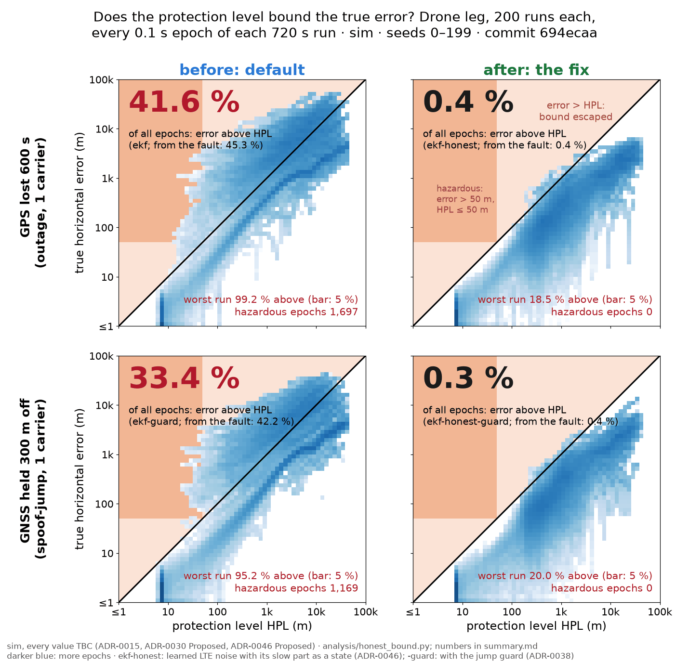

# Honest bound after GPS loss (#226)

**sim, every value TBC (ADR-0015, ADR-0030 Proposed, ADR-0046 Proposed).** Every number is a simulation of the committed `challenge-*` scenario entries; no real flight. The fix is the opt-in `ekf-honest` (`ekf-honest-guard` with the jump guard), ADR-0046 Proposed: `ekf-learned-noise` (ADR-0039) with the slow part of a radio's LTE range error carried as a Gauss-Markov state per emitter (`multipath_ratio` 1.0, `multipath_tau_s` 30 s, both `TBC`). No default changes.

**Scenario keys:** `drone/<entry>/<n>c` is `challenge-drone-<entry>` (1 carrier, EARFCN 2460) or `challenge-drone-hop-<entry>` cut to its first n of 13 carriers (as `analysis/stacked_fixes.py`); `timing/<entry>`, `approach/<entry>` the other legs; `/lte*k` the truth's LTE white noise and multipath sigma times k, the records still reporting 2 m (model mismatch). Guarded entries (`spoof-jump`, `meaconing`, `spoof-ramp`) score the `-guard` estimators.

**Statistics.** *Above HPL*: share of 0.1 s epochs with true horizontal error > HPL, pooled over runs, over each whole 720 s run (T5's epochs, as the T5 figure, #222) and from the first fault to the run's end (the stricter; the bars use it). *Worst run*: the largest per-run share from the fault. *Hazardous*: error > 50 m alert limit with HPL ≤ 50 m (`pnt.metrics`). *NEES mean*: horizontal NEES from the fault (2 if the covariance is honest). *Tightness*: at each second 0–300 s after GPS loss, median over runs of HPL / 95th percentile over runs of error; the median of that over the 300 s. *HPL ≤ 50 m*: share of epochs from the fault with HPL under the alert limit (the bound usable for the 50 m alert limit, `TBC`). *Unsafe*: median seconds from GPS loss to HPL over 50 m. *p95 worst*: ADR-0034's statistic, the worst second of the across-run 95th percentile of error over 0–300 s. *HPL bound* as PR #240 and `pnt.metrics` name it (`hpl_bound_frac`) is 1 − *above HPL, whole run*; PR #240 reports, on the sim drone leg (seeds 200–249, its own window), 0.67 for `ekf`, 0.95 for learned noise and 1.00 with no LTE. *Tightness* and *p95 worst* count from GPS loss, or on the GNSS attack entries (jump, meaconing, ramp) from the attack's start.

## Bars on held-out seeds (`stress`)

`python analysis/honest_bound.py --plan stress --part plain:13c --seeds 0-19 --jobs 3 --host g14` at `9b02665` on g14 (Python 3.12.13), seeds 0–19, 107 min; `python analysis/honest_bound.py --plan stress --part plain:1c --seeds 0-199 --jobs 5 --host g14` at `694ecaa` on g14 (Python 3.12.13), seeds 0–199, 90 min; `python analysis/honest_bound.py --plan stress --part plain:6c --seeds 0-19 --jobs 2 --host g14` at `9b02665` on g14 (Python 3.12.13), seeds 0–19, 61 min

| Scenario | Fix | above HPL from fault (pooled) | worst run | hazardous | Honest (≤ 1 %, ≤ 5 %, 0) | T5 99.9 % | tightness | Useful (≤ 3) | HPL ≤ 50 m | p95 worst: fix / unfixed / default (m) | No harm (≤ 1.05×) | false alarms /h added |
|---|---|---|---|---|---|---|---|---|---|---|---|---|
| `drone/nominal/1c` | `ekf-honest` | 0.00 % | 0.0 % | 0 | met | met | – | – | 100.0 % | – / – / – | – – | +0.00 |
| `drone/outage/1c` | `ekf-honest` | 0.45 % | 18.5 % | 0 | **not met** | **not met** | 1.35 | met | 9.8 % | 2,242 / 2,446 / 11,656 | 0.917 met | -0.30 |
| `drone/outage-tower-clock-step/1c` | `ekf-honest` | 1.74 % | 22.3 % | 0 | **not met** | **not met** | 1.12 | met | 9.7 % | 2,242 / 2,516 / 11,631 | 0.891 met | -0.85 |
| `drone/outage-tower-holdover/1c` | `ekf-honest` | 0.45 % | 18.0 % | 0 | **not met** | **not met** | 1.35 | met | 9.8 % | 2,203 / 2,446 / 10,863 | 0.901 met | -0.35 |
| `drone/outage-imu-bias/1c` | `ekf-honest` | 0.45 % | 18.5 % | 0 | **not met** | **not met** | 1.35 | met | 9.8 % | 2,242 / 2,446 / 11,656 | 0.917 met | -0.30 |
| `drone/outage-baro-drift/1c` | `ekf-honest` | 0.44 % | 18.4 % | 0 | **not met** | **not met** | 1.35 | met | 0.7 % | 2,242 / 2,446 / 11,656 | 0.917 met | +0.00 |
| `drone/spoof-jump/1c` | `ekf-honest-guard` | 0.39 % | 20.0 % | 0 | **not met** | **not met** | 0.71 | met | 0.9 % | 2,856 / 2,692 / 11,738 | 1.061 **not met** | +0.00 |
| `drone/meaconing/1c` | `ekf-honest-guard` | 0.39 % | 20.0 % | 0 | **not met** | **not met** | 0.71 | met | 0.9 % | 2,856 / 2,692 / 11,738 | 1.061 **not met** | +0.00 |
| `drone/spoof-ramp/1c` | `ekf-honest-guard` | 99.34 % | 99.6 % | 1,089,731 | **not met** | **not met** | 0.02 | met | 100.0 % | 602 / 602 / 602 | 1.000 met | +0.00 |
| `drone/nominal/6c` | `ekf-honest` | 0.00 % | 0.0 % | 0 | met | met | – | – | 100.0 % | – / – / – | – – | +0.00 |
| `drone/outage/6c` | `ekf-honest` | 0.38 % | 2.7 % | 0 | met | **not met** | 1.67 | met | 9.8 % | 303 / 331 / 11,190 | 0.916 met | +0.00 |
| `drone/outage-tower-clock-step/6c` | `ekf-honest` | 0.38 % | 2.6 % | 0 | met | **not met** | 1.64 | met | 9.8 % | 315 / 340 / 11,190 | 0.927 met | +0.00 |
| `drone/outage-tower-holdover/6c` | `ekf-honest` | 0.43 % | 2.3 % | 0 | met | **not met** | 1.70 | met | 9.8 % | 313 / 341 / 11,194 | 0.918 met | +0.00 |
| `drone/outage-imu-bias/6c` | `ekf-honest` | 0.38 % | 2.7 % | 0 | met | **not met** | 1.67 | met | 9.8 % | 303 / 331 / 11,190 | 0.916 met | +0.00 |
| `drone/outage-baro-drift/6c` | `ekf-honest` | 0.38 % | 2.7 % | 0 | met | **not met** | 1.66 | met | 0.7 % | 303 / 331 / 11,190 | 0.916 met | +0.00 |
| `drone/spoof-jump/6c` | `ekf-honest-guard` | 0.24 % | 2.8 % | 0 | met | **not met** | 1.71 | met | 0.9 % | 260 / 290 / 5,497 | 0.897 met | +0.00 |
| `drone/meaconing/6c` | `ekf-honest-guard` | 0.24 % | 2.8 % | 0 | met | **not met** | 1.71 | met | 0.9 % | 260 / 290 / 5,497 | 0.897 met | +0.00 |
| `drone/spoof-ramp/6c` | `ekf-honest-guard` | 99.34 % | 99.5 % | 108,980 | **not met** | **not met** | 0.02 | met | 100.0 % | 602 / 602 / 602 | 1.000 met | +0.00 |
| `drone/nominal/13c` | `ekf-honest` | 0.00 % | 0.0 % | 0 | met | met | – | – | 100.0 % | – / – / – | – – | +0.00 |
| `drone/outage/13c` | `ekf-honest` | 0.20 % | 0.9 % | 0 | met | **not met** | 1.79 | met | 9.8 % | 136 / 115 / 12,503 | 1.186 **not met** | +0.00 |
| `drone/outage-tower-clock-step/13c` | `ekf-honest` | 0.19 % | 0.8 % | 0 | met | **not met** | 1.80 | met | 9.8 % | 136 / 117 / 12,503 | 1.163 **not met** | +0.00 |
| `drone/outage-tower-holdover/13c` | `ekf-honest` | 0.20 % | 0.9 % | 0 | met | **not met** | 1.79 | met | 9.8 % | 136 / 120 / 12,375 | 1.132 **not met** | +0.00 |
| `drone/outage-imu-bias/13c` | `ekf-honest` | 0.20 % | 0.9 % | 0 | met | **not met** | 1.79 | met | 9.8 % | 136 / 115 / 12,503 | 1.186 **not met** | +0.00 |
| `drone/outage-baro-drift/13c` | `ekf-honest` | 0.19 % | 0.9 % | 0 | met | **not met** | 1.79 | met | 0.8 % | 136 / 115 / 12,503 | 1.186 **not met** | +0.00 |
| `drone/spoof-jump/13c` | `ekf-honest-guard` | 0.18 % | 1.0 % | 0 | met | **not met** | 1.93 | met | 0.9 % | 139 / 134 / 9,973 | 1.039 met | +0.00 |
| `drone/meaconing/13c` | `ekf-honest-guard` | 0.18 % | 1.0 % | 0 | met | **not met** | 1.93 | met | 0.9 % | 139 / 134 / 9,973 | 1.039 met | +0.00 |
| `drone/spoof-ramp/13c` | `ekf-honest-guard` | 99.34 % | 99.5 % | 108,979 | **not met** | **not met** | 0.02 | met | 100.0 % | 602 / 602 / 602 | 1.000 met | +0.00 |

Honest on 17 of 27 drone scenario keys; T5's 99.9 % on 3 of 27; useful (where there is a GPS loss) on 24 of 24; no harm on 17 of 24. *Useful* tests tightness ≤ 3 only: below 1 (the 2 m/s ramp, 0.02) the HPL is far under the error and the entry fails *Honest*. *No harm* compares the fix with the same estimator without it (`ekf-learned-noise`, `+guard`) at its worst second.

## Before and after, every drone scenario key (`stress`)

| Scenario | Estimator | runs | above HPL, whole run | above HPL, from fault | worst run | hazardous (runs) | NEES mean | tightness | HPL ≤ 50 m | p95 worst (m, s) | unsafe after loss (median s) |
|---|---|---|---|---|---|---|---|---|---|---|---|
| `drone/nominal/1c` | `ekf` | 200 | 0.00 % | 0.00 % | 0.0 % (seed 0) | 0 (0) | 1.6 | – | 100.0 % | – | – |
| `drone/nominal/1c` | `ekf-learned-noise` | 200 | 0.00 % | 0.00 % | 0.0 % (seed 0) | 0 (0) | 1.6 | – | 100.0 % | – | – |
| `drone/nominal/1c` | `ekf-honest` | 200 | 0.00 % | 0.00 % | 0.0 % (seed 0) | 0 (0) | 1.6 | – | 100.0 % | – | – |
| `drone/outage/1c` | `ekf` | 200 | 41.55 % | 45.33 % | 99.2 % (seed 119) | 1,697 (33) | 526.9 | 0.88 | 4.3 % | 11,656 (s 300) | 4.9 |
| `drone/outage/1c` | `ekf-learned-noise` | 200 | 2.02 % | 2.21 % | 24.9 % (seed 127) | 0 (0) | 6.7 | 0.97 | 9.5 % | 2,446 (s 300) | 4.9 |
| `drone/outage/1c` | `ekf-honest` | 200 | 0.41 % | 0.45 % | 18.5 % (seed 9) | 0 (0) | 2.9 | 1.35 | 9.8 % | 2,242 (s 300) | 4.9 |
| `drone/outage-tower-clock-step/1c` | `ekf` | 200 | 40.75 % | 44.45 % | 97.6 % (seed 106) | 1,838 (34) | 559.2 | 0.88 | 4.4 % | 11,631 (s 300) | 4.9 |
| `drone/outage-tower-clock-step/1c` | `ekf-learned-noise` | 200 | 9.12 % | 9.95 % | 58.0 % (seed 95) | 27 (3) | 16.2 | 0.75 | 8.5 % | 2,516 (s 300) | 4.9 |
| `drone/outage-tower-clock-step/1c` | `ekf-honest` | 200 | 1.59 % | 1.74 % | 22.3 % (seed 40) | 0 (0) | 5.5 | 1.12 | 9.7 % | 2,242 (s 300) | 4.9 |
| `drone/outage-tower-holdover/1c` | `ekf` | 200 | 41.79 % | 45.59 % | 99.2 % (seed 119) | 1,810 (34) | 547.3 | 0.88 | 4.5 % | 10,863 (s 300) | 4.9 |
| `drone/outage-tower-holdover/1c` | `ekf-learned-noise` | 200 | 2.01 % | 2.20 % | 25.6 % (seed 127) | 0 (0) | 6.7 | 0.97 | 9.5 % | 2,446 (s 300) | 4.9 |
| `drone/outage-tower-holdover/1c` | `ekf-honest` | 200 | 0.41 % | 0.45 % | 18.0 % (seed 127) | 0 (0) | 2.9 | 1.35 | 9.8 % | 2,203 (s 300) | 4.9 |
| `drone/outage-imu-bias/1c` | `ekf` | 200 | 41.55 % | 45.33 % | 99.2 % (seed 119) | 1,697 (33) | 526.9 | 0.88 | 4.3 % | 11,656 (s 300) | 4.9 |
| `drone/outage-imu-bias/1c` | `ekf-learned-noise` | 200 | 2.02 % | 2.21 % | 24.9 % (seed 127) | 0 (0) | 6.7 | 0.97 | 9.5 % | 2,446 (s 300) | 4.9 |
| `drone/outage-imu-bias/1c` | `ekf-honest` | 200 | 0.41 % | 0.45 % | 18.5 % (seed 9) | 0 (0) | 2.9 | 1.35 | 9.8 % | 2,242 (s 300) | 4.9 |
| `drone/outage-baro-drift/1c` | `ekf` | 200 | 41.35 % | 45.10 % | 99.2 % (seed 119) | 1,700 (31) | 522.6 | 0.88 | 0.9 % | 11,656 (s 300) | 4.9 |
| `drone/outage-baro-drift/1c` | `ekf-learned-noise` | 200 | 2.12 % | 2.31 % | 28.0 % (seed 9) | 0 (0) | 7.0 | 0.97 | 0.7 % | 2,446 (s 300) | 4.9 |
| `drone/outage-baro-drift/1c` | `ekf-honest` | 200 | 0.41 % | 0.44 % | 18.4 % (seed 9) | 0 (0) | 2.9 | 1.35 | 0.7 % | 2,242 (s 300) | 4.9 |
| `drone/spoof-jump/1c` | `ekf` | 200 | 75.02 % | 94.75 % | 96.0 % (seed 194) | 1,030,718 (194) | 45413.6 | 0.02 | 91.3 % | 1,677 (s 160) | – |
| `drone/spoof-jump/1c` | `ekf-learned-noise` | 200 | 71.09 % | 89.78 % | 96.4 % (seed 40) | 1,019,701 (200) | 44889.7 | 0.02 | 90.3 % | 406 (s 52) | – |
| `drone/spoof-jump/1c` | `ekf-honest` | 200 | 72.23 % | 91.22 % | 96.3 % (seed 40) | 1,038,913 (200) | 45749.0 | 0.02 | 92.0 % | 305 (s 33) | – |
| `drone/spoof-jump/1c` | `ekf-guard` | 200 | 33.41 % | 42.19 % | 95.2 % (seed 53) | 1,169 (22) | 427.9 | 0.88 | 1.0 % | 11,738 (s 300) | – |
| `drone/spoof-jump/1c` | `ekf-learned-noise+guard` | 200 | 1.34 % | 1.70 % | 16.0 % (seed 195) | 0 (0) | 6.6 | 0.61 | 0.9 % | 2,692 (s 300) | – |
| `drone/spoof-jump/1c` | `ekf-honest-guard` | 200 | 0.31 % | 0.39 % | 20.0 % (seed 183) | 0 (0) | 3.0 | 0.71 | 0.9 % | 2,856 (s 300) | – |
| `drone/meaconing/1c` | `ekf` | 200 | 78.44 % | 99.07 % | 99.4 % (seed 182) | 0 (0) | 884.0 | 0.18 | 99.4 % | 46 (s 6) | – |
| `drone/meaconing/1c` | `ekf-learned-noise` | 200 | 78.46 % | 99.09 % | 99.4 % (seed 182) | 0 (0) | 886.2 | 0.18 | 99.9 % | 46 (s 6) | – |
| `drone/meaconing/1c` | `ekf-honest` | 200 | 78.47 % | 99.10 % | 99.4 % (seed 182) | 0 (0) | 886.5 | 0.18 | 99.9 % | 46 (s 6) | – |
| `drone/meaconing/1c` | `ekf-guard` | 200 | 33.41 % | 42.19 % | 95.2 % (seed 53) | 1,169 (22) | 427.9 | 0.88 | 1.0 % | 11,738 (s 300) | – |
| `drone/meaconing/1c` | `ekf-learned-noise+guard` | 200 | 1.34 % | 1.70 % | 16.0 % (seed 195) | 0 (0) | 6.6 | 0.61 | 0.9 % | 2,692 (s 300) | – |
| `drone/meaconing/1c` | `ekf-honest-guard` | 200 | 0.31 % | 0.39 % | 20.0 % (seed 183) | 0 (0) | 3.0 | 0.71 | 0.9 % | 2,856 (s 300) | – |
| `drone/spoof-ramp/1c` | `ekf` | 200 | 78.66 % | 99.34 % | 99.6 % (seed 199) | 1,089,741 (200) | 242051.3 | 0.02 | 100.0 % | 602 (s 300) | – |
| `drone/spoof-ramp/1c` | `ekf-learned-noise` | 200 | 78.66 % | 99.34 % | 99.6 % (seed 199) | 1,089,730 (200) | 242010.2 | 0.02 | 100.0 % | 602 (s 300) | – |
| `drone/spoof-ramp/1c` | `ekf-honest` | 200 | 78.66 % | 99.34 % | 99.6 % (seed 199) | 1,089,731 (200) | 242059.2 | 0.02 | 100.0 % | 602 (s 300) | – |
| `drone/spoof-ramp/1c` | `ekf-guard` | 200 | 78.66 % | 99.34 % | 99.6 % (seed 199) | 1,089,741 (200) | 242051.3 | 0.02 | 100.0 % | 602 (s 300) | – |
| `drone/spoof-ramp/1c` | `ekf-learned-noise+guard` | 200 | 78.66 % | 99.34 % | 99.6 % (seed 199) | 1,089,730 (200) | 242010.2 | 0.02 | 100.0 % | 602 (s 300) | – |
| `drone/spoof-ramp/1c` | `ekf-honest-guard` | 200 | 78.66 % | 99.34 % | 99.6 % (seed 199) | 1,089,731 (200) | 242059.2 | 0.02 | 100.0 % | 602 (s 300) | – |
| `drone/nominal/6c` | `ekf` | 20 | 0.00 % | 0.00 % | 0.0 % (seed 0) | 0 (0) | 1.6 | – | 100.0 % | – | – |
| `drone/nominal/6c` | `ekf-learned-noise` | 20 | 0.00 % | 0.00 % | 0.0 % (seed 0) | 0 (0) | 1.6 | – | 100.0 % | – | – |
| `drone/nominal/6c` | `ekf-honest` | 20 | 0.00 % | 0.00 % | 0.0 % (seed 0) | 0 (0) | 1.6 | – | 100.0 % | – | – |
| `drone/outage/6c` | `ekf` | 20 | 48.76 % | 53.19 % | 96.0 % (seed 16) | 89 (3) | 834.0 | 1.18 | 3.1 % | 11,190 (s 279) | 4.9 |
| `drone/outage/6c` | `ekf-learned-noise` | 20 | 0.54 % | 0.59 % | 3.6 % (seed 3) | 0 (0) | 5.4 | 1.45 | 9.8 % | 331 (s 203) | 4.9 |
| `drone/outage/6c` | `ekf-honest` | 20 | 0.35 % | 0.38 % | 2.7 % (seed 3) | 0 (0) | 4.8 | 1.67 | 9.8 % | 303 (s 203) | 4.9 |
| `drone/outage-tower-clock-step/6c` | `ekf` | 20 | 49.15 % | 53.61 % | 95.0 % (seed 8) | 66 (2) | 737.8 | 1.18 | 3.1 % | 11,190 (s 279) | 4.9 |
| `drone/outage-tower-clock-step/6c` | `ekf-learned-noise` | 20 | 0.54 % | 0.59 % | 3.6 % (seed 3) | 0 (0) | 5.7 | 1.45 | 9.8 % | 340 (s 203) | 4.9 |
| `drone/outage-tower-clock-step/6c` | `ekf-honest` | 20 | 0.35 % | 0.38 % | 2.6 % (seed 3) | 0 (0) | 5.1 | 1.64 | 9.8 % | 315 (s 203) | 4.9 |
| `drone/outage-tower-holdover/6c` | `ekf` | 20 | 49.70 % | 54.21 % | 95.5 % (seed 16) | 239 (3) | 610.6 | 1.18 | 3.2 % | 11,194 (s 279) | 4.9 |
| `drone/outage-tower-holdover/6c` | `ekf-learned-noise` | 20 | 0.60 % | 0.66 % | 3.6 % (seed 3) | 0 (0) | 5.6 | 1.49 | 9.8 % | 341 (s 203) | 4.9 |
| `drone/outage-tower-holdover/6c` | `ekf-honest` | 20 | 0.39 % | 0.43 % | 2.3 % (seed 11) | 0 (0) | 4.9 | 1.70 | 9.8 % | 313 (s 203) | 4.9 |
| `drone/outage-imu-bias/6c` | `ekf` | 20 | 48.76 % | 53.19 % | 96.0 % (seed 16) | 89 (3) | 834.0 | 1.18 | 3.1 % | 11,190 (s 279) | 4.9 |
| `drone/outage-imu-bias/6c` | `ekf-learned-noise` | 20 | 0.54 % | 0.59 % | 3.6 % (seed 3) | 0 (0) | 5.4 | 1.45 | 9.8 % | 331 (s 203) | 4.9 |
| `drone/outage-imu-bias/6c` | `ekf-honest` | 20 | 0.35 % | 0.38 % | 2.7 % (seed 3) | 0 (0) | 4.8 | 1.67 | 9.8 % | 303 (s 203) | 4.9 |
| `drone/outage-baro-drift/6c` | `ekf` | 20 | 48.60 % | 53.02 % | 96.6 % (seed 16) | 89 (3) | 468.7 | 1.18 | 0.8 % | 11,190 (s 279) | 4.9 |
| `drone/outage-baro-drift/6c` | `ekf-learned-noise` | 20 | 0.54 % | 0.59 % | 3.6 % (seed 3) | 0 (0) | 5.6 | 1.45 | 0.7 % | 331 (s 203) | 4.9 |
| `drone/outage-baro-drift/6c` | `ekf-honest` | 20 | 0.35 % | 0.38 % | 2.7 % (seed 3) | 0 (0) | 5.0 | 1.66 | 0.7 % | 303 (s 203) | 4.9 |
| `drone/spoof-jump/6c` | `ekf` | 20 | 74.37 % | 93.92 % | 95.7 % (seed 17) | 91,639 (20) | 40384.7 | 0.01 | 81.2 % | 2,321 (s 112) | – |
| `drone/spoof-jump/6c` | `ekf-learned-noise` | 20 | 48.23 % | 60.91 % | 86.7 % (seed 0) | 68,683 (20) | 30188.7 | 0.44 | 61.1 % | 313 (s 88) | – |
| `drone/spoof-jump/6c` | `ekf-honest` | 20 | 49.90 % | 63.03 % | 91.0 % (seed 3) | 71,744 (20) | 31563.8 | 0.44 | 63.8 % | 308 (s 246) | – |
| `drone/spoof-jump/6c` | `ekf-guard` | 20 | 31.91 % | 40.30 % | 91.7 % (seed 16) | 82 (2) | 365.9 | 1.33 | 0.9 % | 5,497 (s 300) | – |
| `drone/spoof-jump/6c` | `ekf-learned-noise+guard` | 20 | 0.19 % | 0.24 % | 2.6 % (seed 5) | 0 (0) | 4.9 | 1.49 | 0.9 % | 290 (s 109) | – |
| `drone/spoof-jump/6c` | `ekf-honest-guard` | 20 | 0.19 % | 0.24 % | 2.8 % (seed 11) | 0 (0) | 4.2 | 1.71 | 0.9 % | 260 (s 113) | – |
| `drone/meaconing/6c` | `ekf` | 20 | 78.47 % | 99.11 % | 99.3 % (seed 10) | 0 (0) | 886.6 | 0.18 | 99.9 % | 45 (s 6) | – |
| `drone/meaconing/6c` | `ekf-learned-noise` | 20 | 78.48 % | 99.11 % | 99.3 % (seed 7) | 0 (0) | 886.2 | 0.18 | 99.9 % | 45 (s 6) | – |
| `drone/meaconing/6c` | `ekf-honest` | 20 | 78.46 % | 99.09 % | 99.3 % (seed 7) | 0 (0) | 886.1 | 0.18 | 99.9 % | 45 (s 6) | – |
| `drone/meaconing/6c` | `ekf-guard` | 20 | 31.91 % | 40.30 % | 91.7 % (seed 16) | 82 (2) | 365.9 | 1.33 | 0.9 % | 5,497 (s 300) | – |
| `drone/meaconing/6c` | `ekf-learned-noise+guard` | 20 | 0.19 % | 0.24 % | 2.6 % (seed 5) | 0 (0) | 4.9 | 1.49 | 0.9 % | 290 (s 109) | – |
| `drone/meaconing/6c` | `ekf-honest-guard` | 20 | 0.19 % | 0.24 % | 2.8 % (seed 11) | 0 (0) | 4.2 | 1.71 | 0.9 % | 260 (s 113) | – |
| `drone/spoof-ramp/6c` | `ekf` | 20 | 78.65 % | 99.34 % | 99.5 % (seed 5) | 108,983 (20) | 242037.7 | 0.02 | 100.0 % | 602 (s 300) | – |
| `drone/spoof-ramp/6c` | `ekf-learned-noise` | 20 | 78.65 % | 99.34 % | 99.5 % (seed 5) | 108,980 (20) | 241989.7 | 0.02 | 100.0 % | 602 (s 300) | – |
| `drone/spoof-ramp/6c` | `ekf-honest` | 20 | 78.65 % | 99.34 % | 99.5 % (seed 5) | 108,980 (20) | 242002.0 | 0.02 | 100.0 % | 602 (s 300) | – |
| `drone/spoof-ramp/6c` | `ekf-guard` | 20 | 78.65 % | 99.34 % | 99.5 % (seed 5) | 108,983 (20) | 242037.7 | 0.02 | 100.0 % | 602 (s 300) | – |
| `drone/spoof-ramp/6c` | `ekf-learned-noise+guard` | 20 | 78.65 % | 99.34 % | 99.5 % (seed 5) | 108,980 (20) | 241989.7 | 0.02 | 100.0 % | 602 (s 300) | – |
| `drone/spoof-ramp/6c` | `ekf-honest-guard` | 20 | 78.65 % | 99.34 % | 99.5 % (seed 5) | 108,980 (20) | 242002.0 | 0.02 | 100.0 % | 602 (s 300) | – |
| `drone/nominal/13c` | `ekf` | 20 | 0.00 % | 0.00 % | 0.0 % (seed 0) | 0 (0) | 1.6 | – | 100.0 % | – | – |
| `drone/nominal/13c` | `ekf-learned-noise` | 20 | 0.00 % | 0.00 % | 0.0 % (seed 0) | 0 (0) | 1.6 | – | 100.0 % | – | – |
| `drone/nominal/13c` | `ekf-honest` | 20 | 0.00 % | 0.00 % | 0.0 % (seed 0) | 0 (0) | 1.6 | – | 100.0 % | – | – |
| `drone/outage/13c` | `ekf` | 20 | 49.29 % | 53.76 % | 98.1 % (seed 0) | 526 (3) | 1256.4 | 0.62 | 3.9 % | 12,503 (s 300) | 4.9 |
| `drone/outage/13c` | `ekf-learned-noise` | 20 | 0.02 % | 0.02 % | 0.3 % (seed 7) | 0 (0) | 3.7 | 1.88 | 9.8 % | 115 (s 286) | 5.0 |
| `drone/outage/13c` | `ekf-honest` | 20 | 0.18 % | 0.20 % | 0.9 % (seed 16) | 0 (0) | 3.9 | 1.79 | 9.8 % | 136 (s 41) | 5.0 |
| `drone/outage-tower-clock-step/13c` | `ekf` | 20 | 50.36 % | 54.93 % | 98.1 % (seed 0) | 597 (3) | 1314.7 | 0.62 | 3.5 % | 12,503 (s 300) | 4.9 |
| `drone/outage-tower-clock-step/13c` | `ekf-learned-noise` | 20 | 0.03 % | 0.03 % | 0.3 % (seed 19) | 0 (0) | 3.8 | 1.88 | 9.8 % | 117 (s 181) | 5.0 |
| `drone/outage-tower-clock-step/13c` | `ekf-honest` | 20 | 0.18 % | 0.19 % | 0.8 % (seed 16) | 0 (0) | 4.0 | 1.80 | 9.8 % | 136 (s 41) | 5.0 |
| `drone/outage-tower-holdover/13c` | `ekf` | 20 | 50.56 % | 55.15 % | 98.1 % (seed 0) | 590 (3) | 1346.9 | 0.62 | 3.5 % | 12,375 (s 300) | 4.9 |
| `drone/outage-tower-holdover/13c` | `ekf-learned-noise` | 20 | 0.08 % | 0.09 % | 0.7 % (seed 7) | 0 (0) | 3.9 | 1.87 | 9.8 % | 120 (s 286) | 5.0 |
| `drone/outage-tower-holdover/13c` | `ekf-honest` | 20 | 0.18 % | 0.20 % | 0.9 % (seed 16) | 0 (0) | 4.0 | 1.79 | 9.8 % | 136 (s 41) | 5.0 |
| `drone/outage-imu-bias/13c` | `ekf` | 20 | 49.29 % | 53.76 % | 98.1 % (seed 0) | 526 (3) | 1256.4 | 0.62 | 3.9 % | 12,503 (s 300) | 4.9 |
| `drone/outage-imu-bias/13c` | `ekf-learned-noise` | 20 | 0.02 % | 0.02 % | 0.3 % (seed 7) | 0 (0) | 3.7 | 1.88 | 9.8 % | 115 (s 286) | 5.0 |
| `drone/outage-imu-bias/13c` | `ekf-honest` | 20 | 0.18 % | 0.20 % | 0.9 % (seed 16) | 0 (0) | 3.9 | 1.79 | 9.8 % | 136 (s 41) | 5.0 |
| `drone/outage-baro-drift/13c` | `ekf` | 20 | 49.62 % | 54.13 % | 98.1 % (seed 0) | 526 (3) | 1275.2 | 0.62 | 1.2 % | 12,503 (s 300) | 4.9 |
| `drone/outage-baro-drift/13c` | `ekf-learned-noise` | 20 | 0.02 % | 0.02 % | 0.3 % (seed 7) | 0 (0) | 3.8 | 1.88 | 0.8 % | 115 (s 286) | 5.0 |
| `drone/outage-baro-drift/13c` | `ekf-honest` | 20 | 0.18 % | 0.19 % | 0.9 % (seed 16) | 0 (0) | 4.0 | 1.79 | 0.8 % | 136 (s 41) | 5.0 |
| `drone/spoof-jump/13c` | `ekf` | 20 | 75.40 % | 95.23 % | 98.2 % (seed 0) | 91,912 (19) | 40947.7 | 0.01 | 81.5 % | 2,774 (s 300) | – |
| `drone/spoof-jump/13c` | `ekf-learned-noise` | 20 | 9.18 % | 11.59 % | 59.3 % (seed 19) | 13,154 (6) | 5780.4 | 1.86 | 12.4 % | 301 (s 254) | – |
| `drone/spoof-jump/13c` | `ekf-honest` | 20 | 10.70 % | 13.52 % | 95.5 % (seed 13) | 15,207 (5) | 6691.2 | 1.35 | 14.2 % | 302 (s 239) | – |
| `drone/spoof-jump/13c` | `ekf-guard` | 20 | 37.12 % | 46.88 % | 98.2 % (seed 0) | 143 (2) | 1218.3 | 0.74 | 1.0 % | 9,973 (s 300) | – |
| `drone/spoof-jump/13c` | `ekf-learned-noise+guard` | 20 | 0.04 % | 0.06 % | 0.8 % (seed 7) | 0 (0) | 3.4 | 2.01 | 0.9 % | 134 (s 237) | – |
| `drone/spoof-jump/13c` | `ekf-honest-guard` | 20 | 0.14 % | 0.18 % | 1.0 % (seed 11) | 0 (0) | 3.6 | 1.93 | 0.9 % | 139 (s 237) | – |
| `drone/meaconing/13c` | `ekf` | 20 | 78.44 % | 99.07 % | 99.3 % (seed 10) | 140 (1) | 1012.7 | 0.10 | 95.1 % | 213 (s 300) | – |
| `drone/meaconing/13c` | `ekf-learned-noise` | 20 | 78.35 % | 98.96 % | 99.3 % (seed 19) | 0 (0) | 884.6 | 0.18 | 99.8 % | 45 (s 6) | – |
| `drone/meaconing/13c` | `ekf-honest` | 20 | 78.36 % | 98.96 % | 99.3 % (seed 19) | 0 (0) | 884.7 | 0.18 | 99.8 % | 45 (s 6) | – |
| `drone/meaconing/13c` | `ekf-guard` | 20 | 37.12 % | 46.88 % | 98.2 % (seed 0) | 143 (2) | 1218.3 | 0.74 | 1.0 % | 9,973 (s 300) | – |
| `drone/meaconing/13c` | `ekf-learned-noise+guard` | 20 | 0.04 % | 0.06 % | 0.8 % (seed 7) | 0 (0) | 3.4 | 2.01 | 0.9 % | 134 (s 237) | – |
| `drone/meaconing/13c` | `ekf-honest-guard` | 20 | 0.14 % | 0.18 % | 1.0 % (seed 11) | 0 (0) | 3.6 | 1.93 | 0.9 % | 139 (s 237) | – |
| `drone/spoof-ramp/13c` | `ekf` | 20 | 78.65 % | 99.34 % | 99.5 % (seed 5) | 108,983 (20) | 242021.0 | 0.02 | 100.0 % | 602 (s 300) | – |
| `drone/spoof-ramp/13c` | `ekf-learned-noise` | 20 | 78.66 % | 99.34 % | 99.5 % (seed 5) | 108,981 (20) | 241969.3 | 0.02 | 100.0 % | 602 (s 300) | – |
| `drone/spoof-ramp/13c` | `ekf-honest` | 20 | 78.65 % | 99.34 % | 99.5 % (seed 5) | 108,979 (20) | 241973.4 | 0.02 | 100.0 % | 602 (s 300) | – |
| `drone/spoof-ramp/13c` | `ekf-guard` | 20 | 78.65 % | 99.34 % | 99.5 % (seed 5) | 108,983 (20) | 242021.0 | 0.02 | 100.0 % | 602 (s 300) | – |
| `drone/spoof-ramp/13c` | `ekf-learned-noise+guard` | 20 | 78.66 % | 99.34 % | 99.5 % (seed 5) | 108,981 (20) | 241969.3 | 0.02 | 100.0 % | 602 (s 300) | – |
| `drone/spoof-ramp/13c` | `ekf-honest-guard` | 20 | 78.65 % | 99.34 % | 99.5 % (seed 5) | 108,979 (20) | 241973.4 | 0.02 | 100.0 % | 602 (s 300) | – |

## Other legs and model mismatch (`stress`)

| Scenario | Estimator | runs | above HPL, whole run | above HPL, from fault | worst run | hazardous (runs) | NEES mean | tightness | HPL ≤ 50 m | p95 worst (m, s) | unsafe after loss (median s) |
|---|---|---|---|---|---|---|---|---|---|---|---|
| `drone/outage/1c/lte*0.5` | `ekf` | 200 | 57.39 % | 62.60 % | 99.4 % (seed 40) | 3,346 (52) | 685.3 | 0.38 | 3.0 % | 10,898 (s 300) | 4.9 |
| `drone/outage/1c/lte*2` | `ekf` | 200 | 28.52 % | 31.11 % | 95.1 % (seed 194) | 651 (14) | 460.1 | 1.29 | 5.6 % | 12,076 (s 300) | 4.9 |
| `drone/outage/1c/lte*0.5` | `ekf-learned-noise` | 200 | 2.84 % | 3.09 % | 79.8 % (seed 4) | 0 (0) | 7.3 | 1.35 | 9.5 % | 2,473 (s 300) | 4.9 |
| `drone/outage/1c/lte*2` | `ekf-learned-noise` | 200 | 4.39 % | 4.78 % | 93.6 % (seed 81) | 0 (0) | 10.3 | 0.84 | 9.3 % | 2,767 (s 300) | 4.9 |
| `drone/outage/1c/lte*0.5` | `ekf-honest` | 200 | 0.55 % | 0.60 % | 17.7 % (seed 4) | 0 (0) | 3.0 | 1.91 | 9.7 % | 2,392 (s 300) | 4.9 |
| `drone/outage/1c/lte*2` | `ekf-honest` | 200 | 2.04 % | 2.23 % | 93.6 % (seed 83) | 0 (0) | 6.4 | 1.19 | 9.6 % | 2,774 (s 300) | 4.9 |
| `drone/outage-imu-bias/1c/lte*0.5` | `ekf` | 50 | 60.91 % | 66.44 % | 99.4 % (seed 40) | 625 (13) | 585.5 | 0.36 | 2.6 % | 12,905 (s 300) | 4.9 |
| `drone/outage-imu-bias/1c/lte*2` | `ekf` | 50 | 26.83 % | 29.26 % | 86.7 % (seed 29) | 10 (2) | 466.8 | 1.64 | 5.2 % | 8,189 (s 276) | 4.9 |
| `drone/outage-imu-bias/1c/lte*0.5` | `ekf-learned-noise` | 50 | 3.42 % | 3.73 % | 79.8 % (seed 4) | 0 (0) | 7.3 | 1.47 | 9.4 % | 3,046 (s 300) | 4.9 |
| `drone/outage-imu-bias/1c/lte*2` | `ekf-learned-noise` | 50 | 4.42 % | 4.82 % | 90.6 % (seed 2) | 0 (0) | 9.4 | 0.96 | 9.1 % | 2,733 (s 300) | 4.9 |
| `drone/outage-imu-bias/1c/lte*0.5` | `ekf-honest` | 50 | 0.61 % | 0.66 % | 17.7 % (seed 4) | 0 (0) | 3.0 | 1.99 | 9.8 % | 2,393 (s 300) | 4.9 |
| `drone/outage-imu-bias/1c/lte*2` | `ekf-honest` | 50 | 0.72 % | 0.79 % | 18.3 % (seed 26) | 0 (0) | 3.2 | 1.64 | 9.8 % | 2,435 (s 300) | 4.9 |
| `timing/nominal` | `ekf` | 50 | 0.00 % | 0.00 % | 0.0 % (seed 0) | 0 (0) | 1.5 | – | 100.0 % | – | – |
| `timing/nominal` | `ekf-learned-noise` | 50 | 0.00 % | 0.00 % | 0.0 % (seed 0) | 0 (0) | 1.5 | – | 100.0 % | – | – |
| `timing/nominal` | `ekf-honest` | 50 | 0.00 % | 0.00 % | 0.0 % (seed 0) | 0 (0) | 1.5 | – | 100.0 % | – | – |
| `timing/outage` | `ekf` | 50 | 36.04 % | 39.31 % | 93.8 % (seed 32) | 19 (3) | 353.9 | 1.72 | 4.1 % | 9,036 (s 274) | 4.9 |
| `timing/outage` | `ekf-learned-noise` | 50 | 0.07 % | 0.08 % | 3.8 % (seed 8) | 0 (0) | 0.7 | 7.30 | 9.8 % | 1,423 (s 300) | 4.9 |
| `timing/outage` | `ekf-honest` | 50 | 0.00 % | 0.00 % | 0.0 % (seed 0) | 0 (0) | 0.5 | 8.78 | 9.8 % | 1,227 (s 300) | 4.9 |

The approach leg's `stress` rows were computed before `ekf-honest` gained the receiver-clock switch (its records carry our clock and no `rx_clock`), so they are left out above and rerun here (`legs`); the drone and timing records all have `rx_clock`, which the switch does not touch (`tests/test_ekf_honest.py`).

`python analysis/honest_bound.py --plan legs --seeds 0-199 --jobs 2 --host mac` at `479d98b` on mac (Python 3.14.6), seeds 0–199, 4 min

| Scenario | Estimator | runs | above HPL, whole run | above HPL, from fault | worst run | hazardous (runs) | NEES mean | tightness | HPL ≤ 50 m | p95 worst (m, s) | unsafe after loss (median s) |
|---|---|---|---|---|---|---|---|---|---|---|---|
| `approach/nominal` | `ekf` | 50 | 0.00 % | 0.00 % | 0.0 % (seed 0) | 0 (0) | 1.5 | – | 100.0 % | – | – |
| `approach/nominal` | `ekf-learned-noise` | 50 | 0.00 % | 0.00 % | 0.0 % (seed 0) | 0 (0) | 1.5 | – | 100.0 % | – | – |
| `approach/nominal` | `ekf-honest` | 50 | 0.00 % | 0.00 % | 0.0 % (seed 0) | 0 (0) | 1.5 | – | 100.0 % | – | – |
| `approach/outage` | `ekf` | 50 | 76.78 % | 83.75 % | 96.1 % (seed 22) | 0 (0) | 33412.3 | 0.45 | 0.7 % | 2,938 (s 199) | 4.9 |
| `approach/outage` | `ekf-learned-noise` | 50 | 76.78 % | 83.75 % | 96.1 % (seed 22) | 0 (0) | 33412.3 | 0.45 | 0.7 % | 2,938 (s 199) | 4.9 |
| `approach/outage` | `ekf-honest` | 50 | 0.00 % | 0.00 % | 0.0 % (seed 0) | 0 (0) | 1.3 | 3.36 | 9.8 % | 1,747 (s 230) | 4.9 |

## `realistic-long-outage` and the barometer, held-out seeds (`realistic`, #228)

`python analysis/honest_bound.py --plan realistic --seeds 0-199 --jobs 2 --host mac` at `624436f` (DIRTY TREE) on mac (Python 3.14.6), seeds 0–199, 42 min

| Scenario | Estimator | runs | above HPL, whole run | above HPL, from fault | worst run | hazardous (runs) | NEES mean | tightness | HPL ≤ 50 m | p95 worst (m, s) | unsafe after loss (median s) |
|---|---|---|---|---|---|---|---|---|---|---|---|
| `realistic/nominal` | `ekf {"pseudorange_receiver_clock": true}` | 200 | 0.00 % | 0.00 % | 0.0 % (seed 0) | 0 (0) | 1.6 | – | 99.9 % | – | – |
| `realistic/nominal` | `ekf` | 200 | 0.00 % | 0.00 % | 0.0 % (seed 0) | 0 (0) | 1.6 | – | 99.9 % | – | – |
| `realistic/nominal` | `ekf-honest {"pseudorange_receiver_clock": false}` | 200 | 0.00 % | 0.00 % | 0.0 % (seed 0) | 0 (0) | 1.6 | – | 99.9 % | – | – |
| `realistic/nominal` | `ekf-honest` | 200 | 0.00 % | 0.00 % | 0.0 % (seed 0) | 0 (0) | 1.6 | – | 99.9 % | – | – |
| `realistic/long-outage` | `ekf {"pseudorange_receiver_clock": true}` | 200 | 8.89 % | 10.67 % | 54.2 % (seed 80) | 0 (0) | 18.9 | 0.59 | 1.6 % | 588 (s 270) | 4.9 |
| `realistic/baro-drift` | `ekf {"pseudorange_receiver_clock": true}` | 200 | 2.43 % | 3.65 % | 32.9 % (seed 45) | 0 (0) | 9.4 | 0.92 | 44.8 % | 327 (s 178) | – |
| `realistic/long-outage` | `ekf` | 200 | 75.75 % | 90.87 % | 97.3 % (seed 9) | 0 (0) | 6692.3 | 0.17 | 1.6 % | 3,609 (s 288) | 4.9 |
| `realistic/baro-drift` | `ekf` | 200 | 5.30 % | 7.95 % | 37.5 % (seed 137) | 0 (0) | 1266.0 | 1.23 | 45.5 % | 3,702 (s 239) | – |
| `realistic/long-outage` | `ekf-honest {"pseudorange_receiver_clock": false}` | 200 | 70.27 % | 84.30 % | 95.6 % (seed 160) | 0 (0) | 1314.0 | 0.26 | 1.6 % | 2,706 (s 298) | 4.9 |
| `realistic/baro-drift` | `ekf-honest {"pseudorange_receiver_clock": false}` | 200 | 8.76 % | 13.14 % | 49.8 % (seed 153) | 0 (0) | 271.1 | 0.93 | 45.2 % | 3,276 (s 234) | – |
| `realistic/long-outage` | `ekf-honest` | 200 | 0.16 % | 0.19 % | 24.5 % (seed 74) | 0 (0) | 2.6 | 1.85 | 1.6 % | 516 (s 270) | 4.9 |
| `realistic/baro-drift` | `ekf-honest` | 200 | 0.00 % | 0.00 % | 0.8 % (seed 45) | 0 (0) | 2.1 | 2.07 | 45.5 % | 319 (s 150) | – |
| `realistic/long-outage/nobaro` | `ekf {"pseudorange_receiver_clock": true}` | 200 | 7.60 % | 9.11 % | 66.0 % (seed 44) | 0 (0) | 16.5 | 0.54 | 1.6 % | 1,089 (s 270) | 4.9 |
| `realistic/long-outage/drop-baro` | `ekf {"pseudorange_receiver_clock": true}` | 200 | 6.83 % | 8.19 % | 61.6 % (seed 81) | 0 (0) | 17.1 | 0.63 | 1.6 % | 1,079 (s 270) | 4.9 |
| `realistic/long-outage/barobias=0` | `ekf {"pseudorange_receiver_clock": true}` | 200 | 8.89 % | 10.67 % | 54.2 % (seed 80) | 0 (0) | 18.9 | 0.59 | 1.6 % | 588 (s 270) | 4.9 |
| `realistic/long-outage/nobaro` | `ekf` | 200 | 69.81 % | 83.75 % | 96.6 % (seed 45) | 0 (0) | 1161.9 | 0.25 | 1.6 % | 2,942 (s 294) | 4.9 |
| `realistic/long-outage/drop-baro` | `ekf` | 200 | 71.17 % | 85.38 % | 97.0 % (seed 24) | 0 (0) | 1059.1 | 0.26 | 1.6 % | 2,715 (s 277) | 4.9 |
| `realistic/long-outage/barobias=0` | `ekf` | 200 | 75.75 % | 90.88 % | 97.3 % (seed 9) | 0 (0) | 6692.4 | 0.17 | 1.6 % | 3,609 (s 288) | 4.9 |
| `realistic/long-outage/nobaro` | `ekf-honest {"pseudorange_receiver_clock": false}` | 200 | 58.90 % | 70.67 % | 96.0 % (seed 183) | 0 (0) | 233.1 | 0.46 | 1.6 % | 2,552 (s 299) | 4.9 |
| `realistic/long-outage/drop-baro` | `ekf-honest {"pseudorange_receiver_clock": false}` | 200 | 62.25 % | 74.68 % | 95.6 % (seed 160) | 0 (0) | 222.3 | 0.45 | 1.6 % | 2,496 (s 299) | 4.9 |
| `realistic/long-outage/barobias=0` | `ekf-honest {"pseudorange_receiver_clock": false}` | 200 | 70.27 % | 84.30 % | 95.6 % (seed 160) | 0 (0) | 1314.0 | 0.26 | 1.6 % | 2,706 (s 298) | 4.9 |
| `realistic/long-outage/nobaro` | `ekf-honest` | 200 | 0.20 % | 0.24 % | 18.2 % (seed 6) | 0 (0) | 3.0 | 1.81 | 1.6 % | 760 (s 270) | 4.9 |
| `realistic/long-outage/drop-baro` | `ekf-honest` | 200 | 0.09 % | 0.11 % | 22.5 % (seed 74) | 0 (0) | 2.6 | 1.84 | 1.6 % | 608 (s 270) | 4.9 |
| `realistic/long-outage/barobias=0` | `ekf-honest` | 200 | 0.16 % | 0.19 % | 24.5 % (seed 74) | 0 (0) | 2.6 | 1.85 | 1.6 % | 516 (s 270) | 4.9 |

## Sweep of the new settings (`sweep`)

`python analysis/honest_bound.py --plan sweep --seeds 0-49 --jobs 5 --host g14` at `624436f` on g14 (Python 3.12.13), seeds 0–49, 17 min

| Scenario | Setting | above HPL from fault | worst run | hazardous | tightness | p95 worst (m) | p95 worst / unfixed | Honest | Useful | No harm |
|---|---|---|---|---|---|---|---|---|---|---|
| `drone/outage/1c` | multipath_ratio: 0.5 | 0.98 % | 16.5 % | 0 | 1.36 | 2,181 | 0.882 | **not met** | met | met |
| `drone/outage/1c` | multipath_ratio: 1.5 | 1.74 % | 30.3 % | 0 | 1.77 | 2,298 | 0.929 | **not met** | met | met |
| `drone/outage/1c` | multipath_tau_s: 15.0 | 0.60 % | 9.2 % | 0 | 2.02 | 2,233 | 0.903 | **not met** | met | met |
| `drone/outage/1c` | multipath_tau_s: 3.0 | 0.72 % | 13.3 % | 0 | 1.66 | 2,375 | 0.960 | **not met** | met | met |
| `drone/outage/1c` | multipath_tau_s: 45.0 | 0.72 % | 15.3 % | 0 | 1.78 | 2,107 | 0.852 | **not met** | met | met |
| `drone/outage/1c` | q_accel: 1.25 | 0.33 % | 14.2 % | 0 | 2.53 | 2,296 | 0.928 | **not met** | met | met |
| `drone/outage/1c` | q_accel: 1.5 | 0.31 % | 15.4 % | 0 | 3.39 | 2,422 | 0.979 | **not met** | **not met** | met |
| `drone/outage/1c` | as proposed | 0.90 % | 18.5 % | 0 | 1.91 | 2,249 | 0.909 | **not met** | met | met |
| `drone/outage/13c` | multipath_ratio: 0.5 | 0.03 % | 0.2 % | 0 | 1.98 | 133 | 0.976 | met | met | met |
| `drone/outage/13c` | multipath_ratio: 1.5 | 0.22 % | 1.4 % | 0 | 1.59 | 500 | 3.681 | met | met | **not met** |
| `drone/outage/13c` | multipath_tau_s: 15.0 | 0.06 % | 0.6 % | 0 | 1.99 | 120 | 0.879 | met | met | met |
| `drone/outage/13c` | multipath_tau_s: 3.0 | 0.06 % | 0.6 % | 0 | 1.95 | 134 | 0.985 | met | met | met |
| `drone/outage/13c` | multipath_tau_s: 45.0 | 0.07 % | 0.7 % | 0 | 1.95 | 116 | 0.855 | met | met | met |
| `drone/outage/13c` | as proposed | 0.06 % | 0.6 % | 0 | 1.95 | 115 | 0.849 | met | met | met |

## Solution separation as the reference (`mhss`)

`python analysis/honest_bound.py --plan mhss --seeds 0-19 --jobs 2 --host g14` at `624436f` on g14 (Python 3.12.13), seeds 0–19, 41 min

| Scenario | Estimator | runs | above HPL, whole run | above HPL, from fault | worst run | hazardous (runs) | NEES mean | tightness | HPL ≤ 50 m | p95 worst (m, s) | unsafe after loss (median s) |
|---|---|---|---|---|---|---|---|---|---|---|---|
| `drone/nominal/1c` | `ekf-mhss` | 20 | 0.00 % | 0.00 % | 0.0 % (seed 0) | 0 (0) | 3.5 | – | 0.0 % | – | – |
| `drone/nominal/1c` | `ekf-honest-mhss` | 20 | 0.00 % | 0.00 % | 0.0 % (seed 0) | 0 (0) | 1.6 | – | 0.0 % | – | – |
| `drone/outage/1c` | `ekf-mhss` | 20 | 0.00 % | 0.00 % | 0.0 % (seed 0) | 0 (0) | 308.3 | 1.61 | 0.0 % | 17,407 (s 300) | 0.0 |
| `drone/outage/1c` | `ekf-honest-mhss` | 20 | 0.00 % | 0.00 % | 0.0 % (seed 0) | 0 (0) | 3.3 | 5.27 | 0.0 % | 2,307 (s 300) | 0.0 |
| `drone/spoof-jump/1c` | `ekf-mhss` | 20 | 0.00 % | 0.00 % | 0.0 % (seed 0) | 0 (0) | 46780.3 | 4.32 | 0.0 % | 649 (s 59) | – |
| `drone/spoof-jump/1c` | `ekf-honest-mhss` | 20 | 1.48 % | 1.87 % | 13.0 % (seed 3) | 0 (0) | 46321.4 | 3.02 | 0.0 % | 389 (s 49) | – |
| `drone/meaconing/1c` | `ekf-mhss` | 20 | 0.03 % | 0.03 % | 0.6 % (seed 14) | 0 (0) | 887.6 | 30.61 | 0.0 % | 51 (s 65) | – |
| `drone/meaconing/1c` | `ekf-honest-mhss` | 20 | 0.00 % | 0.00 % | 0.0 % (seed 0) | 0 (0) | 886.6 | 17.30 | 0.0 % | 45 (s 6) | – |
| `drone/spoof-ramp/1c` | `ekf-mhss` | 20 | 11.27 % | 14.23 % | 19.5 % (seed 7) | 37 (1) | 242004.9 | 4.00 | 0.0 % | 602 (s 300) | – |
| `drone/spoof-ramp/1c` | `ekf-honest-mhss` | 20 | 3.53 % | 4.45 % | 27.5 % (seed 11) | 0 (0) | 242086.3 | 3.30 | 0.0 % | 602 (s 300) | – |

## Diagnosis (#226 step 2, tuning seeds 1000–1049 only)

1. **`ekf` believes the 2 m the records report** (true error 50 m white + 50 m Gauss-Markov, 30 s; `challenge-drone`, `TBC`). After GPS loss its gate rejects most LTE records and each one it accepts at 2 m collapses the covariance: on `drone/outage/1c` error above HPL in 37.55 % of epochs from GPS loss, worst run 95.3 % (`measure`). That is the T5 figure's 43.7 %. Learned noise (ADR-0039) removes most of it.
2. **`ekf-learned-noise` takes the whole error as white.** The size it learns is right, but an error correlated over 30 s is averaged down as if each 1 Hz record were independent: on `drone/outage/1c` 2.66 % above HPL from loss, worst run 22.3 %, mean horizontal NEES 7.1 against 2 for an honest covariance (`diagnose`): a model error, not a K error. `ekf-calibrated-learned-noise`, which already has a multipath state per emitter, is at 0.04 % on the same entry and seeds. With 13 carriers more cells average the slow errors of different towers and the escape is small already.
3. **One term changed at a time** (`diagnose`, 50 seeds each):

| Change to `ekf-learned-noise` | above HPL from loss, 1 carrier | worst run | NEES mean | NEES > K² | tightness |
|---|---|---|---|---|---|
| `ekf-learned-noise` as it is | 2.66 % | 22.3 % | 7.1 | 5.51 % | 1.11 |
| (a) coasting process noise q_accel 1 → 1.5 | 1.19 % | 13.5 % | 3.8 | 2.66 % | 1.70 |
| (c) tower clock random walk 0.2 → 1 m/√s | 2.07 % | 21.3 % | 6.6 | 5.09 % | 1.12 |
| slow range error as a state (`ekf-honest`, the fix) | 0.43 % | 8.3 % | 2.8 | 0.78 % | 1.62 |
| the fix + (a) | 0.11 % | 3.2 % | 1.7 | 0.19 % | 3.00 |

| Same, 13 carriers (first 10 seeds) | above HPL from loss | worst run | NEES mean | NEES > K² | tightness |
|---|---|---|---|---|---|
| `ekf-learned-noise` as it is | 0.20 % | 1.1 % | 4.1 | 0.40 % | 1.87 |
| (a) coasting process noise q_accel 1 → 1.5 | 0.10 % | 0.7 % | 3.6 | 0.25 % | 2.07 |
| (c) tower clock random walk 0.2 → 1 m/√s | 0.01 % | 0.1 % | 3.7 | 0.09 % | 1.95 |
| slow range error as a state (`ekf-honest`, the fix) | 0.23 % | 1.9 % | 4.1 | 0.44 % | 1.95 |
| the fix + (a) | 0.14 % | 0.9 % | 3.6 | 0.41 % | 2.11 |

   - (a) **Process noise is not the wrong term.** The circuit (8 m/s, 40 m corners) has |a| rms 0.34 m/s², max 0.68. Per axis, var(velocity change over T) / T, which is q_accel² = 1 m²/s³ for the model: 1 s: 0.07, 5 s: 0.34, 10 s: 0.66, 20 s: 1.20, 60 s: 2.18, 120 s: 0.70 (the larger axis; `challenge-drone-outage` seed 1000). Under 1 up to 10 s, up to 2.2 at 60 s and above: the turns are correlated, not white. A larger q_accel helps the stretches just after loss but makes HPL larger everywhere.
   - (b) **Covariance collapse on a few accepted ranges** is case 1 (2 m believed). What still escapes with the fix (3 of 50 tuning runs above 1 %: seeds 1038, 1041, 1028) escapes while the position is already 1 to 1.4 km off and new cells are first heard (seed 1041: 7 cells at 240 s, escape 240–276 s; seed 1038: one at 218 s, escape 210–265 s): their clocks start at the wrong position and a few of their ranges pull the covariance in, a linearisation-point problem the fix does not address. Starting a new cell's slow state at its learned share was tried on these seeds and did not help (0.59 %, worst 8.6 %); not adopted.
   - (c) **Clock states:** on 1 carrier a tower clock random walk 5 × larger changes the escape share little (row 3). On 13 carriers it removes most of the (already small) escape and the NEES stays near 4 with or without the fix: there the tower clocks, not the slow range error, are the larger model error (10 seeds; not changed here). On `realistic-long-outage` our own clock in the ranges is the cause (below).
   - (d) **K:** K_H = 5.33 on the largest horizontal sigma. With the slow error as a state the NEES mean is near 2 and NEES > K² rare, so the covariance, not K, was wrong; no empirical inflation is used.

### `realistic-long-outage` and the barometer (#228, tuning seeds 1000–1049)

The set's towers report their true white noise (50 m) but carry 50 m / 30 s multipath too, and every range carries our receiver clock (`receiver_clock: true`, 20 ppb drift), which `ekf` does not model (`pseudorange_receiver_clock` False). Its barometer is drawn as white 0.5 m at 10 Hz plus one constant bias of sigma 1.0 m per run (`sim.models.baro`); the filter is told the 0.5 m white part only. Rows: each estimator with the receiver-clock switch as registered and the other way; scenario variants: `nobaro` (no barometer in the sim: every later source's draws change, as #228's ablation), `drop-baro` (the same records, the barometer's dropped before the filter: paired), `barobias=0` (no bias).

| Scenario | Estimator | runs | above HPL, whole run | above HPL, from fault | worst run | hazardous (runs) | NEES mean | tightness | HPL ≤ 50 m | p95 worst (m, s) | unsafe after loss (median s) |
|---|---|---|---|---|---|---|---|---|---|---|---|
| `realistic/nominal` | `ekf {"pseudorange_receiver_clock": true}` | 50 | 0.00 % | 0.00 % | 0.0 % (seed 1000) | 0 (0) | 1.6 | – | 99.9 % | – | – |
| `realistic/nominal` | `ekf` | 50 | 0.00 % | 0.00 % | 0.0 % (seed 1000) | 0 (0) | 1.6 | – | 99.9 % | – | – |
| `realistic/nominal` | `ekf-honest {"pseudorange_receiver_clock": false}` | 50 | 0.00 % | 0.00 % | 0.0 % (seed 1000) | 0 (0) | 1.6 | – | 99.9 % | – | – |
| `realistic/nominal` | `ekf-honest` | 50 | 0.00 % | 0.00 % | 0.0 % (seed 1000) | 0 (0) | 1.6 | – | 99.9 % | – | – |
| `realistic/long-outage` | `ekf {"pseudorange_receiver_clock": true}` | 50 | 6.40 % | 7.68 % | 43.5 % (seed 1010) | 0 (0) | 16.8 | 0.73 | 1.6 % | 578 (s 289) | 4.9 |
| `realistic/baro-drift` | `ekf {"pseudorange_receiver_clock": true}` | 50 | 2.85 % | 4.28 % | 37.5 % (seed 1026) | 0 (0) | 17.5 | 0.89 | 45.0 % | 413 (s 150) | – |
| `realistic/long-outage` | `ekf` | 50 | 76.16 % | 91.36 % | 97.3 % (seed 1023) | 0 (0) | 6905.1 | 0.19 | 1.6 % | 3,375 (s 275) | 4.9 |
| `realistic/baro-drift` | `ekf` | 50 | 5.84 % | 8.75 % | 22.9 % (seed 1035) | 0 (0) | 1378.0 | 1.56 | 45.8 % | 3,490 (s 239) | – |
| `realistic/long-outage` | `ekf-honest {"pseudorange_receiver_clock": false}` | 50 | 70.70 % | 84.81 % | 94.6 % (seed 1016) | 0 (0) | 1335.7 | 0.26 | 1.6 % | 2,824 (s 299) | 4.9 |
| `realistic/baro-drift` | `ekf-honest {"pseudorange_receiver_clock": false}` | 50 | 8.05 % | 12.07 % | 46.6 % (seed 1034) | 0 (0) | 260.1 | 0.99 | 45.4 % | 2,994 (s 239) | – |
| `realistic/long-outage` | `ekf-honest` | 50 | 0.30 % | 0.36 % | 17.9 % (seed 1001) | 0 (0) | 2.3 | 2.35 | 1.6 % | 456 (s 289) | 4.9 |
| `realistic/baro-drift` | `ekf-honest` | 50 | 0.00 % | 0.00 % | 0.0 % (seed 1000) | 0 (0) | 2.1 | 2.20 | 45.8 % | 380 (s 150) | – |
| `realistic/long-outage/nobaro` | `ekf {"pseudorange_receiver_clock": true}` | 50 | 7.37 % | 8.84 % | 63.0 % (seed 1019) | 0 (0) | 18.0 | 0.70 | 1.6 % | 1,278 (s 292) | 4.9 |
| `realistic/long-outage/drop-baro` | `ekf {"pseudorange_receiver_clock": true}` | 50 | 4.29 % | 5.15 % | 51.9 % (seed 1010) | 0 (0) | 13.5 | 0.77 | 1.6 % | 769 (s 293) | 4.9 |
| `realistic/long-outage/barobias=0` | `ekf {"pseudorange_receiver_clock": true}` | 50 | 6.40 % | 7.68 % | 43.5 % (seed 1010) | 0 (0) | 16.8 | 0.73 | 1.6 % | 578 (s 289) | 4.9 |
| `realistic/long-outage/nobaro` | `ekf` | 50 | 68.77 % | 82.50 % | 97.0 % (seed 1026) | 0 (0) | 1006.8 | 0.25 | 1.6 % | 2,454 (s 270) | 4.9 |
| `realistic/long-outage/drop-baro` | `ekf` | 50 | 71.88 % | 86.23 % | 97.6 % (seed 1023) | 0 (0) | 1134.1 | 0.25 | 1.6 % | 2,998 (s 279) | 4.9 |
| `realistic/long-outage/barobias=0` | `ekf` | 50 | 76.16 % | 91.36 % | 97.3 % (seed 1023) | 0 (0) | 6905.1 | 0.19 | 1.6 % | 3,375 (s 275) | 4.9 |
| `realistic/long-outage/nobaro` | `ekf-honest {"pseudorange_receiver_clock": false}` | 50 | 61.89 % | 74.25 % | 95.3 % (seed 1034) | 0 (0) | 210.4 | 0.45 | 1.6 % | 2,452 (s 297) | 4.9 |
| `realistic/long-outage/drop-baro` | `ekf-honest {"pseudorange_receiver_clock": false}` | 50 | 62.56 % | 75.05 % | 94.6 % (seed 1016) | 0 (0) | 156.6 | 0.47 | 1.6 % | 2,393 (s 294) | 4.9 |
| `realistic/long-outage/barobias=0` | `ekf-honest {"pseudorange_receiver_clock": false}` | 50 | 70.70 % | 84.81 % | 94.6 % (seed 1016) | 0 (0) | 1335.7 | 0.26 | 1.6 % | 2,824 (s 299) | 4.9 |
| `realistic/long-outage/nobaro` | `ekf-honest` | 50 | 0.01 % | 0.01 % | 0.3 % (seed 1025) | 0 (0) | 2.9 | 1.74 | 1.6 % | 836 (s 265) | 4.9 |
| `realistic/long-outage/drop-baro` | `ekf-honest` | 50 | 0.21 % | 0.26 % | 12.8 % (seed 1001) | 0 (0) | 2.5 | 2.22 | 1.6 % | 618 (s 291) | 4.9 |
| `realistic/long-outage/barobias=0` | `ekf-honest` | 50 | 0.30 % | 0.36 % | 17.9 % (seed 1001) | 0 (0) | 2.3 | 2.35 | 1.6 % | 456 (s 289) | 4.9 |

## Step 1: the existing estimators on tuning seeds (`measure`)

`python analysis/honest_bound.py --plan measure --part calibrated:1c --seeds 1000-1049 --jobs 5 --host g14` at `e982f95` (DIRTY TREE) on g14 (Python 3.12.13), seeds 1000–1049, 10 min; `python analysis/honest_bound.py --plan measure --part plain --seeds 1000-1049 --jobs 5 --host g14` at `e982f95` (DIRTY TREE) on g14 (Python 3.12.13), seeds 1000–1049, 14 min

| Scenario | Estimator | runs | above HPL, whole run | above HPL, from fault | worst run | hazardous (runs) | NEES mean | tightness | HPL ≤ 50 m | p95 worst (m, s) | unsafe after loss (median s) |
|---|---|---|---|---|---|---|---|---|---|---|---|
| `drone/nominal/1c` | `ekf` | 50 | 0.00 % | 0.00 % | 0.0 % (seed 1000) | 0 (0) | – | – | 100.0 % | – | – |
| `drone/nominal/1c` | `ekf-learned-noise` | 50 | 0.00 % | 0.00 % | 0.0 % (seed 1000) | 0 (0) | – | – | 100.0 % | – | – |
| `drone/nominal/1c` | `ekf-calibrated` | 50 | 0.00 % | 0.00 % | 0.0 % (seed 1000) | 0 (0) | – | – | 100.0 % | – | – |
| `drone/nominal/1c` | `ekf-calibrated-learned-noise` | 50 | 0.00 % | 0.00 % | 0.0 % (seed 1000) | 0 (0) | – | – | 100.0 % | – | – |
| `drone/outage/1c` | `ekf` | 50 | 34.42 % | 37.55 % | 95.3 % (seed 1015) | 237 (7) | – | 1.03 | 4.5 % | 10,006 (s 300) | 4.9 |
| `drone/outage/1c` | `ekf-learned-noise` | 50 | 2.43 % | 2.66 % | 22.3 % (seed 1041) | 0 (0) | – | 1.11 | 9.5 % | 2,344 (s 300) | 4.9 |
| `drone/outage/1c` | `ekf-calibrated` | 50 | 32.94 % | 35.93 % | 93.0 % (seed 1015) | 25 (2) | – | 1.29 | 4.7 % | 7,295 (s 299) | 4.9 |
| `drone/outage/1c` | `ekf-calibrated-learned-noise` | 50 | 0.03 % | 0.04 % | 1.8 % (seed 1013) | 0 (0) | – | 1.81 | 9.6 % | 2,442 (s 300) | 4.9 |
| `drone/spoof-jump/1c` | `ekf` | 50 | 74.63 % | 94.25 % | 97.7 % (seed 1015) | 240,047 (48) | – | 0.00 | 85.1 % | 7,508 (s 300) | – |
| `drone/spoof-jump/1c` | `ekf-learned-noise` | 50 | 71.60 % | 90.43 % | 96.2 % (seed 1025) | 256,516 (50) | – | 0.02 | 90.9 % | 508 (s 57) | – |
| `drone/spoof-jump/1c` | `ekf-guard` | 50 | 24.45 % | 30.88 % | 97.7 % (seed 1015) | 669 (6) | – | 1.61 | 1.1 % | 9,532 (s 300) | – |
| `drone/spoof-jump/1c` | `ekf-learned-noise+guard` | 50 | 2.62 % | 3.31 % | 19.1 % (seed 1010) | 0 (0) | – | 0.82 | 0.9 % | 1,828 (s 300) | – |
| `drone/spoof-jump/1c` | `ekf-calibrated` | 50 | 74.98 % | 94.70 % | 96.7 % (seed 1046) | 249,259 (48) | – | 0.01 | 88.3 % | 2,446 (s 300) | – |
| `drone/spoof-jump/1c` | `ekf-calibrated-learned-noise` | 50 | 73.38 % | 92.68 % | 95.5 % (seed 1004) | 264,026 (50) | – | 0.02 | 93.5 % | 306 (s 28) | – |
| `drone/spoof-jump/1c` | `ekf-calibrated-guard` | 50 | 24.62 % | 31.09 % | 95.6 % (seed 1015) | 29 (2) | – | 1.53 | 0.9 % | 7,619 (s 300) | – |
| `drone/spoof-jump/1c` | `ekf-calibrated-learned-noise+guard` | 50 | 0.22 % | 0.28 % | 5.2 % (seed 1028) | 0 (0) | – | 1.06 | 0.9 % | 2,004 (s 300) | – |
| `drone/nominal/6c` | `ekf` | 50 | 0.00 % | 0.00 % | 0.0 % (seed 1000) | 0 (0) | – | – | 100.0 % | – | – |
| `drone/nominal/6c` | `ekf-learned-noise` | 50 | 0.00 % | 0.00 % | 0.0 % (seed 1000) | 0 (0) | – | – | 100.0 % | – | – |
| `drone/outage/6c` | `ekf` | 50 | 42.34 % | 46.19 % | 98.2 % (seed 1013) | 293 (6) | – | 0.82 | 3.6 % | 12,442 (s 300) | 4.9 |
| `drone/outage/6c` | `ekf-learned-noise` | 50 | 0.21 % | 0.23 % | 1.8 % (seed 1034) | 0 (0) | – | 1.41 | 9.8 % | 213 (s 94) | 4.9 |
| `drone/spoof-jump/6c` | `ekf` | 50 | 75.40 % | 95.23 % | 96.5 % (seed 1017) | 244,207 (50) | – | 0.00 | 86.6 % | 4,700 (s 300) | – |
| `drone/spoof-jump/6c` | `ekf-learned-noise` | 50 | 48.49 % | 61.24 % | 95.1 % (seed 1047) | 174,122 (48) | – | 0.44 | 62.0 % | 304 (s 82) | – |
| `drone/spoof-jump/6c` | `ekf-guard` | 50 | 28.74 % | 36.30 % | 96.5 % (seed 1017) | 590 (6) | – | 1.36 | 1.1 % | 12,539 (s 300) | – |
| `drone/spoof-jump/6c` | `ekf-learned-noise+guard` | 50 | 0.38 % | 0.48 % | 8.2 % (seed 1021) | 0 (0) | – | 1.59 | 0.9 % | 199 (s 270) | – |
| `drone/nominal/13c` | `ekf` | 50 | 0.00 % | 0.00 % | 0.0 % (seed 1000) | 0 (0) | – | – | 100.0 % | – | – |
| `drone/nominal/13c` | `ekf-learned-noise` | 50 | 0.00 % | 0.00 % | 0.0 % (seed 1000) | 0 (0) | – | – | 100.0 % | – | – |
| `drone/outage/13c` | `ekf` | 50 | 49.42 % | 53.90 % | 99.1 % (seed 1047) | 362 (8) | – | 0.65 | 3.1 % | 14,019 (s 300) | 4.9 |
| `drone/outage/13c` | `ekf-learned-noise` | 50 | 0.07 % | 0.08 % | 1.1 % (seed 1005) | 0 (0) | – | 1.70 | 9.8 % | 130 (s 256) | 5.0 |
| `drone/spoof-jump/13c` | `ekf` | 50 | 75.12 % | 94.88 % | 98.4 % (seed 1013) | 240,838 (48) | – | 0.00 | 85.4 % | 9,428 (s 300) | – |
| `drone/spoof-jump/13c` | `ekf-learned-noise` | 50 | 2.71 % | 3.42 % | 56.5 % (seed 1048) | 9,467 (6) | – | 1.88 | 4.2 % | 120 (s 259) | – |
| `drone/spoof-jump/13c` | `ekf-guard` | 50 | 35.77 % | 45.17 % | 98.4 % (seed 1013) | 588 (4) | – | 0.92 | 1.1 % | 11,725 (s 300) | – |
| `drone/spoof-jump/13c` | `ekf-learned-noise+guard` | 50 | 0.06 % | 0.08 % | 1.3 % (seed 1004) | 0 (0) | – | 1.88 | 0.9 % | 120 (s 259) | – |

## Step 2: one term changed at a time, tuning seeds (`diagnose`)

`python analysis/honest_bound.py --plan diagnose --seeds 1000-1049 --jobs 2 --host mac` at `af3aab6` (DIRTY TREE) on mac (Python 3.14.6), seeds 1000–1049, 20 min

| Scenario | Estimator | runs | above HPL, whole run | above HPL, from fault | worst run | hazardous (runs) | NEES mean | tightness | HPL ≤ 50 m | p95 worst (m, s) | unsafe after loss (median s) |
|---|---|---|---|---|---|---|---|---|---|---|---|
| `drone/outage/1c` | `ekf-learned-noise {"q_accel": 1.5}` | 50 | 1.10 % | 1.19 % | 13.5 % (seed 1043) | 0 (0) | 3.8 | 1.70 | 9.6 % | 2,993 (s 300) | 3.6 |
| `drone/outage/1c` | `ekf-learned-noise {"q_emitter": 1.0}` | 50 | 1.90 % | 2.07 % | 21.3 % (seed 1041) | 0 (0) | 6.6 | 1.12 | 9.8 % | 2,085 (s 300) | 4.9 |
| `drone/outage/1c` | `ekf-learned-noise` | 50 | 2.43 % | 2.66 % | 22.3 % (seed 1041) | 0 (0) | 7.1 | 1.11 | 9.5 % | 2,344 (s 300) | 4.9 |
| `drone/outage/1c` | `ekf-honest {"q_accel": 1.5}` | 50 | 0.10 % | 0.11 % | 3.2 % (seed 1038) | 0 (0) | 1.7 | 3.00 | 9.6 % | 2,616 (s 300) | 3.6 |
| `drone/outage/1c` | `ekf-honest` | 50 | 0.40 % | 0.43 % | 8.3 % (seed 1038) | 0 (0) | 2.8 | 1.62 | 9.8 % | 2,067 (s 300) | 4.9 |
| `drone/outage/13c` | `ekf-learned-noise {"q_accel": 1.5}` | 10 | 0.10 % | 0.10 % | 0.7 % (seed 1005) | 0 (0) | 3.6 | 2.07 | 9.6 % | 155 (s 194) | 3.7 |
| `drone/outage/13c` | `ekf-learned-noise {"q_emitter": 1.0}` | 10 | 0.01 % | 0.01 % | 0.1 % (seed 1001) | 0 (0) | 3.7 | 1.95 | 9.8 % | 142 (s 194) | 5.0 |
| `drone/outage/13c` | `ekf-learned-noise` | 10 | 0.18 % | 0.20 % | 1.1 % (seed 1005) | 0 (0) | 4.1 | 1.87 | 9.8 % | 147 (s 194) | 5.0 |
| `drone/outage/13c` | `ekf-honest {"q_accel": 1.5}` | 10 | 0.13 % | 0.14 % | 0.9 % (seed 1005) | 0 (0) | 3.6 | 2.11 | 9.6 % | 148 (s 194) | 3.7 |
| `drone/outage/13c` | `ekf-honest` | 10 | 0.21 % | 0.23 % | 1.9 % (seed 1005) | 0 (0) | 4.1 | 1.95 | 9.8 % | 137 (s 197) | 5.0 |

Runs that raised: 0.

## Limits and not checked

- **Sim only.** Every LTE error size is a placeholder (`TBC`, ADR-0015). On real static replays every LTE-aided run was worse than no LTE (PR #233, PR #240: new front-end arcs start hundreds of metres from where the last ended), and learned noise, which `ekf-honest` builds on, held its HPL on 94 % and 48 % of epochs there (PR #240). Nothing here shows the bound holds on real data; `ekf-honest` was not replayed on a real session.
- **Seeds.** 1 carrier and the realistic set: held-out seeds 0–199; the timing and approach legs and the IMU-bias mismatch case: 0–49; 6 and 13 carriers: 0–19 only (`ekf-honest` takes 10 to 40 s a run there, one multipath state per heard cell); the sweep: 0–49 (1 carrier) and 0–9 (13 carriers); `mhss`: 0–19, 1 carrier.
- **Model mismatch** ran on 1 carrier only; the truth's LTE white and multipath sigma were scaled together, never the correlation time (the sweep moves the filter's instead).
- **IMU bias:** `ekf` and `ekf-honest` do not use the IMU (constant-velocity motion), so the IMU-bias entry equals `outage` for them; `ekf-imu` was not run.
- **Calibrated family:** `ekf-calibrated` and `-learned-noise` were measured on 1 carrier (tuning seeds) only; their 6- and 13-carrier runs (8 min and 1.6 GB a run) were stopped. No fix is proposed for them.
- **PR #241** (keep a GNSS fix's horizontal when only its height fails the 3-D gate; not on this branch) would change only epochs where GNSS is present and the barometer has drifted: the last 60 s of the drone `outage-baro-drift` runs (GPS back at 660 s after 96 m of baro drift; HPL ≤ 50 m on 0.7 % of epochs against 9.8 % on `outage`) and `realistic/baro-drift` (GNSS never lost, refused once the drift exceeds the gate). It cannot change an outage epoch.
- **Real barometer.** A BMP180 told 0.3 m read −3.4 to +77.5 m on a static receiver (PR #241); the sim's barometer is white 0.5 m plus a 1 m bias. Not modelled here.
- **Hop entries and the sweep** were run at different commits from the 1-carrier part (provenance lines); the estimator code is the same in all of them, except the receiver-clock switch, which changes no drone or timing record (test) and is why the approach leg was rerun.
