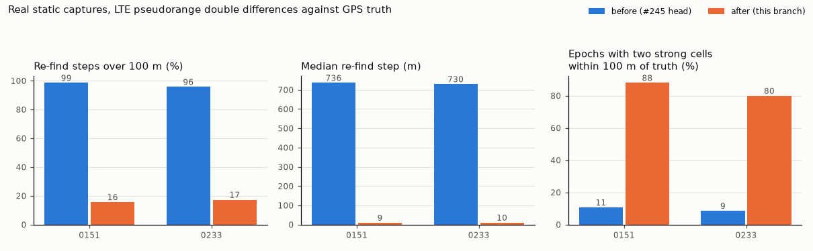

# LTE re-acquisition steps and doppler aliases (#183, #214)

Evidence: **real static sessions** `20261111-0151-static-fullsuite2` (600 s) and `20261111-0233-static-lte-1h` (1 h), one NESDR (`sdr_a`), EARFCN 2460. Before: the front end at `09e7fbd` (#245 head). After: `ea72f6a` (this branch's front end). Truth: the mean of the session's GPS fixes (the receiver does not move). Every number is a double difference (DD) of two cells at one 0.1 s epoch after removing each one's true range, which cancels our dongle clock (definitions of `real-lte-root-cause-20261111`). Errors and residuals only.



## The cause

Not a CP or symbol-boundary offset, and not quantised: the ~700 m "re-acquisition" steps were the **first-path check** (`_Track._earlier_path`). 87 to 93 % of the new arcs were first-path moves (351 of 378 on 0151, 1,778 of 2,036 on 0233), each 1.6 to 7.6 samples earlier; their median, about 4.5 samples, is the middle of the 4 µs search window.

- A cell that fades below its co-timed neighbours keeps passing the 8 dB detect gate: the reserved-bin noise does not see the neighbours' PSS and SSS, which correlate with its sequences at every delay. Averaging does not lower that floor (it is static), and the check's only test that still binds, 4× the reserved-bin noise, passes on it. The track then moved earlier every 200 ms (PCI 92 on 0151: 46 samples earlier in 9 s, 10 arcs) until lost, and the periodic search re-found it 66 to 127 samples from where it had walked to.
- At moderate SNR the check moved PCI 92 -2.4 samples onto its own path's skirt, which the code gate cannot track: it slid back, was re-found on the old path, and moved again (4 times in 7 s on 0151).
- PCI 244 and 220 (#214: "2.5 to 11.9 km off, likely false locks") were these walks. After the fix they agree with truth: DD within 100 m on 61 to 100 % of epochs against PCI 92 and 204.

A second, smaller cause on 0233 (seen once the walks stopped): a cell re-found 12 samples early, beyond `max_path_jump_us`, was sized as a 19,188-sample drop although the host stamps showed no stall. That gap moved every other cell by 12 samples (1.9 km) for the rest of the hour.

## The fix

1. `first_path_floor` (TBC, 10): an earlier path must clear 10× the profile's interference floor (median of the whole delay grid / ln 2), and be the largest value within the code gate around it.
2. Stamps that cover the stretch and show no stall rule a drop out: the re-find is a path move (new arc), not a gap. Without stamps, nothing changes.
3. Doppler records are opt-in (`Config.doppler`, off by default, TBC). The carrier is only known modulo the half-frame rate, and a whole 100 Hz alias fits as well if subframes 0 and 5 reach us with different phases (a synthetic 2.8 rad offset put the loop 90 Hz off). Nothing checks the record against the code rate. Resolving it was tried (10 ms same-subframe aiding with a 12.5 Hz lock threshold): it worked on the synthetic case, but delayed aiding past 1 s at 0 dB and was not checked on a real capture, so it is not in this branch. Turning the records off is the smallest honest change; the sim's front-end-shaped records carry pseudoranges only already.

## Before → after (`summary.json`)

| | 0151 before | 0151 after | 0233 before | 0233 after |
|---|---|---|---|---|
| New arcs (first path / re-search / search) | 378 (351 / 19 / 8) | 53 (2 / 46 / 5) | 2,036 (1,778 / 192 / 66) | 197 (13 / 159 / 25) |
| Re-find steps (DD, one cell's new arc) | 402 | 64 | 1,764 | 192 |
| Re-find step median | 736 m | 9.4 m | 730 m | 10.1 m |
| Re-find step p90 | 1,125 m | 1,033 m | 1,140 m | 462 m |
| Re-find steps > 100 m | 98.5 % | 15.6 % | 95.7 % | 17.2 % |
| Epochs with two cells ≥ −8 dB, DD within 100 m | 10.6 % | 88.0 % | 8.5 % | 79.9 % |
| Doppler differences on a 100 Hz alias (non-zero) | 68.6 % (49.4 %), told 0.10 m/s | none emitted | 72.4 % (52.1 %), told 0.09 m/s | none emitted |

On 0233 with fix 1 alone (run at `656827a`): 61.6 % of epochs with two strong cells within 100 m; fix 2 lifts it to 79.9 %.

## GPS cut (pseudoranges only), median (worst) error in m

Replay of each session with GNSS cut in software (`analysis/real_gps_cut.py` at `f15ba13`, `origin/shrikar/integration/20261111`, read-only; driver `gps_cut.py`). Cuts: 100 to 300 s by 50 s (0151), 600 to 3,000 s by 600 s (0233), the cuts of `real-lte-root-cause-20261111`. `B` = `ekf-measured-sigma` (#147). The before rows match that run's table.

| | 0151, 60 s | 0151, 300 s | 0233, 60 s | 0233, 300 s |
|---|---|---|---|---|
| no LTE | 0.2 (3.2) | 0.6 (15.9) | 0.5 (0.7) | 1.3 (3.2) |
| `ekf`, before | 4,722 (8,254) | 7,857 (9,277) | 173 (700) | 1,726 (5,092) |
| `ekf`, after | 9,792 (12,712) | 21,553 (29,463) | 5,813 (76,990) | 10,718 (98,706) |
| `B`, before | 0.2 (355) | 3,658 (10,034) | 48 (332) | 1,638 (12,145) |
| `B`, after | 94 (299) | 205 (5,130) | 101 (917) | 1,513 (4,655) |

- `B` improves at 300 s (0151: 3,658 → 205 m median; worst 12.1 → 4.7 km on 0233) but **LTE still does not beat no-LTE** on a static receiver, and B's HPL bounds the error on 65 % (0151) and 49 % (0233) of withheld fixes.
- The default `ekf` gets **worse**: GNSS is excluded on 100 % (0151) and 28 % (0233) of epochs before the cut. With more cells tracked at their own timing, more records are told 1 to 5 m while their DD still carries tens of metres (pair medians up to 45 m). The gate latch of #214 §3 is a filter issue, not fixed here.

## What is left

- Steps > 100 m on 16 to 17 % of re-finds (p90 0.5 to 1 km), mostly from the re-search (`_relocate`) and periodic search; not diagnosed.
- DD pair medians of 1 to 45 m against a told σ of a few metres at high SNR: multipath or tower frame offsets; ADR-0036's σ does not cover them.
- More sized gaps after the fix on 0233 (22 against 11, none ambiguous): whether those drops are real is `TBD`, as before.

## Commands

```bash
S=data/sessions
# per capture, at each commit (worktree's own src)
PYTHONPATH=<worktree>/src python analysis/results/lte-reacq-steps/reacq.py run $S/<session>/sdr_a.cu8 <x>.pkl
python analysis/results/lte-reacq-steps/reacq.py score $S/<session> <before>.pkl <after>.pkl --out <score>.json
PYTHONPATH=src python analysis/results/lte-reacq-steps/reacq.py session $S/<session> <x>.pkl <x>-lte --commit <c>
# GPS cut, in a worktree at f15ba13
PYTHONPATH=<it>/src python analysis/results/lte-reacq-steps/gps_cut.py --cut-script <it>/analysis/real_gps_cut.py \
    before-0151=<b-0151-lte> after-0151=<c-0151-lte> before-0233=<b-0233-lte> after-0233=<c-0233-lte> \
    --lte-only after-0151 after-0233 --out <gpscut>.json
python analysis/results/lte-reacq-steps/figure.py
```

`summary.json` was assembled from the score and GPS-cut JSONs by hand (a few lines, not committed).
