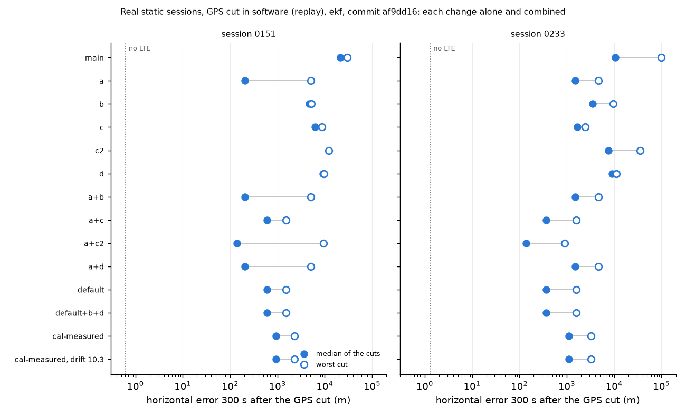

# Real LTE records in the EKF: each change alone and combined (#214, #246, ADR-0050)

Evidence: **replay of two real static sessions, GPS cut in software** (`20261111-0151-static-fullsuite2`, 600 s; `20261111-0233-static-lte-1h`, 1 h), #245's front end (`ea72f6a`, records as in `lte-reacq-steps`), LTE pseudoranges only. Script `analysis/real_lte_filter.py` at the commit in `summary.json`. Truth: the withheld GPS fixes. Errors only: no position, range or bearing.



Cuts: 100 to 300 s by 50 s (0151), 600 to 3,000 s by 600 s (0233). Median (worst) of the five cuts, m. Full table: [`summary.md`](summary.md).

| | 0151, 60 s | 0151, 300 s | 0233, 60 s | 0233, 300 s | HPL ≥ error (0151 / 0233) | GNSS excluded before the cut |
|---|---|---|---|---|---|---|
| no LTE | 0.2 (3.2) | 0.6 (16) | 0.5 (0.7) | 1.3 (3.2) | 100 % / 100 % | 0 % / 0 % |
| `main` | 9,792 (12,712) | 21,553 (29,463) | 5,813 (76,990) | 10,718 (98,706) | 0 % / 14 % | 100 % / 28 % |
| a | 94 (299) | 205 (5,130) | 101 (917) | 1,513 (4,655) | 65 % / 49 % | 0 % / 0 % |
| b | 596 (941) | 4,710 (5,192) | 844 (1,138) | 3,524 (9,493) | 16 % / 21 % | 0 % / 1 % |
| c | 8,111 (10,735) | 6,253 (8,592) | 1,887 (2,678) | 1,680 (2,429) | 0 % / 2 % | 100 % / 96 % |
| c2 | 6,987 (9,690) | 12,031 (12,211) | 3,035 (20,852) | 7,600 (35,015) | 0 % / 31 % | 100 % / 26 % |
| d | 7,899 (8,239) | 9,171 (9,752) | 8,355 (9,383) | 8,992 (11,130) | 0 % / 27 % | 100 % / 31 % |
| a+b, a+d | = a | = a | = a | = a | = a | = a |
| **a+c = this branch's `ekf`** | **137 (249)** | **595 (1,536)** | **53 (504)** | **364 (1,582)** | **76 % / 75 %** | **0 % / 0 %** |
| a+c2 | 93 (220) | 138 (9,298) | 89 (836) | 137 (900) | 73 % / 58 % | 0 % / 0 % |

- a: ADR-0036's σ for a real capture's records (default here). b: GNSS re-admission (opt-in). c: a bias per new arc (default here for a real capture). c2: a new arc's first 5 s told 10 × σ (opt-in). d: a heard cell bounds the position to 10 km of its site (opt-in).
- **a** removes the GNSS latch (#246) on both sessions and is most of the gain. **c** on top halves to thirds the worst run and lifts the HPL bound rate to 75 %. **b** removes the latch alone but leaves kilometres; with a it never fires here. **d** binds only beyond 10 km.
- No variant beats no LTE on a static receiver, and the HPL still misses a quarter of the fixes.
- `ekf-imu` equals `ekf` here: a static receiver never aligns its IMU.
- `ekf-calibrated-measured` (not changed by this branch) gives 936 (2,290) m on 0151 and 1,108 (3,265) m on 0233 at 300 s. Its tower drift prior at 10.3 m/s instead of 6.6 m/s (the post-#245 inter-eNB value with both cells ≥ −8 dB; a proposal, ADR-0043 unchanged) gives 943 (2,289) and 1,108 (3,265): the result is not sensitive to it.

## Does re-admission (b) let a spoof in? (sim)

`analysis/readmit_attacks.py` at `af9dd16`, seeds 0 and 1, `ekf`, `ekf-imu`, `ekf-guard`, `ekf-imu-guard`, `ekf-calibrated-guard`, each as registered and with `gnss_readmit` ([`readmit_attacks.json`](readmit_attacks.json)). Sim, LTE model `placeholder`.

- `spoof-jump`, `meaconing`, `gps-outage`, `challenge-drone-spoof-ramp`, `challenge-drone-meaconing`: no re-admission from the fault on; every metric equal.
- **`spoof-ramp`: re-admitted once in two runs** for every family but `ekf-calibrated-guard`. Misleading epochs per run 1,441 → 2,060 (`ekf`, `ekf-guard`) and 2,026 (`ekf-imu`, `ekf-imu-guard`); hazardous 1,204 → 1,823 and 1,789. The towers there are told their true σ, so the tower test alone did not hold it, and the IMU velocity check did not stop it.
- **`challenge-drone-spoof-jump`, `ekf-imu`: re-admitted once**; misleading epochs per run 2,144 → 2,490.

So (b) reopens the slow-spoof hole: it is not fit to be a default, and its opt-in use needs the owners' call.

## Sim defaults unchanged

Every estimator registered on `main` (18), hashed (`pos_enu`, `pos_cov`, `hpl_m` of every estimate) on `challenge-drone-outage`, `challenge-approach-outage`, `challenge-timing-outage`, `gps-outage`, `realistic-long-outage`, `meaconing`, `spoof-jump` and `spoof-ramp`, seeds 0 and 1: **288 of 288 identical** between `main` at `c97e09a` and this branch at `af9dd16`. `challenge-drone-hop-outage` was not compared on this base: one hop run takes about 13 min per estimator, so both sides need about 80 min each. Before the last rebase, `main` at `8892fca` hashed it (all 36 entries), and its records carry no `sample_index`, like the drone leg's.

## Commands

```bash
S=<sessions>  # the #245 records of each session, as lte-reacq-steps made them
python analysis/real_lte_filter.py 0151=$S/c-0151-lte 0233=$S/c-0233-lte --jobs 3 \
    --out analysis/results/real-lte-filter/summary.json
python analysis/readmit_attacks.py --seeds 0-1 --jobs 3 --out <attacks>.json
```
