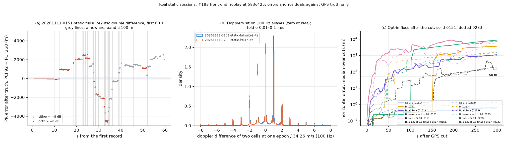

# Root cause: LTE pulls the real static sessions kilometres away after a GPS cut (#214)

Evidence: **replay of two real static sessions** (`20261111-0151-static-fullsuite2`, 600 s; `20261111-0233-static-lte-1h`, 3,600 s), GPS cut in software, #183's front end. Numbers from [`summary.md`](summary.md) (driver [`root_cause.py`](root_cause.py), run at `583e425` of the local branch `tmp/rcreal-run` = `tmp/e2e-combined` de888ca + this driver; never pushed). Truth is the session's GPS mean. Errors and residuals only.

## The cause, in one line

The front end's LTE records carry almost no position information that is right: a cell's track re-acquires about 700 m away from where it was (even at high SNR), its dopplers sit on 100 Hz aliases, and two cells are both strong and right at once on only 9 to 11 % of epochs. The filter is told the records are good to a few metres (pseudoranges) or 0.01 to 0.1 m/s (dopplers). After the cut, the record it lets in moves the position, and the constant-velocity model keeps the velocity it was given.

## 1. Pseudoranges against truth (our dongle clock cancelled by differencing two cells)

- **The table's sites are right for PCI 92, 268 (both sessions) and 204 (1 h).** When both cells are ≥ −8 dB the double difference (DD) has a median of 3.2 m (92 − 268, 0151), 4.8 m (92 − 268, 0233), −11.5 m (92 − 204) and 13.9 m (204 − 268). On the first arcs, before any re-acquisition, 92 − 268 sits at −7.6 m (span 82 m, 0151) and −0.9 m (span 53 m, 0233). These towers are frame-aligned to within tens of metres. **A wrong site is not the cause.**
- **PCI 244 (eNB 30066) and PCI 220 (on 0233) never agree with truth:** their DD medians are 2.5 to 11.9 km, with a robust σ of 1 to 8 km and no epoch within 100 m. On a 1 to 8 km scatter, matching another eNB would mean nothing (not tested). #242 found PCI 220 consistent with eNB 36122 on another session, so the more likely cause is a false lock, not a wrong site. In the 1 h session PCI 220 and 204 are sectors of the same eNB, yet their DD median is 17.5 km.
- **Steps at re-acquisition, not offsets or drift.** When one cell of a pair starts a new arc, the DD jumps by a median of 708 m (0151) and 733 m (0233), and 95 to 99 % of these jumps exceed 100 m. With both cells ≥ −8 dB the median is still 606 to 644 m. Panel (a): 92 − 268 holds within about 60 m for the first 12 s at SNR 5 to 8 dB. It then steps to +965 m at the first common re-acquisition, and then to ±2 to 4 km.
- **Inside an arc at high SNR** the DD wanders tens of metres in seconds (−59 m by 10 s on 0151), against a told σ for the DD of 6.7 to 12 m.
- **Coverage:** two cells ≥ −8 dB together on 25 % (0151) and 21 % (0233) of epochs. Both strong and within 100 m of truth: 11 % and 9 %. Only those epochs carry position information once GPS is gone.

## 2. Dopplers: 100 Hz carrier aliases told as 0.1 m/s

At rest, two cells' dopplers at one epoch should differ by zero: both carry our dongle's drift. In fact:

- 68 % (0151) and 71 % (0233) of the differences fall within 3 % of a whole multiple of 34.26 m/s (100 Hz at 875 MHz). A uniform spread would give 6 %.
- 49 to 51 % fall on a non-zero multiple, and only 19 to 20 % are within 1 m/s of zero.
- The told σ is 0.09 to 0.10 m/s (median), against a robust σ of 51 m/s for the differences (panel b).

One such record moves the velocity by tens of m/s, which is kilometres after a minute. This is why `PR+doppler` excludes GNSS before the cut and starts the coast 4 to 5 km off (#214 combined table).

## 3. The 100 % GNSS exclusion on 0151 (default `ekf`, #183 records, pseudoranges only)

- **Mechanism:** an early gate latch, not a tiny σ on one record.
  - For the first 12 s, #183's front end tracks PCI 92 and 268 together at SNR 6 to 6.5 dB, told σ 2.6 and 4.3 m (median). The default EKF takes the pair's difference as near-truth.
  - Tower clocks may only random-walk at 0.2 m/√s. The DD wanders by tens of metres (above), so the position absorbs it: LTE moves it 14.3 m (PCI 268) and 1.8 m (PCI 92) before 10 s.
  - At 10.0 s the GNSS fix (told σ 5.4 m, filter σ 4.2 m) gives a NIS of 42.6, over the 16.3 gate. It is rejected, and so are all 290 fixes until the cut: the two LTE cells keep the filter's σ near 4 m, so the gate never reopens.
- **Old front end:** with c21e047's records the same run never rejects GNSS. There PCI 268 is ≥ −8 dB on 9 % of records (41 % with #183) and its smallest told σ is 4.25 m (1.30 m with #183). There was no second strong, tightly told cell at the start.
- `B` (ADR-0036 σ) avoids it on both sessions: 0 % excluded.

## 4. After the cut (`B`, pseudoranges only)

- **0151 (cut 200 s): the gate has locked every cell out long before the cut.** It last uses PCI 268 at 12.3 s, 92 at 27.6 s and 204 at 59.4 s: each one's first ~1 km re-acquisition step is more than its tower clock (0.2 m/√s) can follow. After the cut it uses none of their 5,175 records.
  - The only cell it uses is PCI 244, first heard after the cut. It gets a fresh clock and cannot be checked against anything. It is the cell that never agrees with truth, and it moves the position 1,243 m net (4,011 m summed).
  - The constant-velocity coast then runs away with no further updates: about 22 m/s on the 250 s cut.
- **0233 (cut 1,800 s):** the cells are readmitted between steps. In the 300 s after the cut, PCI 92 moves the position 525 m net (2,100 m summed), 268 366 m (2,081 m) and 204 107 m.
- **Do the tower clocks absorb the steps?** No. With q = 0.2 m/√s they cannot, so a step either locks the cell out (0151) or goes into position (0233). Loosening q does not help (below): a clock free enough to absorb a 700 m step also absorbs the position information.

## 5. Opt-in fixes (driver only, nothing under `src/` changed)

None keeps LTE-aided within 50 m at 300 s. `no LTE` gives 0.6 m (0151) and 1.3 m (0233) median; worst 16 m and 3 m.

| Fix | 0151, 300 s median (worst) | 0233, 300 s median (worst) | What it shows |
|---|---|---|---|
| `B` as is | 3,658 (10,034) | 1,638 (12,145) | baseline |
| drop cells bad against truth (uses truth) | 5,521 (11,218) | 1,307 (12,144) | the good sites' own steps are enough |
| new arc = new bias (`arc_bias`) | 1,947 (2,209) | 5,074 (5,525) | lowers the worst on 0151, worse elsewhere, HPL bounds 23 to 41 % |
| tower clock q 0.02 / 2 / 20 m/√s | 3,657 / 3,800 / 8,588 | 1,469 / 1,645 / 1,609 | no setting helps |
| 1 Hz instead of 10 Hz | 4,352 (6,969) | 518 (1,906) | helps on 0233 only |
| ≥ −8 dB only | 3,667 (9,917) | 979 (4,420) | the cut is not the problem: strong records step too |
| keep only epochs with two cells ≥ −8 dB | 6,191 (6,963) | 246 (5,283) | half of those pairs are km off |
| all four (≥ −8 dB, 1 Hz, truth-good cells, arc bias) | 1,105 (4,170) | 1,026 (1,723) | HPL then bounds 98 to 100 % (honest, but km) |
| told σ × 10 | 6,910 (14,054) | 5,850 (8,501) | **worse**: the χ² gate is what keeps the bad records out; widening σ lets them in |
| `q_accel` 0.1 (near-static prior) | 147 (869) | 198 (861) | the CV velocity integrates the errors; not a fix for a drone |

**No fix in the filter's settings works**, so nothing is implemented in `src/`. The records are wrong at the 700 m (pseudorange) and 34 m/s (doppler) scale far more often than they are right. A filter setting can only choose between ignoring them and being pulled by them.

## What would fix it (each needs its own issue or ADR, not decided here)

- **Front end (#183):**
  - Find why a re-acquired track lands about 700 m (about 4.5 samples at 1.92 MS/s) from the old one, even at high SNR.
  - Flag or drop dopplers that are off by a multiple of the 100 Hz alias, or tell them a σ that covers it.
  - Report lock loss instead of reporting through it.
- **Filter guard:** use a cell after the cut only while it agrees with another cell at the same epoch (a DD check). A single cell with a fresh clock (PCI 244 on 0151) should not move the position at all.
- **Gate latch:** a GNSS rejection that is never undone (0151) is the same latch #184's jump guard handles for GNSS jumps. Tight LTE should not be able to lock GNSS out.

## Not checked

- Whether PCI 244 and PCI 220 are another eNB or a false lock. Their DD scatters by 1 to 8 km, so a site test is ill-posed.
- The front end's code: why re-acquisition steps by about 700 m.
- A moving receiver, and the IMU. Both sessions are static, so `no LTE` is right by construction.
- The 1 h session's grid uses 5 of the combined run's 11 cuts (600 to 3,000 s every 600 s), to stay within the run budget. The cuts share one recording and are not independent draws.
