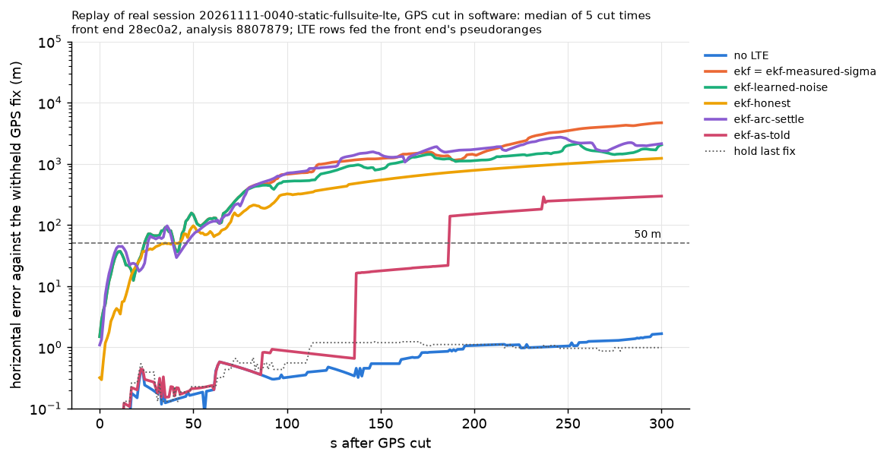
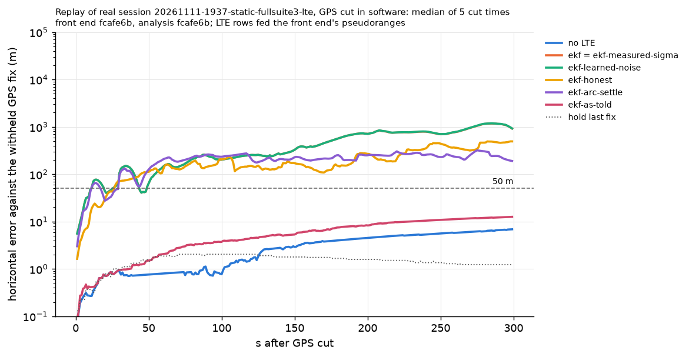

# Our opt-in LTE filters on a real session with GPS cut in software (#256)

**Real, one stationary session:** `20261111-0040-static-fullsuite` (about 600 s; GPS fixes, barometer, IMU, one LTE radio's IQ). GPS removed in software at 99, 149, 199, 249 and 299 s; each cut scored for 300 s against the withheld 1 Hz GPS fixes (1,505 fixes in all). Front end at `d02d16e` (its `src/pnt/frontends` equals `main` `c526b9e`, so it includes #245): 12,581 pseudoranges, 5 cells, 34 arcs. Analysis at `2fbb84f`, clean tree. Sessions `0151` and `0233` were not reachable and nothing was substituted. The five cuts share one recording: differences between rows describe these runs, not a general improvement.



| Row | What the filter does with real LTE records | Error at 120 s, median (worst) m | Error at 300 s, median (worst) m | Fixes with error above HPL | LTE updates accepted / ungated / rejected | Beats no LTE |
|---|---|---|---|---|---|---|
| no LTE | IMU and barometer only | 0.4 (2.0) | 1.7 (3.2) | 0 % | – | – |
| `ekf` (default on `main`) | sigma retold to ADR-0036 (77.5 m), a bias per new arc (ADR-0050) | 1,001 (1,616) | 4,689 (5,193) | 41.3 % | 43,554 / 122 / 342 | no |
| `ekf-measured-sigma` | identical to `ekf` on real records since #267 | 1,001 (1,616) | 4,689 (5,193) | 41.3 % | identical | no |
| `ekf-learned-noise` (#156) | learned noise starting from the retold sigma | 701 (1,349) | 2,046 (3,323) | 33.3 % | 36,223 / 122 / 252 | no |
| `ekf-honest` (#251) | plus a slow error state per cell | 381 (849) | 1,229 (3,262) | **0 %** | 7,502 / 122 / 2 | no |
| `ekf` + `arc_settle_s=5` | ADR-0050's opt-in settling sigma | 872 (1,467) | 2,133 (4,845) | 37.7 % | 43,550 / 122 / 346 | no |
| `ekf-as-told` (reference) | `ekf` before #267: the front end's own sigma, no arc bias | 0.7 (575) | 296 (980) | 0 % | 125 / 6 / 43,887 | no |

- **No LTE row beats no LTE, and none meets T1 or the 50 m fallback.** No LTE and "hold the last fix" meet both, because the receiver does not move.
- **HPL.** `ekf-honest` is the only LTE-using row whose HPL is above the error at every withheld fix, but its bound is 3.2 km at 120 s and 9.4 km at 300 s (no LTE: 4.2 and 16.3 km): honest, not usable. The default `ekf` is overconfident: HPL about 1.3 km at 300 s, error above it on 41.3 % of fixes.
- `ekf-as-told` looks good only because it rejects 99.7 % of LTE updates after the cut; before the cut it excludes GNSS on 30 % of epochs (#246).

## Against `main`'s committed results

`f92af3a`'s front end and script on the same IQ reproduce `main`'s committed `0040` results (largest raw difference 0.044 m). `ekf`, error at 300 s, median (worst), m:

| | filter before #267 | filter after #267 |
|---|---|---|
| front end before #245 | 1,426 (2,813), as committed | 3,137 (6,356) |
| front end after #245 | 296 (980) | 4,689 (5,193), `main` now |

On this session #245 helps the old filter, and #267's defaults make the result worse.

## Why the filters do not help (`diagnosis.json`)

1. **Range errors are several times larger and slower than modelled.** Double differences against truth (our clock cancels) spread 30 to 147 m within one arc pair and wander 171 to 437 m end to end, with slopes up to 11 m/s. ADR-0036's correlated part is 10 m over 3 s. Treated as white, the error is averaged down and the estimate walks: median speed 8 to 27 m/s on a receiver that does not move.
2. **Too few cells.** A 2-D fix from LTE alone needs 3 cells. After the cuts at 99 to 199 s, 3 or more are heard in 17 to 21 % of seconds (median: 1 cell).
3. **The learner learns too small a noise.** While GPS is trusted the tower clock states absorb the slow error, so `ekf-learned-noise` learns 15 to 31 m for the two main cells, below the retold 77.5 m. `ekf-honest` holds 72 to 133 m, which is why its HPL holds.
4. **Arc restarts:** 29 after #245, 18 of them 70 m or less; at 61.6 s and 62.6 s both strong cells step by the same amount with no `sample_gap` flag (our own timing), and the per-arc bias resets both cells at once.
5. **Clock:** every row uses the dongle's own clock block; `ekf-honest`'s receiver-clock switch changes nothing for these records.

## What would help (nothing was tuned or tried on this session)

An error model sized from real double differences, as a state per cell (`ekf-honest`'s form; its size and time constant need more than one session); more cells (a second carrier, hopping, ADR-0040); a front-end flag for shared timing steps; a learner that does not shrink while clock states can absorb the slow error. Otherwise the owners' existing option stands: keep real LTE out of the default solution until a moving session decides.

## Not checked

Sessions `0151`, `0233`; any moving session; 50 paired runs; `ekf-imu` and `ekf-calibrated` rows; whether tower identities are right; the cause of the unflagged shared timing step; `just qa`'s sim and plot smoke.

## Commands

```bash
pnt frontend lte data/sessions/20261111-0040-static-fullsuite/sdr_a.cu8 --out data/sessions/20261111-0040-static-fullsuite-lte
python analysis/real_gps_cut.py data/sessions/20261111-0040-static-fullsuite-lte --cuts 99 149 199 249 299 --rows filters --jobs 3 \
  --out analysis/results/real-replay-256/20261111-0040-static-fullsuite --runs-out analysis/results/runs/real-replay-256/20261111-0040-static-fullsuite
python analysis/real_replay_diagnose.py data/sessions/20261111-0040-static-fullsuite-lte --out analysis/results/real-replay-256/20261111-0040-static-fullsuite/diagnosis.json
```

## Second session: `20261111-1937-static-fullsuite3` (recorded 2026-11-12 UTC, #282)

Real, stationary, 600 s, same commands, analysis at `2fbb84f`, front end as above: 18,572 pseudoranges, 4 cells, 3 or more cells heard in 77 % of seconds (17 to 21 % on `0040` after its early cuts). Same five cuts, 1,500 withheld fixes. The error at exactly 300 s is not scored on this session: even with #264's nearest-fix rule (now on `main`), no withheld fix inside the scored window lies within 0.5 s of that instant (cause not examined), so the 0–300 s p95 is given instead. GPS error estimates in this session's records are inflated (#284).



| Row | Error at 120 s, median (worst) m | p95 over 0–300 s, worst cut, m | Fixes with error above HPL | Beats no LTE |
|---|---|---|---|---|
| no LTE | 1.6 (9.6) | 19.3 | 0 % | – |
| `ekf` (default, = `ekf-measured-sigma`) | 255 (1,246) | 2,586 | 26.9 % (403 of 1,500) | no |
| `ekf-learned-noise` | 255 (1,247) | 2,589 | 26.7 % (401) | no |
| `ekf-honest` | 150 (326) | 696 | **0 %** | no |
| `ekf` + `arc_settle_s=5` | 217 (433) | 728 | 3.7 % (55) | no |
| `ekf-as-told` (before #267) | 4.5 (9.6) | 19.3 | 0 % | no |

- **Same picture as `0040`:** no LTE row beats no LTE; `ekf-honest` is again the only row that uses LTE updates and whose HPL covers every withheld fix; the default is overconfident (26.9 % of fixes).
- With four cells and a 3-cell fix available most of the time, the tower-aided error is several times smaller than on `0040` (255 m against 1,001 m at 120 s for the default), and learned noise makes no difference here.
- `ekf-honest` learns 63 to 112 m per cell; `ekf-learned-noise` 15 to 39 m.
- Across both sessions: error above HPL on 1,025 of 3,005 withheld fixes (34.1 %) for the default, 0 of 3,005 for `ekf-honest`.

## Before the rebase

Both sessions were first run at the pre-rebase twins of `2639cd1` (`0040`) and `a6c28c9` (`1937`), on a branch that carried copies of #156 and #251. Re-run after the rebase onto `main` `5cf9cd6` (which adds ADR-0045's GNSS-height fallback, #289's GNSS σ from eph and #264's nearest-fix scoring) with the same commands: every field of both `summary.json` and `diagnosis.json` files is identical except the commit, so no number above moved. The pooled count stands: error above HPL on 1,025 of 3,005 withheld fixes for the default, 0 of 3,005 for `ekf-honest`.
