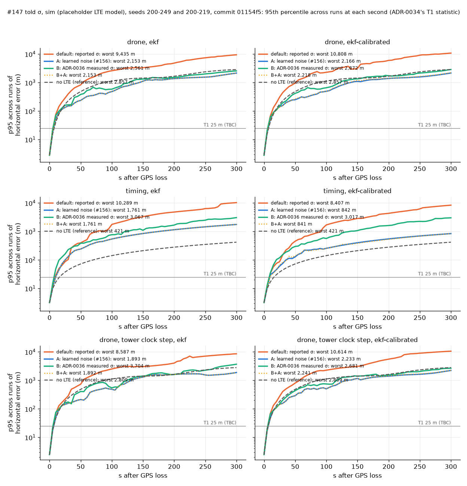
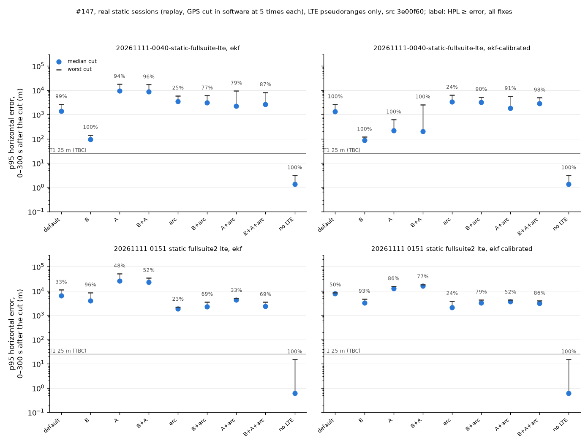

# What should the filter believe about a radio's LTE records? (#147)

Fixes for an optimistic reported σ, compared on the same records. Each is run for `ekf` and `ekf-calibrated`, and every value is `TBC`.

- **A:** learn each cell's range noise from its innovations (ADR-0039, #156).
- **B:** tell the filter ADR-0036's measured σ from each record's SNR (`nav/told_sigma.py`, ADR-0044).
- **B+A:** both.
- **arc:** a cell's new front-end arc gets its own range bias (`arc_bias`), alone and with each of the above. Real replay only: the sim's arcs never change, so there it equals its base by construction (`tests/test_arc_bias.py`).
- **default:** the reported σ, 2 m in the sim.
- **no LTE:** a reference.

**Where the numbers come from.** Branch `shrikar/cmp/147-comparison` on `origin` is #156 rebased onto `main` `c21e047` plus #147's commits. #156 is not on `main`, so these trees are not either.
- Sim: `src/` at `01154f5`. Its #147 commits are on `main`, the last as `aca3a83`.
- Real replays: `src/` at `3e00f60`, the branch head: `01154f5` plus `arc_bias`, which is `fa6bd4f` on `main` less one line for #156's curvature term. The cut is #214's `analysis/real_gps_cut.py` at `ad45c1c`.
- The defaults, B and arc need only #147's commits, now on `main`; A needs #156's code as well.
- On both trees every default estimator hashes the same as on `main` (PR text).
- `analysis/told_sigma_147_report.py` draws the figures and `tables.md` from the JSON beside them.

```bash
python analysis/told_sigma_147.py --legs challenge-drone-outage challenge-timing-outage \
    --seeds 200-249 --jobs 3 --out <dir> --tag=-t1          # 20 min wall, 3 workers
python analysis/told_sigma_147.py --legs challenge-drone-outage-tower-clock-step \
    challenge-drone-spoof-jump --seeds 200-219 --jobs 3 --out <dir> --tag=-other   # 15 min
python analysis/told_sigma_147_real.py <sessions>/20261111-0151-static-fullsuite2-lte \
    --cut-script <#214>/analysis/real_gps_cut.py --with-doppler --jobs 3 --out <dir>
python analysis/told_sigma_147_real.py <sessions>/20261111-0040-static-fullsuite-lte \
    --cut-script <#214>/analysis/real_gps_cut.py --cuts 99 149 199 249 299 --jobs 3 --out <dir>
python analysis/told_sigma_147_report.py <dir> --out analysis/results/told-sigma-147
```

**Seeds (reduced).** The drone and timing legs use sim seeds 200–249; the tower-clock-step and spoof-jump legs use 200–219. None of them was used to tune A (100–149) or B (none). The sim's LTE model is `placeholder` (`verification.md`, *Sim validity*): 50 m white and 50 m / 30 s multipath per eNB, records told 2 m, arcs never broken. These numbers compare the variants with each other and do not predict a flight.

**Real sessions.**
- Two static sessions on the ground at one site, EARFCN 2460, 10 Hz records after `pnt frontend lte`.
- GPS is cut in software five times per session, and each run is scored against the fixes the filter no longer sees.
- The cuts share one recording, so they are not independent runs.
- A static receiver favours `no LTE` and the held last fix: dead reckoning from a stopped vehicle stays put.
- The front end restarts a cell's arc often, and the range steps there: #214 counts 90 of 103 new arcs at SNR ≥ −8 dB more than 100 m from the cell's last record (median 874 m).
- Only errors are given here: no position, origin, range or bearing.



*Sim (`placeholder` LTE model), `01154f5`. The drone and timing legs use seeds 200–249, the tower-clock-step leg 200–219. Each line is ADR-0034's T1 statistic: the 95th percentile across runs at each second. B+A (dotted) lies on A for `ekf`.*



*Replay of two real static sessions, GPS cut in software at 5 times each, LTE pseudoranges only, `src/` at `3e00f60`. The label above each variant is its HPL bound rate over every withheld fix.*

### Sim: drone, timing — seeds 200-249, commit `01154f5`

| Leg | Filter | Variant | T1 worst-second p95 (m) | median run 300 s p95 (m) | NEES median / p95 | HPL bound mean / worst run | misleading (runs) | hazardous (runs) | false alarms /h | T3 600 s time p95 median (µs) |
|---|---|---|---|---|---|---|---|---|---|---|
| drone | ekf | default | **9,435** | 3,738 | 270 / 2,022 | 0.67 / 0.09 | 799 (7) | 720 (7) | 3.3 | 0.3 |
| drone | ekf | A | **2,153** | 656 | 7.4 / 29.0 | 0.95 / 0.63 | 0 (0) | 0 (0) | 0.6 | 0.3 |
| drone | ekf | B | **2,561** | 677 | 48.5 / 194 | 0.67 / 0.29 | 73 (3) | 43 (3) | 4.2 | 0.3 |
| drone | ekf | B+A | **2,153** | 656 | 7.4 / 29.0 | 0.95 / 0.63 | 0 (0) | 0 (0) | 0.6 | 0.3 |
| drone | ekf | no LTE | **2,857** | 2,503 | 2.0 / 2.4 | 1.00 / 1.00 | 0 (0) | 0 (0) | 0.0 | 0.3 |
| drone | ekf-calibrated | default | **10,808** | 3,653 | 75.4 / 579 | 0.65 / 0.02 | 109 (2) | 69 (2) | 3.2 | 0.1 |
| drone | ekf-calibrated | A | **2,166** | 731 | 2.0 / 6.4 | 1.00 / 0.86 | 0 (0) | 0 (0) | 0.1 | 0.1 |
| drone | ekf-calibrated | B | **2,872** | 792 | 14.8 / 59.4 | 0.82 / 0.44 | 31 (1) | 31 (1) | 3.7 | 0.1 |
| drone | ekf-calibrated | B+A | **2,218** | 701 | 2.0 / 7.2 | 1.00 / 0.93 | 0 (0) | 0 (0) | 0.1 | 0.1 |
| drone | ekf-calibrated | no LTE | **2,857** | 2,503 | 2.0 / 2.4 | 1.00 / 1.00 | 0 (0) | 0 (0) | 0.0 | 0.1 |
| timing | ekf | default | **10,289** | 2,743 | 104 / 2,227 | 0.76 / 0.05 | 93 (9) | 85 (9) | 3.1 | 0.3 |
| timing | ekf | A | **1,761** | 552 | 0.7 / 6.9 | 0.99 / 0.74 | 0 (0) | 0 (0) | 0.0 | 0.3 |
| timing | ekf | B | **3,067** | 980 | 25.9 / 225 | 0.84 / 0.47 | 178 (5) | 158 (4) | 3.1 | 0.3 |
| timing | ekf | B+A | **1,761** | 552 | 0.7 / 6.9 | 0.99 / 0.74 | 0 (0) | 0 (0) | 0.0 | 0.3 |
| timing | ekf | no LTE | **421** | 212 | 0.0 / 0.1 | 1.00 / 1.00 | 0 (0) | 0 (0) | 0.0 | 0.3 |
| timing | ekf-calibrated | default | **8,407** | 2,632 | 16.5 / 215 | 0.78 / 0.17 | 0 (0) | 0 (0) | 2.9 | 0.1 |
| timing | ekf-calibrated | A | **842** | 239 | 0.1 / 0.9 | 1.00 / 1.00 | 0 (0) | 0 (0) | 0.0 | 0.1 |
| timing | ekf-calibrated | B | **3,017** | 1,022 | 12.7 / 89.1 | 0.91 / 0.51 | 0 (0) | 0 (0) | 2.9 | 0.1 |
| timing | ekf-calibrated | B+A | **841** | 242 | 0.1 / 0.8 | 1.00 / 1.00 | 0 (0) | 0 (0) | 0.0 | 0.1 |
| timing | ekf-calibrated | no LTE | **421** | 212 | 0.0 / 0.1 | 1.00 / 1.00 | 0 (0) | 0 (0) | 0.0 | 0.1 |

### Sim: drone, tower clock step, drone, spoof jump — seeds 200-219, commit `01154f5`

| Leg | Filter | Variant | T1 worst-second p95 (m) | median run 300 s p95 (m) | NEES median / p95 | HPL bound mean / worst run | misleading (runs) | hazardous (runs) | false alarms /h | T3 600 s time p95 median (µs) |
|---|---|---|---|---|---|---|---|---|---|---|
| drone, tower clock step | ekf | default | **8,587** | 3,640 | 187 / 1,521 | 0.67 / 0.09 | 503 (3) | 450 (3) | 3.0 | 0.2 |
| drone, tower clock step | ekf | A | **1,893** | 1,049 | 11.0 / 39.7 | 0.91 / 0.64 | 58 (2) | 24 (2) | 1.5 | 0.2 |
| drone, tower clock step | ekf | B | **3,704** | 1,421 | 76.2 / 264 | 0.63 / 0.30 | 60 (3) | 28 (3) | 5.0 | 0.2 |
| drone, tower clock step | ekf | B+A | **1,892** | 1,049 | 11.0 / 39.7 | 0.91 / 0.64 | 57 (2) | 23 (2) | 1.5 | 0.2 |
| drone, tower clock step | ekf | no LTE | **2,809** | 2,490 | 2.0 / 2.5 | 1.00 / 1.00 | 0 (0) | 0 (0) | 0.0 | 0.2 |
| drone, tower clock step | ekf-calibrated | default | **10,614** | 3,234 | 59.7 / 505 | 0.66 / 0.07 | 0 (0) | 0 (0) | 3.5 | 0.1 |
| drone, tower clock step | ekf-calibrated | A | **2,233** | 933 | 2.6 / 10.0 | 0.99 / 0.85 | 0 (0) | 0 (0) | 0.3 | 0.1 |
| drone, tower clock step | ekf-calibrated | B | **2,681** | 891 | 21.3 / 107 | 0.76 / 0.37 | 0 (0) | 0 (0) | 4.0 | 0.1 |
| drone, tower clock step | ekf-calibrated | B+A | **2,241** | 886 | 2.5 / 9.7 | 0.99 / 0.87 | 0 (0) | 0 (0) | 0.3 | 0.1 |
| drone, tower clock step | ekf-calibrated | no LTE | **2,809** | 2,490 | 2.0 / 2.5 | 1.00 / 1.00 | 0 (0) | 0 (0) | 0.0 | 0.1 |

| Leg | Filter | Variant | misleading (runs) | hazardous (runs) | false alarms /h |
|---|---|---|---|---|---|
| drone, spoof jump | ekf | default | 97,251 (19) | 97,251 (19) | 0.0 |
| drone, spoof jump | ekf | A | 98,676 (20) | 98,676 (20) | 0.0 |
| drone, spoof jump | ekf | B | 94,730 (20) | 94,730 (20) | 0.0 |
| drone, spoof jump | ekf | B+A | 98,676 (20) | 98,676 (20) | 0.0 |
| drone, spoof jump | ekf | no LTE | 108,596 (20) | 108,596 (20) | 0.0 |
| drone, spoof jump | ekf-calibrated | default | 98,608 (19) | 98,608 (19) | 0.0 |
| drone, spoof jump | ekf-calibrated | A | 104,554 (20) | 104,554 (20) | 0.0 |
| drone, spoof jump | ekf-calibrated | B | 104,226 (20) | 104,226 (20) | 0.0 |
| drone, spoof jump | ekf-calibrated | B+A | 104,480 (20) | 104,480 (20) | 0.0 |
| drone, spoof jump | ekf-calibrated | no LTE | 108,596 (20) | 108,596 (20) | 0.0 |

### Real replay: `20261111-0040-static-fullsuite-lte`, GPS cut in software at 99, 149, 199, 249, 299 s (#214's script at `ad45c1c`)

Errors against the withheld GPS fixes; median over the cuts, worst cut in brackets (m). HPL bound pooled over every withheld fix.

| Filter | Variant | LTE records | p95 0–120 s | p95 0–300 s | error at 60 s | error at 300 s | HPL ≥ error | error > HPL (fixes) | before cut: GNSS excluded |
|---|---|---|---|---|---|---|---|---|---|
| ekf | default | told-pr | 0.9 (775) | 1,391 (2,639) | 0.2 (390) | 1,426 (2,813) | 99% | 14 / 1505 | 0% |
| ekf | B | told-pr | 0.9 (49.7) | 94.8 (144) | 0.2 (23.0) | 103 (482) | 100% | 0 / 1505 | 0% |
| ekf | A | told-pr | 87.2 (2,032) | 9,554 (17,879) | 10.9 (221) | 10,133 (21,087) | 94% | 90 / 1505 | 0% |
| ekf | B+A | told-pr | 87.7 (2,189) | 8,859 (17,142) | 11.0 (508) | 9,388 (20,292) | 96% | 66 / 1505 | 0% |
| ekf | arc | told-pr | 2,049 (3,639) | 3,545 (5,980) | 490 (1,387) | 3,387 (4,818) | 25% | 1127 / 1505 | 0% |
| ekf | B+arc | told-pr | 1,415 (3,578) | 3,119 (5,998) | 515 (1,362) | 3,137 (6,356) | 77% | 344 / 1505 | 0% |
| ekf | A+arc | told-pr | 747 (3,816) | 2,285 (9,476) | 276 (1,422) | 2,428 (9,996) | 79% | 320 / 1505 | 0% |
| ekf | B+A+arc | told-pr | 657 (3,307) | 2,586 (8,202) | 253 (1,202) | 2,692 (8,644) | 87% | 193 / 1505 | 0% |
| ekf-calibrated | default | told-pr | 0.9 (770) | 1,333 (2,622) | 0.2 (319) | 1,365 (2,834) | 100% | 0 / 1505 | 0% |
| ekf-calibrated | B | told-pr | 0.9 (31.5) | 86.6 (120) | 0.2 (14.7) | 94.2 (429) | 100% | 0 / 1505 | 0% |
| ekf-calibrated | A | told-pr | 13.9 (276) | 221 (615) | 1.6 (75.0) | 230 (618) | 100% | 0 / 1505 | 0% |
| ekf-calibrated | B+A | told-pr | 34.1 (578) | 204 (2,565) | 1.7 (143) | 255 (2,731) | 100% | 0 / 1505 | 0% |
| ekf-calibrated | arc | told-pr | 1,559 (3,292) | 3,301 (6,393) | 748 (1,701) | 2,445 (5,873) | 24% | 1146 / 1505 | 0% |
| ekf-calibrated | B+arc | told-pr | 1,371 (2,900) | 3,239 (5,251) | 391 (1,144) | 3,038 (5,684) | 90% | 151 / 1505 | 0% |
| ekf-calibrated | A+arc | told-pr | 563 (2,881) | 1,809 (5,712) | 237 (1,194) | 1,923 (5,973) | 91% | 142 / 1505 | 0% |
| ekf-calibrated | B+A+arc | told-pr | 655 (2,600) | 2,885 (4,933) | 132 (998) | 3,080 (5,149) | 98% | 36 / 1505 | 0% |
| ekf | no LTE | none | 0.9 (1.7) | 1.4 (3.1) | 0.2 (0.6) | 1.7 (3.2) | 100% | 0 / 1505 | 0% |
| ekf-calibrated | no LTE | none | 0.9 (1.7) | 1.4 (3.1) | 0.2 (0.6) | 1.7 (3.2) | 100% | 0 / 1505 | 0% |
| hold | last fix | - | 1.1 (1.6) | 1.2 (1.7) | 0.2 (1.2) | 1.0 (1.6) | — | — | — |

### Real replay: `20261111-0151-static-fullsuite2-lte`, GPS cut in software at 100, 150, 200, 250, 300 s (#214's script at `ad45c1c`)

Errors against the withheld GPS fixes; median over the cuts, worst cut in brackets (m). HPL bound pooled over every withheld fix.

| Filter | Variant | LTE records | p95 0–120 s | p95 0–300 s | error at 60 s | error at 300 s | HPL ≥ error | error > HPL (fixes) | before cut: GNSS excluded |
|---|---|---|---|---|---|---|---|---|---|
| ekf | default | told-pr | 1,463 (2,069) | 6,299 (11,047) | 449 (595) | 7,886 (11,919) | 33% | 1009 / 1505 | 0% |
| ekf | default | told | 3,965 (8,009) | 11,507 (15,759) | 1,703 (5,521) | 12,436 (16,531) | 6% | 1422 / 1505 | 20% |
| ekf | B | told-pr | 0.4 (2,543) | 4,026 (8,521) | 0.2 (7.6) | 4,277 (9,083) | 96% | 66 / 1505 | 0% |
| ekf | B | told | 2,094 (3,104) | 7,418 (9,316) | 945 (1,297) | 7,615 (10,282) | 8% | 1381 / 1505 | 3% |
| ekf | A | told-pr | 3,557 (5,347) | 26,477 (51,535) | 160 (238) | 28,453 (53,295) | 48% | 786 / 1505 | 0% |
| ekf | A | told | 1,872 (3,957) | 6,553 (12,306) | 569 (1,258) | 6,859 (13,032) | 25% | 1131 / 1505 | 20% |
| ekf | B+A | told-pr | 3,824 (6,408) | 22,824 (33,892) | 306 (658) | 21,137 (37,342) | 52% | 726 / 1505 | 0% |
| ekf | B+A | told | 1,871 (3,941) | 6,587 (9,132) | 568 (1,258) | 6,910 (9,401) | 25% | 1131 / 1505 | 0% |
| ekf | arc | told-pr | 1,008 (1,639) | 1,873 (2,197) | 589 (1,172) | 1,540 (2,409) | 23% | 1165 / 1505 | 0% |
| ekf | arc | told | 2,102 (2,498) | 2,778 (3,371) | 1,097 (2,465) | 2,834 (3,470) | 17% | 1250 / 1505 | 23% |
| ekf | B+arc | told-pr | 1,077 (1,937) | 2,267 (3,516) | 725 (900) | 1,881 (3,804) | 69% | 463 / 1505 | 0% |
| ekf | B+arc | told | 2,243 (3,465) | 6,112 (10,412) | 759 (1,630) | 6,463 (11,369) | 9% | 1371 / 1505 | 0% |
| ekf | A+arc | told-pr | 1,521 (2,024) | 4,361 (5,034) | 1,042 (1,185) | 4,553 (5,410) | 33% | 1005 / 1505 | 0% |
| ekf | A+arc | told | 2,058 (3,490) | 6,906 (7,934) | 899 (1,719) | 7,307 (8,235) | 8% | 1387 / 1505 | 48% |
| ekf | B+A+arc | told-pr | 1,073 (1,937) | 2,364 (3,456) | 725 (893) | 2,638 (3,632) | 69% | 473 / 1505 | 0% |
| ekf | B+A+arc | told | 2,281 (3,431) | 6,892 (10,571) | 776 (1,630) | 7,379 (11,534) | 9% | 1371 / 1505 | 0% |
| ekf-calibrated | default | told-pr | 781 (1,568) | 7,731 (8,513) | 205 (447) | 8,526 (9,246) | 50% | 754 / 1505 | 0% |
| ekf-calibrated | default | told | 1,624 (3,797) | 7,624 (9,419) | 717 (1,248) | 8,333 (10,176) | 20% | 1209 / 1505 | 19% |
| ekf-calibrated | B | told-pr | 0.4 (973) | 3,280 (4,686) | 0.2 (6.8) | 3,553 (4,969) | 93% | 108 / 1505 | 0% |
| ekf-calibrated | B | told | 575 (3,186) | 7,635 (9,933) | 364 (1,258) | 8,304 (10,633) | 33% | 1008 / 1505 | 4% |
| ekf-calibrated | A | told-pr | 726 (1,621) | 12,859 (15,518) | 39.3 (174) | 15,876 (17,068) | 86% | 205 / 1505 | 0% |
| ekf-calibrated | A | told | 1,719 (3,018) | 7,388 (9,518) | 695 (1,193) | 7,574 (10,154) | 20% | 1208 / 1505 | 22% |
| ekf-calibrated | B+A | told-pr | 1,771 (1,866) | 16,170 (18,510) | 186 (328) | 17,581 (20,461) | 77% | 349 / 1505 | 0% |
| ekf-calibrated | B+A | told | 511 (3,147) | 6,943 (7,723) | 362 (1,263) | 7,325 (7,972) | 37% | 945 / 1505 | 4% |
| ekf-calibrated | arc | told-pr | 1,190 (1,651) | 2,075 (3,782) | 386 (603) | 1,905 (4,213) | 24% | 1141 / 1505 | 0% |
| ekf-calibrated | arc | told | 4,812 (6,432) | 6,218 (6,262) | 2,502 (6,248) | 5,461 (5,924) | 0% | 1505 / 1505 | 87% |
| ekf-calibrated | B+arc | told-pr | 1,431 (1,739) | 3,269 (4,355) | 421 (585) | 3,412 (4,530) | 79% | 319 / 1505 | 0% |
| ekf-calibrated | B+arc | told | 778 (3,630) | 6,770 (8,336) | 396 (1,536) | 7,181 (8,633) | 28% | 1080 / 1505 | 4% |
| ekf-calibrated | A+arc | told-pr | 1,449 (2,043) | 3,611 (4,319) | 824 (1,086) | 3,822 (5,842) | 52% | 729 / 1505 | 0% |
| ekf-calibrated | A+arc | told | 1,009 (3,662) | 5,270 (9,059) | 471 (1,634) | 5,725 (9,541) | 22% | 1177 / 1505 | 7% |
| ekf-calibrated | B+A+arc | told-pr | 705 (1,572) | 3,075 (3,891) | 338 (423) | 3,417 (4,063) | 86% | 217 / 1505 | 0% |
| ekf-calibrated | B+A+arc | told | 750 (3,539) | 6,948 (8,733) | 391 (1,506) | 7,179 (9,063) | 28% | 1078 / 1505 | 4% |
| ekf | no LTE | none | 0.3 (6.1) | 0.6 (15.1) | 0.2 (3.2) | 0.6 (15.9) | 100% | 0 / 1505 | 0% |
| ekf-calibrated | no LTE | none | 0.3 (6.1) | 0.6 (15.1) | 0.2 (3.2) | 0.6 (15.9) | 100% | 0 / 1505 | 0% |
| hold | last fix | - | 0.3 (0.3) | 0.4 (1.1) | 0.1 (0.2) | 0.5 (1.2) | — | — | — |
## What it shows

- **Nothing beats no LTE on real data.** On both static sessions every LTE variant is worse than `no LTE` (1.4 and 0.6 m median 300 s p95). Among the LTE variants, B is the best on both, and only B keeps the HPL honest on both:
  - 0040: 95 and 87 m against the default's 1,391 and 1,333 m; HPL bound 100 %.
  - 0151: 4,026 and 3,280 m against 6,299 and 7,731 m; HPL bound 96 % and 93 %.
- **A is worse than the default on real data** on three of the four session × filter cells:
  - 0040 `ekf`: 9,554 m against 1,391.
  - 0151: 26,477 and 12,859 m.
  - The exception is 0040 `ekf-calibrated` (221 m, HPL 100 %).
  - A was tuned on 1 Hz sim records; these are 10 Hz.
- **arc (new arc = new bias) does not rescue it.** Alone it lowers 0151's 300 s p95 (6,299 → 1,873 m, `ekf`) but raises 0040's (1,391 → 3,545 m). With every variant it cuts the HPL bound rate: 23 to 25 % alone, 69 to 90 % with B. It also costs B its first minute (error at 60 s: 0.2 m without arc, 391 to 725 m with). Absorbing each step resets that cell's range to unknown on every new arc, and arcs restart every few seconds, so little range information survives the cut. Steps that happen inside an arc are not caught. The front-end fix (#183) is the better place for this.
- **Before the cut (0151):** with the front end's dopplers fed (`told`), GNSS is excluded on 20 and 19 % of epochs by default and on 23 and 87 % with arc. With B it is 3 and 4 %. Pseudoranges alone exclude GNSS on no epoch, whatever the variant, on both sessions.
- **Sim, drone leg:** every fix beats the default (T1 9,435 → 2,153 to 2,872 m). A and B+A also beat no LTE (2,857 m) with honest covariance: median NEES 7.4 and 2.0, HPL bound 0.95 to 1.00, no misleading epoch. B beats no LTE on error (2,561 m) but stays overconfident there:
  - median NEES 48 and 15;
  - HPL bound 0.67 and 0.82;
  - hazardous epochs in 3 and 1 runs.
  - The cause: the sim's true error (50 m white, 50 m / 30 s multipath) is two to three times what B tells (25 to 29 m at 1 Hz).
- **Sim, timing leg (static):** no variant beats no LTE (421 m), as on the real sessions.
- **Tower clock step (20 seeds):** the same ranking as the drone leg. `ekf` has misleading epochs in 2 runs with A and B+A and in 3 with B; `ekf-calibrated` has none. **Spoof jump:** every variant follows the held jump (ADR-0038's job).
- **B+A ≈ A:** A's 40 m prior and learned value are above B's told σ, so B never binds.

## What it cannot show

- Two real sessions, both static, at one site. No moving session with GPS truth exists yet, and that is the case LTE is for.
- The sim's LTE sizes are placeholders, larger than ADR-0036 measured at rest, so the sim favours A by construction. B's correlated part (10 m, 3 s) is sized at rest only.
- The real records are 10 Hz and the sim's 1 Hz; A was tuned on 1 Hz.
- The arc steps are the front end's (#183). Neither σ fix is designed for them.
