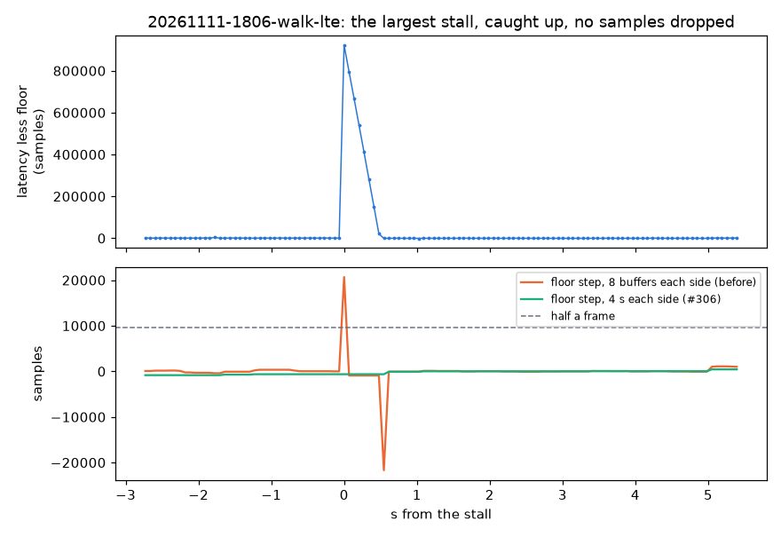

# USB stalls taken for dropped samples (#306)

Evidence: **real sessions** `20261111-1806-walk-lte` (handheld walk), `20261111-0151-static-fullsuite2` and `20261111-0233-static-lte-1h` (static), one NESDR on EARFCN 2460. Front end on the weak-cell branch (`fcf5274`, #214) against this branch (`b339616`), each session run from its `sdr_a.cu8`. Privacy: sample counts, times, errors and cell names only. No position, track, origin, range or bearing.



*`20261111-1806-walk-lte`, its largest stall. Top: each USB buffer's latency (host stamp less sample time) less the floor before it. Nothing arrived for 0.48 s (922,002 samples), then the queued buffers arrived back to back and caught up within 0.55 s. Bottom: the latency floor after each buffer less the floor before it. Over 8 buffers each side (before), the catch-up was not over and the floor looked a frame up: the front end put in a 19,200-sample gap. Over 4 s each side (#306), it is flat.*

## Cause

- **Two places sized a drop from the stamps, and both counted a stall that catches up:**
  - `_relocate` sized it from the largest gap between two stamps (`_host_gap`). Whenever a strong cell was re-found 0.5 samples or more off while the host had stalled, the stall became a drop. The signal sizes a drop only modulo a frame, so the gap was the stall's whole frames plus the re-find's few samples.
  - `_unexplained_stalls` (drops of whole frames, which only the stamps see) compared the floor over 8 buffers each side, 0.55 s at rtl_sdr's 131,072-sample transfers. The walk's 0.48 s stall took 0.55 s to catch up, so the floor after still looked a frame up.
- **Effect:** each such gap moved every cell's timing by the re-find's few samples (one sample is 156 m) and every later record's `t_ns` by whole frames (up to 1.2 s on 0233). A gap found by two cells was put in twice.

## Fix (`src/pnt/frontends/lte/tracker.py`, `frontend.py`)

Both now use `floor_step`: the latency floor over `FLOOR_WINDOW_S` (4 s, `TBC`) after the stretch less the floor over 4 s before it. A real drop moves the floor up for good. A stall that catches up does not. A re-find with stamps that show no drop is a path move, a new arc.

Why 4 s: the longest catch-up on the three sessions was 1.3 s (a 2.3 M-sample stall on 0233). With 8 buffers, 1, 1 and 12 floor-step onsets of half a frame or more appear (walk, 0151, 0233). With 4 s there are none, and the largest step is 1,039, 1,020 and 1,561 samples, against 9,600 for half a frame. Full table: `stalls.md` (`analysis/usb_stall_gaps.py`).

## Before / after (`fcf5274` → `b339616`)

| Session | Gaps the front end put in | Records | Arcs | Structure function within one arc, all cells, 1 / 10 / 100 s (m) |
|---|---|---|---|---|
| walk | 7 → 0 | 42,433 → 42,397 | 215 → 214 | 16 / 27 / 29 → 15 / 26 / 28 |
| 0151 | 4 → 0 | 14,792 → 15,385 | 59 → 51 | 11 / 37 / 69 → 10 / 35 / 90 |
| 0233 | 20 → 0 | 91,485 → 91,680 | 221 → 232 | 9 / 30 / 36 → 9 / 26 / 24 |

- **No gap was a real drop.** Every one of the 31 gaps was at a place where the 4 s floor does not step. Some were one stall put in twice, by two cells a few thousand samples apart: 1 pair on the walk, 1 on 0151 and 4 on 0233.
- **0151's 100 s value rose from 69 to 90 m.** It rests on few long arcs. On #214's weak-cell run it had already moved from 36 to 69 m with no change to the gaps. Per cell, the 100 s values that exist went down or held (`244`: 41 → 22 m).
- Full tables: `structure-walk.md`, `structure-0151.md`, `structure-0233.md` (`analysis/weak_cell_wander.py`, each session's dongle clock from its own GPS-on `ekf` replay).

## Tests (`tests/test_lte_frontend.py`)

- A 103 ms stall caught up over 14 buffers: no gap. Before, the 8-buffer floor put in a 96,000-sample one.
- A strong cell re-found 3 samples early during that stall: no gap and a new arc. Before, a 192,003-sample gap.
- Both fail without the fix. The existing drop, stall and outage tests pass unchanged.

## Commands

Front end per session at each commit (scratch `fe_dump.py`: `process_capture` with the default `Config`, then `write_session(..., copy_from=<session>)`). Then:

```
python analysis/usb_stall_gaps.py data/sessions/20261111-1806-walk-lte data/sessions/20261111-0151-static-fullsuite2 data/sessions/20261111-0233-static-lte-1h --fig walk_stall.png --out stalls.md
python analysis/weak_cell_wander.py data/sessions/20261111-1806-walk-lte --lte weak-cell=<fcf5274 -lte> 306=<b339616 -lte> --out structure-walk.md
python analysis/weak_cell_wander.py data/sessions/20261111-0151-static-fullsuite2 --static --lte ... --out structure-0151.md
python analysis/weak_cell_wander.py data/sessions/20261111-0233-static-lte-1h --static --lte ... --out structure-0233.md
```

`weak_cell_wander.py` needs `walk_gps_cut.py` (#299) beside it.
