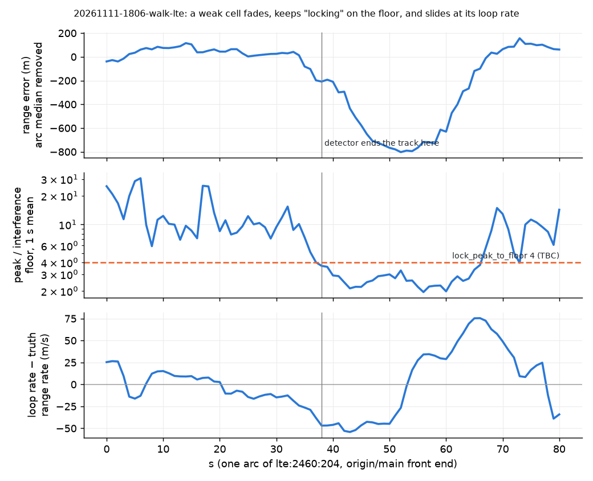

# Weak LTE cells sliding inside one arc: root cause and a lock detector (#214)

Evidence: **real sessions** `20261111-1806-walk-lte` (handheld walk), `20261111-0151-static-fullsuite2` and `20261111-0233-static-lte-1h` (static), one NESDR on EARFCN 2460. Front end at `origin/main` (`28c313ad`) against this branch (`fcf52743`), every session run here from its `sdr_a.cu8`. The `origin/main` walk records are identical to the committed-era `20261111-1806-walk-lte-lte` (`fa5795c`): 71,718 records, same hash. Truth: the good GPS fixes, linear between fixes on the walk and their mean on the static sessions. Privacy: errors, rates, SNR, counts and cell names only. No position, track, origin, range or bearing.



*`20261111-1806-walk-lte`, `lte:2460:204`, one arc, front end at `origin/main`, 1 s means. Top: range error against GPS truth with the arc median removed. Middle: peak power over the delay profile's interference floor. Bottom: the loop's rate less the truth range rate, dongle clock drift included.*

## Root cause

1. **The lock test only checks against thermal noise.** An epoch is accepted when its post-correlation SNR against the reserved-bin noise clears `detect_snr_db` (8 dB). The reserved bins do not see the other cells' PSS and SSS. Those arrive with ours in a frame-synchronised network and correlate with our sequences at every delay. When a weak cell fades, the largest bin of that floor inside the code gate still clears 8 dB on most epochs. In the figure, 30 to 200 of 200 epochs a second are still accepted after the fade, with peak/floor at 2 to 3. The floor alone gives about 2. Nothing ends the arc (`lost_s` needs 2 s with no accepted epoch).
2. **The loop then coasts at its own rate, and that rate is already wrong.** The rate is carrier-aided, and on weak cells the aiding drags it. On the walk at `origin/main`, the per-second loop rate less the reference cell's (`220`, same dongle, true difference ≤ about 3 m/s walking) was 17 m/s or more (half a 100 Hz alias) on this share of epochs: `204` 44 %, `90` 45 %, `106` 38 %, `98` 56 %, `132` 35 %, `92` 60 %, `244` 67 %, `268` 29 %, `212` 98 %. The p90 of the difference was 27 to 134 m/s. On `220` itself it was 0 %. In the figure, `204` held its range while its rate was 10 to 25 m/s off, because the code kept correcting it. Once the peak fell to the floor, the code stopped correcting and the error grew at the rate error, about −45 m/s: 800 m in 15 s. #277's alias finding is part of this (a 100 Hz alias is 34 m/s), but the drift is not limited to one alias.
3. **#245's guards do not cover this.** They check first-path moves and re-finds. A slow slide on the floor triggers neither.

How well each signal separates sliding from good, on the walk at `origin/main`, using 1 s means. A second counts as sliding if its error changes more than 150 m over 5 s, and as good if it changes less than 50 m and stays within 150 m:

| Flag | Sliding seconds flagged | Good seconds flagged |
|---|---|---|
| peak/floor < 3 | 51 % | 5 % |
| peak/floor < 4 | 84 % | 16 % |
| SNR < −8 dB | 84 % | 11 % |

Of the seconds more than 300 m off, 58 to 100 % per cell had a rate error of 17 m/s or more, against 15 to 40 % of the other seconds (`212`: 96 and 100 %).

## Fix (`src/pnt/frontends/lte/tracker.py`, `frontend.py`)

- **Lock detector against the interference floor** (`lock_window_s` 1 s, `lock_peak_to_floor` 3, both `TBC`). It averages each accepted epoch's peak power over the profile's interference floor (the same floor `first_path_floor` uses) over each second. If the mean is below 3, it drops that second's epochs and ends the track (`CellTrack.unlocked`).
- **Restart on a new arc.** The next search that finds the cell restarts it on a new arc, with the carrier offset and σ from the search, not the slid loop's rate. ADR-0050's per-arc bias then absorbs the new arc. ADR-0036 has a *Proposed* amendment for this (a new front-end approach).
- **Threshold 3 or 4.** At threshold 4 (`aca91835`) the walk kept 38,787 records instead of 42,433. The structure function was about the same (15 / 25 / 25 m against 16 / 27 / 29 m), and so was the arc count (220 against 215).
- **Tests** through `process_file` (`tests/test_lte_frontend.py`). A strong cell plus a weak cell 2.5 µs earlier on another PSS root, with the weak cell gone at 1 s:
  - Without the detector, the weak cell keeps epochs to the end of the capture.
  - With it, the weak cell's last epoch is before 2.1 s, every kept epoch is within 300 m, and the strong cell is untouched.
  - A unit test of `_start` checks the restart after an unlock.
  - Without the fix, the first two fail (detector off: the second fails) and the third errors.

## Before / after (`origin/main` → `fcf52743`)

Full tables: `walk.md`, `0151.md`, `0233.md` (`analysis/weak_cell_wander.py`). Each session's dongle clock comes from its own GPS-on `ekf` replay.

| Session | Records | Arcs per minute | Structure function within one arc, all cells, 1 / 10 / 100 s (m) | \|error\| p95 below −6 dB (m) |
|---|---|---|---|---|
| walk | 71,718 → 42,433 | 5.27 → 9.36 | 47 / 327 / 3,185 → 16 / 27 / 29 | 7.9 to 21 km → 154 to 169 |
| 0151 (no cell below −6 dB) | 15,457 → 14,792 | 5.51 → 5.91 | 11 / 32 / 36 → 11 / 37 / 69 | – |
| 0233 | 92,342 → 91,485 | 3.32 → 3.68 | 11 / 37 / 52 → 9 / 30 / 36 | 130 to 254 → 220 (5 records) |

- **Walk, records below −8 dB:** 28,203 → 985, all within the p95 above.
- **Walk arcs nearly double**, mostly on `92`. At `origin/main`, `92` was 6.7 km off at its median, tracked 304 s in 5 arcs. With the fix it is tracked 760 s in 87 arcs, with a 10 s structure function of 30 m. Per cell the arc counts are otherwise within ±1, except `204` (30 → 38), `244` (2 → 6) and `98` (3 → 1).
- **0151's 100 s value moved from 36 to 69 m.** It rests on few long arcs (`244` alone has enough pairs: 42 → 41 m). This was not looked into further.

## End to end: the walk's GPS cut (`walk_gps_cut.py` from #299 at `ece3e34c`, unchanged)

5 cuts while walking (100, 418, 495, 818 and 1049 s), `ekf`, the same cuts for every row. Median over the cuts, worst cut in brackets. Full summaries: `walk-gps-cut-main.md` and `walk-gps-cut-fix.md`. Their "Analysis at `unknown`" is because the script ran from outside the repo.

| Config | 60 s | 120 s | 300 s | p95 0–300 s, worst | HPL ≥ error | p95 before the cut |
|---|---|---|---|---|---|---|
| no LTE | 21.0 (51) | 43.6 (161) | 168 (484) | 457 | 100 % | 1.4 |
| LTE, `origin/main` | 150 (378) | 458 (3,496) | 1,941 (8,749) | 8,342 | 42 % | 9.4 |
| LTE, this branch | 158 (659) | 182 (2,820) | 1,463 (3,017) | 5,817 | 73 % | 8.4 |

The cuts here differ from #295's runs (22.8 / 107 / 503 m without LTE), so compare rows only within this table.

**Does LTE help while moving now? No.** The detector takes the kilometre slides out of the records. The worst cuts and the share of time the HPL bounds the error both improve, but LTE still makes the walk worse than no LTE, at every horizon and even with GPS on. It is no longer the weak cells' slides. Two things in these runs are candidates, neither checked:

1. **Arcs are short even on the best cell.** `220` starts a new arc every 22 s (64 arcs in 1,380 s, the same at `origin/main`). Each arc has its own bias (ADR-0050), so once GPS is cut, an arc started after the cut is calibrated only against the filter's own drifting position.
2. **The pre-cut p95 rises from 1.4 m to 8 to 9 m with LTE.** The LTE records pull the GPS solution too.

## Unrelated finding (for an issue, not changed here)

- **The front end declares dropped-sample gaps that the buffer stamps do not show.** At every gap found on these runs, the latency floor (host stamp less sample index) is no higher after the gap than before; it drifts the other way. That covers `origin/main` (3 gaps on the walk, 22 on 0233) and this branch (5 and 20).
- **Cause:** a transient USB stall that catches up. `_relocate` treats a host stall of half a frame or more (`host_stalled`) as a drop when a strong cell is re-found a few samples off.
- **Effect:** each gap moves every cell's timing by the re-find's few samples, and every later record's `t_ns` by whole frames (up to 1.2 s on 0233).
- **This branch changes which ones happen** (walk 3 → 5, 0233 22 → 20), because tracks end at other times.

## Commands

Front end per session (`fe_dump.py`, scratch: `process_capture` with default `Config`, then `write_session(..., copy_from=<session>)`), at `28c313ad` and `fcf52743`. Then:

```
python analysis/weak_cell_wander.py data/sessions/20261111-1806-walk-lte --lte main=<main -lte> fix=<branch -lte> --out walk.md
python analysis/weak_cell_wander.py data/sessions/20261111-0151-static-fullsuite2 --static --lte ... --out 0151.md
python analysis/weak_cell_wander.py data/sessions/20261111-0233-static-lte-1h --static --lte ... --out 0233.md
python analysis/walk_gps_cut.py data/sessions/20261111-1806-walk-lte --lte-session <-lte> --configs "no LTE, ekf" "LTE, ekf" --cut-at 100 418 495 818 1049 --jobs 3
```

`weak_cell_wander.py` and `real_walk_lte.py` need `walk_gps_cut.py` (#299) beside them.
