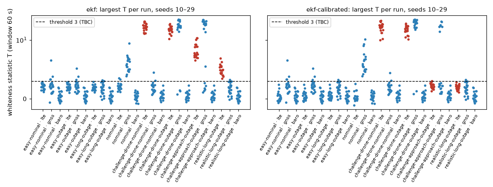
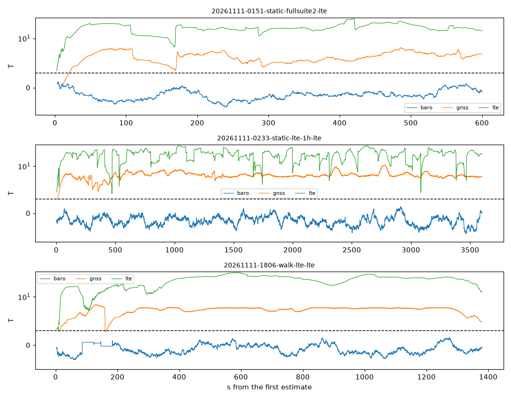
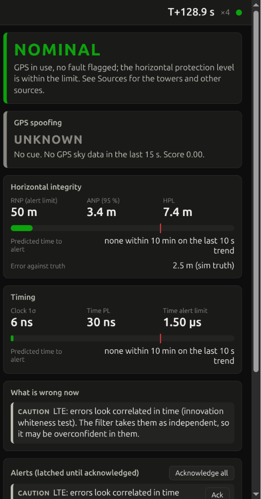

# Innovation whiteness flag per source (#275 step 1, ADR-0052 Proposed)

Evidence: **sim** (placeholder models, ADR-0015) and **replay of three real sessions**. Script `analysis/whiteness.py` at `8218318` (the commit in `study.json`, `real.json` and the hash and timing files). Statistics only: no position, range or bearing.

The test: per source, lag-1 pairs of normalised innovations (z = y_i / √S_ii, same emitter, kind and component, ≤ 5 s apart) over a 60 s window; flag `innovations_correlated:<source>` while T = Σz_k z_(k−1) / √Σ(z_k z_(k−1))² > 3 with ≥ 30 pairs. Report only. Every value `TBC`.

- **GNSS position is analysis only** (owners, 2026-11-11): its T is computed and reported here, never flagged. Receivers smooth their fixes, so consecutive fixes correlate by design (real sessions below).
- **Off on the eval path:** `EKF(whiteness=False)` by default; `nav.estimate(..., whiteness=True)` switches it on for estimators built on `ekf.run`. The panel's feed, `pnt replay` and `pnt live` pass it; `pnt eval`, `pnt results`, `experiments` and the analysis scripts do not.

## Window and threshold (tuning seeds 0–9, `ekf`)

Grid: window 20, 30, 60, 120 s × threshold 3, 4, 5, 6, 8. Rule (`choose`): fewest onsets of a flagged source (LTE, GNSS time, baro) in honest runs; then fewest correlated runs with LTE never flagged; then shortest delay; then the higher threshold. Chosen: **60 s, T > 3**, with 0 false onsets and 0 misses of 40 (120 s / 3, 120 s / 4 and 30 s / 4 also had 0 and 0, with longer delays). Before GNSS position was taken out of the count, the same rule chose 60 s / 6, which missed 7 of 40 (all `realistic-long-outage`) (`study.json`, `tuning_table`).

## Held-out seeds 10–29, `ekf` (panel path)

Red: the LTE of a leg #226/#251 diagnosed. Blue: everything else, GNSS position included (analysis only). Dashed: T = 3.

| Scenario (20 runs each) | LTE: runs flagged | LTE: median (worst) delay | GNSS time: runs / onsets | Baro | GNSS position over T = 3 (not flagged): runs / onsets |
|---|---|---|---|---|---|
| `easy-nominal` | 0 | – | 2 / 3 | 0 | 4 / 33 |
| `easy-outage` | 0 | – | 1 / 1 | 0 | 3 / 19 |
| `easy-long-outage` | 0 | – | 0 | 0 | 2 / 3 |
| `nominal` | **2 / 2 onsets** | – | – | 0 | 20 / 387 |
| `challenge-drone-nominal` | **20** | 29 s (32 s) | 0 | 0 | 2 / 21 |
| `challenge-drone-outage` | **20** | 29 s (32 s) | 0 | 0 | 17 / 17, at GPS return |
| `challenge-approach-outage` | **20** | 47 s (105 s) | 8 / 8, at GPS return | 0 | 14 / 14, at GPS return |
| `realistic-long-outage` | **20** | 61 s (215 s) | 0 | 0 | 2 / 6 |

- **False alarms per hour on honest runs (8 h), flagged sources:** LTE 0.25 (2 onsets, `nominal`), GNSS time 0.5 (4), baro 0: **0.75 per hour** in all. GNSS position would add 55 per hour (442 onsets), most on `nominal`, whose square route the constant-velocity model does not follow.
- **Detection:** LTE flagged in 80 of 80 runs of the diagnosed legs.
- **GNSS time on the approach** fires 6 s after GPS returns (8 of 20): the filter comes back overconfident, so the correlation is real.
- **Delay** runs from the source's first lag-1 pair to the first flagged estimate.

`ekf-calibrated` (multipath state per emitter), LTE: 20/20 on both drone legs (its state is sized to the told 2 m); 1/20 on the approach (at GPS return) and 0/20 on `realistic-long-outage`, where its state matches the sim's multipath; 0 on honest runs. The flags the filter raised equal the offline statistic on every run (`filter_vs_offline_max` 0).

## Real sessions (replay, whole session, `ekf` on the panel path)

| Session | Length | LTE: r, epochs flagged, first | GNSS position: r, epochs over T = 3 (never flagged), first | Baro |
|---|---|---|---|---|
| `20261111-0151-static-fullsuite2` (#245's records) | 0.17 h | 0.99, 99.6 %, 2 s | 0.84, 96.7 %, 20 s | r −0.07, never |
| `20261111-0233-static-lte-1h` (#245's records) | 1.0 h | 0.99, 99.9 %, 4 s | 0.99, 99.7 %, 12 s | r −0.07, never |
| `20261111-1806-walk-lte` (`-lte` records) | 0.38 h | 0.96, 99.7 %, 4 s | 0.997, 98.6 %, 15 s | r 0.00, never |

r is the pooled lag-1 autocorrelation over the whole session. Real GPS HAT fixes are over the threshold 97 to 99.7 % of the time: a GNSS position flag would always be on, which is why it is analysis only. LTE fires on every session, as ADR-0036's correlated part and ADR-0050's arcs predict. The sessions have no GNSS time records.

## Eval-path cost

`analysis/whiteness.py timing` (eval path, `ekf`, seeds 0–2, best of 3, two passes each, interleaved with `main` `c62255d`): `challenge-drone-outage` 3.196 s against 3.174 s (+0.7 %), `nominal` 1.794 s against 1.805 s (−0.6 %): within ±3 %. On the panel path the hook costs about a fifth of `ekf`'s run time (21–27 % before the numpy trim, 17–23 % after, measured before the last rebase).

## Panel

`pnt sim challenge-drone-nominal --dash --estimator ekf` at `8218318`, Chrome, local. The caution is listed under *What is wrong now* and latched under *Alerts*; the status stays NOMINAL.

## No estimate changed

See [`hashes.md`](hashes.md).
