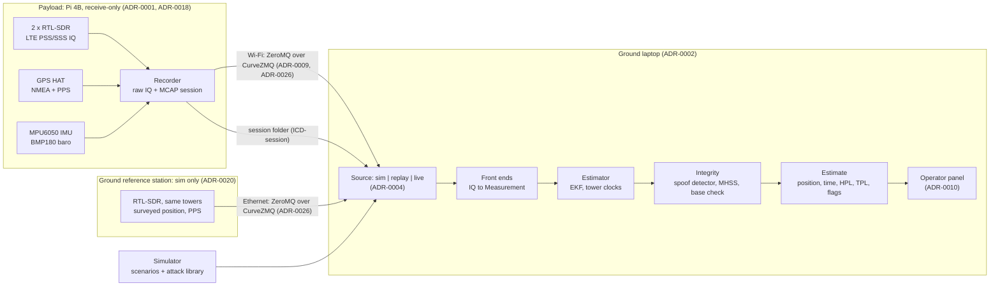

# D1: Architecture

- **Status:** Draft, 2026-11-09 (#28). The humans own the final D1 and the deck; this is the technical draft they build from.
- **Audience:** engineers who build navigation products (mentor Q7, [`mentor-qa.md`](mentor-qa.md)). This file points to the source of each statement instead of restating it.
- **State described:** `origin/main` at `3759d95` plus this branch. Work in flight on other branches is named as such.

## What it is

A receive-only payload records signals of opportunity (LTE towers first), the GPS fix and PPS, an IMU and a barometer. A ground laptop fuses them into position and time, each with a protection level, and treats every source, GPS and the towers alike, as something that can fail ([ADR-0021](adr/0021-what-we-build-and-pitch.md)).

The integrity idea in one line: **learn the towers while GPS is trusted, then use them to keep position and time, catch GPS lying, and catch them lying.** Calibrated, grouped tower clocks are what make a tower testable at all (Jia, Khalife & Kassas 2023, in [`research.md`](research.md)).

## Key requirements by use case

| Use case | Requirements that drive the design | Proposed targets (`TBC`, [`plan.md`](plan.md)) |
| --- | --- | --- |
| [UC-01](use-cases.md) drone on an urban corridor | REQ-01 continuity, REQ-02 HPL, REQ-04 spoof detection, REQ-05 live display | T1, T4, T5 |
| [UC-02](use-cases.md) crewed approach into YOW | REQ-01, REQ-02 (alert limit for RNP 0.3), REQ-04 | T2, T4, T5 |
| [UC-03](use-cases.md) timing user | REQ-03 time holdover with an honest bound, REQ-04 time-spoof detection | T3, T4 |
| All | REQ-06 SoOP primary, REQ-07 receive-only, REQ-08 privacy, REQ-09 platform-agnostic payload, REQ-10 reproducible | — |

Requirements and their verification methods: [`requirements.md`](requirements.md), [`verification.md`](verification.md). The ranked attacks per use case: [`threat-model.md`](threat-model.md).

## Data flow

- **Record raw on board, process on the ground** ([ADR-0002](adr/0002-record-raw-process-ground.md)). The payload decodes nothing beyond what it must; the laptop runs front ends, estimation and integrity, live or from logs.
- **One record type.** Every observable is a `Measurement` ([ICD-measurement](icd/measurement.md), [ADR-0006](adr/0006-measurement-record.md)); its `receiver` field separates payload from base. Time is int64 GPS nanoseconds, positions ENU metres about the session origin ([ADR-0008](adr/0008-time-and-frames.md)).
- **Three interchangeable sources** ([ADR-0004](adr/0004-three-sources.md)): `sim`, `replay` and `live` yield the same stream, so every result on simulated data runs unchanged on a recording.
- **Sessions** are a folder with `session.mcap` and raw IQ sidecars ([ICD-session](icd/session.md), [ADR-0007](adr/0007-logs-mcap.md)).
- **Tower identity** comes from the ISED registry, an EARFCN/PCI scan and a mapper, and every association is a hypothesis with a fault prior ([ADR-0023](adr/0023-tower-identity.md)).

## Estimator

Code: [`src/pnt/nav/`](../src/pnt/nav/). The registry is `pnt.nav.ESTIMATORS`.

| Estimator | What it is | Role |
| --- | --- | --- |
| `baseline` | Deliberately simple reference filter | Control for every comparison |
| `ekf` | Position, velocity, receiver clock (offset, drift), and one block per tower clock | The main filter. Tower clocks are `independent` by default, or `calibrated` ([ADR-0022](adr/0022-tower-clock-model.md)): offset and drift per site under a shared builder term, learned only while GNSS is trusted and checked by independent evidence, and rolled back when GNSS is flagged |
| `ekf-base` | `ekf` differenced against the ground reference station | Tower clocks cancel in the difference ([ADR-0020](adr/0020-ground-reference-station.md)); falls back to `ekf` when the base is lost or excluded |
| `ekf-mhss` | `ekf` with a solution-separation monitor | HPL and exclusion from the fault hypotheses below (#82) |
| `ekf-mhss-beacon` | `ekf-mhss` that may also use a located jammer's received power as a low-trust coarse range | Sim only (ADR-0025, #93): promotion gate, weight cap and its own `hostile:` hypothesis; the PL is not allowed to shrink because of it |
| `ekf-calibrated-measured` | `ekf` with `ekf-calibrated`'s model, every value measured on real sessions or the filter's default, none from a sim set | Opt-in ([ADR-0043](adr/0043-calibrated-from-measured-values.md), Proposed, #118): a calibrated filter whose consistency on a sim set is a test, not self-consistency |
| `ekf-guard`, `ekf-imu-guard`, `ekf-calibrated-guard` | `ekf`, `ekf-imu` and `ekf-calibrated` with the GNSS jump guard | Opt-in ([ADR-0038](adr/0038-refuse-detected-gnss-jump.md), Proposed, #184): a detected GNSS position jump is refused until the GNSS stream steps back by it |
| `ekf-map` | `ekf` with a residual map: each tower's error per 25 m cell, learned while GPS is trusted | Opt-in (P11, [ADR-0032](adr/0032-residual-map.md) Proposed, #95); frozen whenever GPS is not trusted |
| `ekf-measured-sigma`, `ekf-calibrated-measured-sigma` | `ekf` and `ekf-calibrated` that tell a radio's LTE records ADR-0036's measured sigma from their SNR instead of the front end's (#147) | Opt-in ([ADR-0044](adr/0044-told-sigma-for-radio-records.md), Proposed; `nav/told_sigma.py`); the defaults keep the reported sigma |

In flight on other branches: IMU propagation (stage 2, #12) and further calibrated-clock work. The barometer carries the vertical (ASM-05).

## Integrity layer

Code: [`src/pnt/integrity/`](../src/pnt/integrity/) and the checks inside [`ekf.py`](../src/pnt/nav/ekf.py). Design: [`verification.md`](verification.md) (*Integrity monitor: solution separation*).

**GNSS-dependency tags** ([ADR-0024](adr/0024-gnss-dependency-tags.md), `integrity/dependency.py`). Every source is independent (barometer, IMU, VOR), GNSS-timed (LTE towers: geometry survives a GNSS fault, time does not) or GNSS-derived (ADS-B, our own GPS). Only independent evidence can confirm GNSS; tower time could refute it but never confirm it. Refuting GNSS time from towers is planned: `ekf` and `ekf-mhss` don't do it.

**Fault hypotheses**, grouped by what fails together, not by single measurement:

| Hypothesis | Covers | Monitored by |
| --- | --- | --- |
| Tower site | One site's clock jump, a wrong or moved registry entry, a rogue cell on a real PCI | MHSS site subset; base tower-clock monitor (`tower_fault`) |
| Network builder | One builder's timing source in holdover or captured: every site of that builder moves together | MHSS builder subset (from `tower_groups`) |
| Source layer | A whole sensor type (LTE, barometer) wrong | MHSS layer subset |
| GNSS common mode | GNSS plus every GNSS-derived or unclassified source | MHSS GNSS-free subset; spoof detector; time gate |
| Reference station | Base moved, base clock step, base link lost | Base check inside `ekf-base` (`base_excluded`, #107). Not an MHSS hypothesis: `ekf-mhss` does not use the base. Forged base records are planned and not detected on `main` (#89) |
| Hostile emitter | A located jammer used as a beacon: moved, power changed, or lying | `ekf-mhss-beacon` only, sim only: MHSS `hostile:<emitter>` subset behind the beacon's promotion gate and weight cap (`nav/hostile.py`, [ADR-0025](adr/0025-hostile-emitter-beacon.md), #93) |

On `main`: the tower site, network builder, source layer, GNSS common mode and reference station rows, within their limits in [`threat-model.md`](threat-model.md) (no scenario yet faults a whole builder or plants a rogue cell). Planned: rejecting forged records (#89). The hostile emitter row is sim only and off in every other estimator.

**Detectors and outputs:**
- **Spoof detector** (#83, #102): calibrated towers that disagree with the GNSS-steered position refute GNSS (`spoof_suspected`, `gnss_excluded`) and roll the tower clocks back.
- **Time gate:** GNSS time tested against our clock model (`time_spoof_suspected`).
- **Solution separation** (#82, #108): Brenner-style bank of EKF copies; HPL from the multiple-hypothesis bound of Blanch et al.; exclusion when the subset without the faulty group can serve alone.
- **Protection levels:** in `ekf-mhss`, HPL from MHSS and VPL from the filter's covariance; in plain `ekf`, both from the covariance; a time protection level (`integrity/protection.py`, our definition). Time protection levels are published for GNSS timing receivers; we found none for time held by signals of opportunity ([`research.md`](research.md), novelty check). Ours is the receiver-clock covariance, oscillator holdover in `ekf`; a term for GNSS-timed towers is planned.
- **Report card:** time-to-alert, hazardous epochs and a resilience level mapped onto the DHS levels (`pnt.metrics`), per scenario, regenerated by `just results`.

**Where it stops.** Two faults in different groups at once are not covered. A wide-area time spoof that also captures the towers' timing is invisible to the towers by design. MHSS is only valid with honest subset covariances, which the `realistic` environment does not yet give (stated in [`verification.md`](verification.md)). The full gap list is in [`threat-model.md`](threat-model.md).

## Simulation and evidence

- **Attack library:** [`src/pnt/sim/attacks.py`](../src/pnt/sim/attacks.py) and [`scenarios/`](../src/pnt/sim/scenarios/): 74 scenarios, from base cases to the `easy`, `realistic`, `realistic-with-base` and `worst` environments crossed with the attack menu in `sets/_attacks.yaml`. Classified by `integrity/taxonomy.py` (TEXBAT-style).
- **Calibration to reality** ([ADR-0015](adr/0015-sim-calibrated-to-reality.md)): every model's status is in the *Sim validity* table of [`verification.md`](verification.md). Today every model is `placeholder`.
- **Results:** `just results` (report card), `just figures` (error after GPS loss, Stanford plot, ablation, timing holdover), `pnt plot` per session. Every figure names its scenario or session and commit (REQ-10).

## What is real and what is simulated

| Part | Today | Evidence it rests on |
| --- | --- | --- |
| Estimators, integrity, scoring, sim, plots | Code on `main`, tested | Simulation only |
| LTE front end (PSS/SSS tracking on RTL-SDR) | **Not built** (`src/pnt/frontends/` is empty; #21, #23) | — |
| Payload recorder and streamer on the Pi 4B | **Not built** (`src/pnt/payload/` is empty; #17, #19). Live source is a stub | — |
| Operator panel | **Not built** (#25, #90) | — |
| Ground reference station | Simulated only: not built on hardware (ADR-0020, *Amendment 2026-11-10*; #84–#86 closed) | Simulated |
| Ground-link authentication (CurveZMQ, MAVLink signing) | **Not built** (#89) | — |
| Hostile-emitter hypothesis | Code on `main` (`ekf-mhss-beacon`, #93); the jammer's received power is simulated (`sim/hostile.py`) | Simulation only. No real jammer can be used (ADR-0025) |
| Real sessions | **None recorded yet** | — |
| Tower positions | Real (ISED registry). The sim uses the 2024 extract (`data/reference/cells-ottawa.csv`); the 2026 extract with PCI per sector is #110 | Registry; staleness and PCI collisions stay association fault modes (ADR-0023) |
| Tower noise, clocks, multipath, dropouts | Literature or `TBC` | `placeholder` in *Sim validity* |
| LEO (Iridium) | Simulated from real orbits ([ADR-0013](adr/0013-no-iridium-hardware.md)), confirmed acceptable by the mentors | Sim |
| LEO (Starlink, P13) | Simulated from real orbits (`starlink-outage`, #97). Its Ku-band downlink (10.7–12.7 GHz) is out of the RTL-SDR's range; a real receiver needs an LNB and downconverter, as in the Kassas-group Starlink Doppler work, which we don't have | Sim; every Starlink value `TBC` |
| Jamming and spoofing | Software injection only ([ADR-0001](adr/0001-receive-only-payload.md), ASM-03) | Sim; injection into real sessions once they exist |

## Safety, security and regulation

- **Receive-only** payload and base; no transmit path in hardware or code (REQ-07, ADR-0001). Jamming and spoofing exist only in software.
- **Privacy:** only broadcast sync and system information is decoded; Wi-Fi BSSIDs are hashed at capture (REQ-08, [ADR-0011](adr/0011-privacy-at-capture.md)).
- **Ground links:** the payload and base streams are authenticated and encrypted with CurveZMQ, so forged records are dropped, not fused. Each Pi admits only trusted laptop keys, and the laptop pins each Pi's key. Plaintext needs `--insecure` ([ADR-0026](adr/0026-ground-link-security.md), #89). MAVLink signing is `TBC` (INAV, ADR-0028), and hash-chained logs come after judging.
- **Flight:** indoor or handheld only near YOW, RC kill switch always fitted ([ADR-0012](adr/0012-flight-control-levels.md), ASM-06).
- Full list: [`safety.md`](safety.md).
