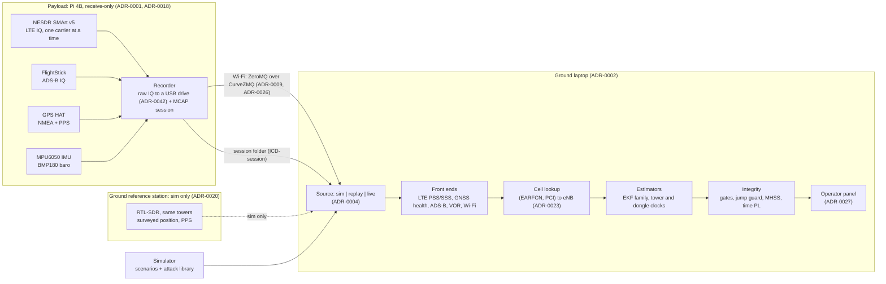

# D1: Architecture

**In one line:** a receive-only navigation layer that keeps a position from cell towers after GPS is lost, and tells the operator when not to trust it. Written for engineers who build navigation products; every number is in [`results.md`](results.md) with its kind (simulated or real) and source.

## What it is

A receive-only payload records LTE tower sync signals, the GPS fix and PPS, an IMU and a barometer. A ground laptop fuses them into position and time, each with a bound under our model (a horizontal protection level, HPL, in the code's terms), and treats every source, GPS and the towers alike, as something that can fail ([ADR-0021](adr/0021-what-we-build-and-pitch.md)).

The idea: **learn the towers while GPS is trusted, then use them to keep position, catch GPS lying, and catch them lying.** It matches the mentors' picture of the mission: GPS at the start, then lost or degraded in one area (call of 2026-11-10, transcript at the repo root).

## Principal use cases and key requirements

Use cases: [`use-cases.md`](use-cases.md) (UC-01 drone, UC-02 approach, UC-03 timing). Requirements: [`requirements.md`](requirements.md). Targets: [`plan.md`](plan.md), [ADR-0034](adr/0034-targets-after-mentor-answers.md). The mentors put location first and timing second (call of 2026-11-10).

| Principal use | Requirements | Targets | Where we stand ([`results.md`](results.md) (b)) |
| --- | --- | --- | --- |
| **Navigation continuity**: keep a position after GPS is lost (UC-01 first; UC-02; time as a second output for UC-03) | REQ-01, REQ-03, REQ-06 | T1: 95 % ≤ 25 m for ≥ 300 s, fallback ≤ 50 m for ≥ 120 s, scored per second across runs (ADR-0034, *Amendment*). T2 (556 m alert limit). T3 (1.5 µs at 10 min) | Sim: T1 and its fallback missed on the `challenge` drone leg on ADR-0034's statistic (best 10,154 m at 300 s, 3,268 m at 120 s); T2 not scored; T3 missed on one seed of 50 |
| **Status and confidence monitoring**: tell the operator whether to trust position and time, and why | REQ-02, REQ-04, REQ-05 | T4 (jump target Accepted, ADR-0034 *Amendment 2026-11-11*; ramps; ≤ 1 false alarm/h), T5 (HPL bounds ≥ 99.9 % of epochs) | Sim: jumps detected in 1.1 s and refused by the opt-in guard; time ramp detected; false-alarm rate met; T5 missed |
| All | REQ-07 receive-only, REQ-08 privacy, REQ-09 platform-agnostic, REQ-10 reproducible | — | REQ-07, REQ-08 by design and inspection (`tests/test_hard_rules.py`) |

**Towers are meant to be primary (REQ-06); today they are not.** The front end reports only the fast part of its range noise, so on the real-shaped `challenge` legs the filter's gate rejects nearly every tower reading (the guard demo's panel lists LTE as not in use), and each reading it does accept is believed to 2 m and collapses the covariance (#251's diagnosis): in simulation that is worse than no towers (12,507 m against 2,909 m, draft PR #247). After GPS loss the default filter flies on the barometer and dead reckoning. Learning each tower's noise (ADR-0039, proposed in PR #156, open, not on `main`; opt-in) is the fix in review; with 13 carriers hopped on a study leg it reaches 132 m (draft PR #247); telling the filter ADR-0036's measured σ (`ekf-measured-sigma`, ADR-0044, Accepted, opt-in) is merged; [`results.md`](results.md) (c).

**The bound holds under our model, not always.** It held throughout the demo except where the plain filter followed a spoof, and on some simulated flights the error escapes it (T5 missed): after GPS loss on `challenge-drone-outage`, 45.3 % of `ekf`'s epochs are above HPL, 0.45 % for the opt-in `ekf-honest` in draft PR #251, whose worst run still escapes 18.5 % (sim, seeds 0–199). We call it a bound under our model, not a certified protection level.

The integrity level is ours to choose, shown several ways (mentor Q2; ADR-0034): the bound against the alert limit, error ellipse, NEES/NIS, per-source trust, time to alert.

## Data flow

- **Record raw on board, process on the ground** ([ADR-0002](adr/0002-record-raw-process-ground.md)). The payload streams records, not IQ; the LTE front end runs on the laptop over a finished capture ([`deploy/demo/RUNBOOK.md`](../deploy/demo/RUNBOOK.md) *Live segment*).
- **One record type**, the `Measurement` ([ICD-measurement](icd/measurement.md)). Time is int64 GPS nanoseconds; positions ENU metres about the session origin ([ADR-0008](adr/0008-time-and-frames.md)).
- **Three interchangeable sources** ([ADR-0004](adr/0004-three-sources.md)); `tests/test_source_contract.py` runs one contract over all three.
- **Records shaped like real ones** ([ADR-0030](adr/0030-challenge-benchmark-set.md), Proposed): the `challenge` legs emit LTE records as the front end writes them, so the benchmark takes the path a capture takes.

## Components as built

| Part | What it does | Code | State on `main` | Evidence kind |
| --- | --- | --- | --- | --- |
| Payload recorder and streamer | Records SDR IQ, gpsd, I2C sensors into a session; streams records live | [`src/pnt/payload/`](../src/pnt/payload/), [`deploy/pi/RUNBOOK.md`](../deploy/pi/RUNBOOK.md) | Built | Real: sessions of 2026-11-10 and 2026-11-11, the latter with a PPS-locked GPS fix |
| Ground link | CurveZMQ; the payload admits only trusted laptop keys | `pnt keys`, [ADR-0026](adr/0026-ground-link-security.md) | Built | Real: 28 min streamed, 0 estimates (no fix then) |
| LTE front end | PSS/SSS search and time-of-arrival tracking on RTL-SDR IQ, from the 3GPP specifications; sync signals only | [`src/pnt/frontends/lte/`](../src/pnt/frontends/lte/) | Built; re-found-cell crash fixed; coherent integration opt-in | Synthetic and real captures |
| Cell lookup | (EARFCN, PCI) to a registered eNB from the 2026 ISED extract; unknown and colliding cells dropped and counted, never guessed | [`src/pnt/nav/cells.py`](../src/pnt/nav/cells.py), [ADR-0023](adr/0023-tower-identity.md) (Proposed) | Built | Registry audit; real captures |
| GNSS health | C/N0 jamming indicator from gpsd SKY reports | [`src/pnt/frontends/gnss.py`](../src/pnt/frontends/gnss.py), [ADR-0031](adr/0031-gnss-jam-indicator.md) | Built | Real: one 595 s session |
| Other front ends | ADS-B, VOR (stations from `navaids.csv`), Wi-Fi RSSI | [`src/pnt/frontends/`](../src/pnt/frontends/) | Built | Real ADS-B frames; VOR no lock |
| Estimators, integrity | Below | [`src/pnt/nav/`](../src/pnt/nav/), [`src/pnt/integrity/`](../src/pnt/integrity/) | Built | Sim; synthetic baseband |
| Operator panel | Position, HPL against the alert limit, NOMINAL / DEGRADED / UNSAFE, latched alerts, time PL, per-source trust; NO DATA when the stream stalls | [`src/pnt/dashboard/`](../src/pnt/dashboard/), [ADR-0027](adr/0027-dashboard-sse-canvas.md) | Built, with the track coloured by confidence (#235) | Sim, replay; real sessions show NO DATA (no origin) |
| Ground reference station | Base/rover differencing; the base is itself a monitored fault | `nav/base_rover.py`, [ADR-0020](adr/0020-ground-reference-station.md) | Estimator built; **sim only**, not built on hardware (*Amendment 2026-11-10*) | Sim |
| Simulator and attack library | Trajectories, error models, attacks, the `challenge` sets; fault injection into recordings (`pnt replay --inject`) | [`src/pnt/sim/`](../src/pnt/sim/) | Built | See *How the sim aligns to reality* |

## Estimators

Registry: `pnt.nav.ESTIMATORS`.

| Estimator | What it is |
| --- | --- |
| `baseline` | Deliberately simple reference filter, the control |
| `ekf` | Position, velocity, receiver clock, one clock block per tower, an (offset, drift) block per SDR dongle; our clock in the tower ranges once GNSS time is used ([ADR-0047](adr/0047-ekf-models-our-clock-in-tower-ranges.md), Accepted); Doppler range rate, though the LTE front end writes no doppler records by default since #245 |
| `ekf-calibrated` | Tower clocks per site under a shared network-builder term, learned only while GNSS is trusted, rolled back when GNSS is flagged ([ADR-0022](adr/0022-tower-clock-model.md), Proposed) |
| `ekf-imu` | `ekf` with IMU-driven prediction |
| `ekf-mhss` | `ekf` with solution-separation bounds and exclusion |
| `ekf-mhss-beacon` | `ekf-mhss` that may use a located jammer's received power as a low-trust coarse range; sim only, behind a promotion gate and weight cap, with its own `hostile:` hypothesis ([ADR-0025](adr/0025-hostile-emitter-beacon.md)) |
| `ekf-base`, `ekf-base-imu` | Differenced against the reference station; fall back to `ekf` when the base is lost or excluded |
| `ekf-guard`, `ekf-imu-guard`, `ekf-calibrated-guard` | The GNSS jump guard, opt-in: a detected jump is refused until the GNSS stream steps back by it ([ADR-0038](adr/0038-refuse-detected-gnss-jump.md), Proposed) |
| `ekf-calibrated-measured` | `ekf` with `ekf-calibrated`'s model, every value measured on real sessions or the filter's default, none from a sim set ([ADR-0043](adr/0043-calibrated-from-measured-values.md), Accepted, #118; opt-in) |
| `ekf-map` | `ekf` with a residual map: each tower's error per 25 m cell, learned while GPS is trusted, frozen whenever it is not (P11, [ADR-0032](adr/0032-residual-map.md) Accepted as opt-in only, #95) |
| `ekf-learned-noise`, `ekf-calibrated-learned-noise` | In review, not on `main` (PR #156, open; ADR-0039 there): learn each LTE cell's range noise from its residuals instead of trusting the reported σ; opt-in |
| `ekf-honest`, `ekf-honest-guard` | In review, not on `main` (draft PR #251; ADR-0046 there): learned noise plus the slow part of each emitter's range error as a filter state, so the HPL bounds the error after GPS loss; `-guard` adds the jump guard; opt-in |
| `ekf-measured-sigma`, `ekf-calibrated-measured-sigma` | `ekf` and `ekf-calibrated` that tell a radio's LTE records ADR-0036's measured sigma from their SNR instead of the front end's ([ADR-0044](adr/0044-told-sigma-for-radio-records.md), Accepted, #147; opt-in) |

Also opt-in: the tower spoof monitor (`ekf-spoof`, `ekf-imu-spoof`, `ekf-calibrated-spoof`, ADR-0037) and carrier hopping in the sim (ADR-0040), both merged through #250; learned LTE range noise (ADR-0039) is in review in PR #156 (open). In review too: the tower monitor's hop rule, which counts a site against the epochs its own carriers were on air (PR #263, open; ADR-0037 amendment there). ADR-0037 and ADR-0040 are Proposed; ADR-0039 exists only on #156's branch.

## Integrity layer

Design: [`verification.md`](verification.md) *Integrity monitor: solution separation*. Gaps: [`threat-model.md`](threat-model.md).

**GNSS-dependency tags** ([ADR-0024](adr/0024-gnss-dependency-tags.md)): each source is independent (barometer, IMU, VOR), GNSS-timed (LTE towers: geometry survives a GNSS fault, time does not) or GNSS-derived (ADS-B, our GPS). Only independent evidence can confirm GNSS; tower time may refute it, never confirm it.

| Hypothesis | Covers | Monitored by (on `main`) |
| --- | --- | --- |
| Tower site | One site's clock jump, a wrong or moved registry entry, a rogue cell on a real PCI | MHSS site subset; base check names the tower and its jump |
| Network builder | One builder's timing source in holdover or captured | MHSS builder subset |
| Source layer | A whole sensor type wrong | MHSS layer subset |
| GNSS common mode | GNSS plus every GNSS-derived source | Filter GNSS gate; jump guard (opt-in); spoof detector; sky-map spoof decision, advisory ([ADR-0041](adr/0041-spoof-decision-from-the-sky.md)); time gate; MHSS GNSS-free subset; ADS-B warning raises its prior ([ADR-0033](adr/0033-adsb-raises-gnss-prior.md), Proposed) |
| Reference station | Base moved, clock step, link lost | Base check in `ekf-base` (sim) |
| Hostile emitter | A located jammer used as a beacon: moved, power changed, or lying | `ekf-mhss-beacon` only, sim only |

**How the confidence number is computed.** In `ekf`, HPL = 5.33 × the largest standard deviation of the horizontal covariance (`integrity/protection.py`; 5.33 matches an integrity risk of 1e-7 per epoch, `TBC`). In `ekf-mhss`, HPL is the multiple-hypothesis bound of Blanch et al. at that risk, with fault priors `p_site` 1e-3, `p_builder` 1e-4, `p_layer` 1e-4, `p_gnss_cm` 1e-3, all `TBC`. The time protection level is 5.33 × the receiver-clock standard deviation (our definition). 5.33 is the two-sided one-dimensional Gaussian factor for 1e-7 (the vertical factor); on the major-axis σ of a horizontal error the same risk needs about 5.68 for a circular error, and no exposure time is set (`TBD`). The owners' choice is open in issue #265; the 45 % escapes above come from the covariance, not the factor (#251).

**Where it stops** ([`results.md`](results.md) (b), (d)):
- A detected jump is followed by default; only the opt-in guard refuses it, at the cost of dead reckoning afterwards.
- A slow position ramp (2 m/s) is not detected by the default filters (0 of 50). The opt-in tower monitor catches it on 1 of 50 seeds on the drone leg as flown (1 to 3 cells), 48 of 50 where every tower within 3 km is heard continuously (131 s median, 313 s worst, #180), and, on 13 hopped carriers, 0 of 50 with the committed site rule (draft PR #254) but 50 of 50 with the hop rule in PR #263 (open; 127 s median, 276 s worst, 0 added false alarms). Every case is sim, all miss T4's 30 s, and hopping is a study leg: the payload cannot hop yet.
- MHSS is safe but unavailable with the `realistic` error sizes: the filter's tower model is not honest for that sim.
- `ekf-calibrated` can stay confident on a wrong tower table.
- Two faults in different groups at once, and a wide-area time spoof that also captures tower timing, are not covered by design.
- The sky-map spoof decision ([ADR-0041](adr/0041-spoof-decision-from-the-sky.md), Accepted) is advisory: it changes no estimate, and a spoofer that fakes the right sky and power pattern for our place and time is not caught.

## How the sim aligns to reality (ADR-0015)

The mentors accept simulated attacks if the architecture says how the sim aligns to reality (Q4, [`mentor-qa.md`](mentor-qa.md)). Status per model: [`verification.md`](verification.md) *Sim validity*.

| Model | Status on `main` | Real data so far |
| --- | --- | --- |
| IMU (MPU6050) | `measured` (noise, bias instability) | Overnight static session |
| LTE pseudorange | `placeholder` (50 m white, 50 m multipath, records told 2 m, `TBC`) | Measured at rest: white σ against SNR, a correlated part, sector clocks ([ADR-0036](adr/0036-lte-measured-error-model.md), Proposed; not yet moved in *Sim validity*) |
| LTE hearing (cells per carrier) | `placeholder` | Real: 1 to 4 cells per carrier in the 15 static captures, often sectors of one site; placement mattered by ≥ 25.7 dB |
| Tower identity | Registry | Real cells consistent with registered eNBs; one heard PCI not in the table |
| GNSS position | `placeholder` | Static sessions with a PPS-locked fix; GPS cut in software on two of them: 0.6 and 1.3 m without LTE, hundreds of metres with it since ADR-0050 ([`results.md`](results.md) (e)) |
| Barometer, VOR, ADS-B, Wi-Fi | `placeholder` | ADS-B frames; VOR no lock |
| LEO, reference station, hostile emitter | `placeholder`, sim only | None possible this week ([ADR-0013](adr/0013-no-iridium-hardware.md), ADR-0020, ADR-0025) |
| Attacks | Software injection only ([ADR-0001](adr/0001-receive-only-payload.md)) | Injection into a real recording works: a 300 m jump injected into a real static session was flagged 0.6 s after onset (PR #241, open); a fake sky injected into one was flagged in 59 of 59 skyviews (#239) |

## Safety, security and regulation

Full list: [`safety.md`](safety.md).

- **Receive-only:** no transmit path in hardware or code (REQ-07, ADR-0001). Attacks exist only in software.
- **Privacy:** only signals meant for general reception are decoded (Radiocommunication Act s.9(2)); Wi-Fi BSSIDs are hashed at capture (REQ-08, [ADR-0011](adr/0011-privacy-at-capture.md)).
- **Ground links:** authenticated and encrypted with CurveZMQ ([ADR-0026](adr/0026-ground-link-security.md)). MAVLink signing `TBC`; hash-chained logs after judging.
- **Flight:** INAV, pilot-flown, RC kill switch ([ADR-0028](adr/0028-fly-inav.md)); tethered indoor hover only for the Wi-Fi bridge ([ADR-0029](adr/0029-tethered-hover-wifi-control.md)).

---

*Status: 2026-11-11, against `main` at `c21e047`; brought up to `c97e09a` (#245, ADR-0047, ADR-0048), then `2499f87` (open PRs #156, #247, #251, #263; issue #265). The agreed-statistic baseline (#187), spoof decision (#206), heat map (#207) and real GPS cut (#214) have merged (#170, #239, #235, #233). PR and issue sources per claim: [`results.md`](results.md).*
