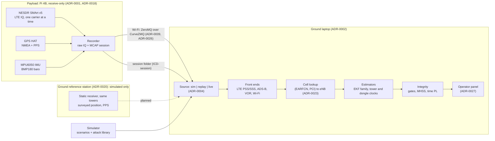

# D1: Architecture

- **Status:** Draft, 2026-11-10 (#28). The humans own the final D1 and the deck; this is the technical draft they build from.
- **Audience:** engineers who build navigation products (mentor Q7, [`mentor-qa.md`](mentor-qa.md)). Each statement points to its source instead of restating it.
- **State described:** `origin/main` at `8987664`. Work in open PRs is named by number and is not on `main`.
- **Evidence:** every number is in [`results.md`](results.md) with its source and kind (sim, synthetic, registry, real).

## What it is

A receive-only payload records LTE tower sync signals, the GPS fix and PPS, an IMU and a barometer. A ground laptop fuses them into position and time, each with a protection level, and treats every source, GPS and the towers alike, as something that can fail ([ADR-0021](adr/0021-what-we-build-and-pitch.md)).

The idea in one line: **learn the towers while GPS is trusted, then use them to keep position and time, catch GPS lying, and catch them lying.** Calibrated, grouped tower clocks are what make a tower testable at all (Jia, Khalife & Kassas 2023, in [`research.md`](research.md)).

## Use cases and key requirements

Use cases: [`use-cases.md`](use-cases.md). Requirements and verification methods: [`requirements.md`](requirements.md), [`verification.md`](verification.md). Attacks ranked per use case: [`threat-model.md`](threat-model.md).

| Use case | Requirements that drive the design | Target (all `TBC`, [`plan.md`](plan.md)) | Where we stand (sim, [`results.md`](results.md) §1) |
| --- | --- | --- | --- |
| UC-01 drone on an urban corridor | REQ-01 continuity, REQ-02 HPL, REQ-04 spoof detection, REQ-05 live display | T1: 95 % ≤ 25 m for ≥ 300 s; fallback ≤ 50 m for ≥ 120 s (mentors, 2026-11-10; ADR-0034 in open PR #158, its T1 part accepted by the team). T4, T5 | T1 missed on records shaped like real ones |
| UC-02 crewed approach into YOW | REQ-01, REQ-02 (556 m alert limit, RNP 0.3), REQ-04 | T2, T4, T5 | T2 not scored; the approach leg uses synthetic towers (ADR-0030) |
| UC-03 timing user | REQ-03 time holdover with an honest bound, REQ-04 time-spoof detection | T3, T4 | T3 missed (`ekf`: 49 of 50 seeds); the time-spoof ramp is detected |
| All | REQ-06 SoOP primary, REQ-07 receive-only, REQ-08 privacy, REQ-09 platform-agnostic, REQ-10 reproducible | — | REQ-07, REQ-08 by design and inspection |

The mentors set the integrity level as ours to choose and asked for confidence shown several ways (#158): protection level against the alert limit, error ellipse, NEES/NIS, per-source trust and time to alert.

## Data flow

- **Record raw on board, process on the ground** ([ADR-0002](adr/0002-record-raw-process-ground.md)): the laptop runs front ends, estimation and integrity, live or from logs.
- **One record type**, the `Measurement` ([ICD-measurement](icd/measurement.md)). Time is int64 GPS nanoseconds, positions ENU metres about the session origin ([ADR-0008](adr/0008-time-and-frames.md)).
- **Three interchangeable sources** ([ADR-0004](adr/0004-three-sources.md)): a result on simulated data runs unchanged on a recording.
- **Records shaped like real ones** ([ADR-0030](adr/0030-challenge-benchmark-set.md), Proposed; #135): the sim can emit LTE records exactly as the front end writes them (cell ID only, a dongle clock, 10 ms wrap, the front end's reported sigma), so the benchmark takes the same path a capture takes.

## Components as built

| Part | What it does | Code | State on `main` | Evidence kind |
| --- | --- | --- | --- | --- |
| Payload recorder and streamer | Records SDR IQ, gpsd, I2C sensors into a session; streams live | [`src/pnt/payload/`](../src/pnt/payload/), [`deploy/pi/RUNBOOK.md`](../deploy/pi/RUNBOOK.md) | Built (#19), runs on the 4 GB Pi 4B ([`hardware/bom.md`](../hardware/bom.md)) | Real: LTE and IMU sessions recorded 2026-11-10 |
| Ground link | CurveZMQ: payload is the server, admits only trusted laptop keys; plaintext needs `--insecure` | `pnt keys`, [ADR-0026](adr/0026-ground-link-security.md) | Built (#89) | Real: Pi to `pnt live` on 2026-11-10 (capture summary, [`results.md`](results.md) §5) |
| LTE front end | PSS/SSS search and time-of-arrival tracker on RTL-SDR IQ, written from the 3GPP specifications; sync signals only | [`src/pnt/frontends/lte/`](../src/pnt/frontends/lte/) | Built (#23). Crash on re-found cells fixed in open PRs #182/#177 (#181). Coherent integration for weaker cells is opt-in in open PR #171 | Synthetic and real captures |
| Cell lookup | (EARFCN, PCI) to a registered eNB from the 2026 ISED extract; unknown, colliding and out-of-range cells are dropped and counted, never guessed | [`src/pnt/nav/cells.py`](../src/pnt/nav/cells.py), [ADR-0023](adr/0023-tower-identity.md) (Proposed) | Built (#122); a PCI reused anywhere in the table is a collision (#138) | Registry audit and real captures |
| Other front ends | ADS-B (readsb frames), VOR radials, Wi-Fi RSSI from hub records | [`src/pnt/frontends/`](../src/pnt/frontends/) | Built; not used in any result below | — |
| Estimators | See *Estimators* | [`src/pnt/nav/`](../src/pnt/nav/) | Built | Sim; synthetic baseband |
| Integrity | See *Integrity layer* | [`src/pnt/integrity/`](../src/pnt/integrity/) | Built | Sim |
| Operator panel | Position, HPL against the alert limit, RNP/ANP, time PL, latched alerts, per-source trust, predicted time to alert; `NO DATA` when the stream stalls | [`src/pnt/dashboard/`](../src/pnt/dashboard/), [ADR-0027](adr/0027-dashboard-sse-canvas.md) | Built (#25, #90, #165); runs on replay and on `pnt live --dash` | Sim through replay and the live path |
| Ground reference station | Base/rover differencing; the base is itself a monitored fault | `nav/base_rover.py`, [ADR-0020](adr/0020-ground-reference-station.md) | Estimator built; hardware not assembled (#84) | Sim only |
| Simulator and attack library | Trajectories, error models, attacks, the `challenge-*` sets | [`src/pnt/sim/`](../src/pnt/sim/) | Built | Every model `placeholder` except as noted in [`verification.md`](verification.md) *Sim validity* |

## Estimators

Registry: `pnt.nav.ESTIMATORS`.

| Estimator | What it is |
| --- | --- |
| `baseline` | Deliberately simple reference filter, the control |
| `ekf` | Position, velocity, receiver clock, one clock block per tower, and an (offset, drift) block per SDR dongle (#122); uses Doppler range rate to towers and LEO satellites (#13) |
| `ekf-calibrated` | `ekf` with per-site tower clocks under a shared network-builder term, learned only while GNSS is trusted, rolled back when GNSS is flagged ([ADR-0022](adr/0022-tower-clock-model.md), Proposed; opt-in) |
| `ekf-imu` | `ekf` with IMU-driven prediction (#12, opt-in) |
| `ekf-mhss` | `ekf` with solution-separation protection levels and exclusion (#82) |
| `ekf-base`, `ekf-base-imu` | Differenced against the reference station; fall back to `ekf` when the base is lost or excluded |
| `ekf-calibrated-measured` | `ekf` with `ekf-calibrated`'s model, every value measured on real sessions or the filter's default, none from a sim set ([ADR-0043](adr/0043-calibrated-from-measured-values.md), Accepted, #118; opt-in) |
| `ekf-map` | `ekf` with a residual map: each tower's error per 25 m cell, learned while GPS is trusted, frozen whenever it is not (P11, [ADR-0032](adr/0032-residual-map.md) Accepted as opt-in only, #95) |
| `ekf-measured-sigma`, `ekf-calibrated-measured-sigma` | `ekf` and `ekf-calibrated` that tell a radio's LTE records ADR-0036's measured sigma from their SNR instead of the front end's ([ADR-0044](adr/0044-told-sigma-for-radio-records.md), Accepted, #147; opt-in) |

Open PRs add, opt-in and not on `main`: a GNSS position spoof monitor outside the filter (`ekf-spoof`, #180), and learned LTE range noise in place of the reported sigma (#156, draft, *Not ready*).

## Integrity layer

Design in full: [`verification.md`](verification.md) (*Integrity monitor: solution separation*). Gaps in full: [`threat-model.md`](threat-model.md) (*Gaps*).

**GNSS-dependency tags** ([ADR-0024](adr/0024-gnss-dependency-tags.md)): each source is independent (barometer, IMU, VOR), GNSS-timed (LTE towers: geometry survives a GNSS fault, time does not) or GNSS-derived (ADS-B, our own GPS). Only independent evidence can confirm GNSS; tower time may refute it, never confirm it. Refuting GNSS time from towers is planned, not built.

**Fault hypotheses**, grouped by what fails together:

| Hypothesis | Covers | Monitored by (on `main`) |
| --- | --- | --- |
| Tower site | One site's clock jump, a wrong or moved registry entry, a rogue cell on a real PCI | MHSS site subset; base check names the tower and its jump (`tower_fault:<emitter>:<m>`, #165) |
| Network builder | One builder's timing source in holdover or captured | MHSS builder subset |
| Source layer | A whole sensor type wrong | MHSS layer subset |
| GNSS common mode | GNSS plus every GNSS-derived source | Filter GNSS gate; spoof detector; time gate; MHSS GNSS-free subset |
| Reference station | Base moved, clock step, link lost | Base check in `ekf-base` |
| Hostile emitter | A located jammer used as a beacon | Not on `main` (ADR-0025; open PR #167) |

**Outputs:** HPL (from MHSS in `ekf-mhss`, from the covariance otherwise), VPL from the covariance, a time protection level from the receiver-clock covariance (`integrity/protection.py`, our definition; oscillator holdover only), flags (`gnss_excluded`, `spoof_suspected`, `time_spoof_suspected`, `mhss_excluded:<h>`), and a report card per scenario (time to alert, hazardous epochs, a DHS resilience level; `pnt.metrics`).

**Where it stops** (measured, [`results.md`](results.md)):
- **A detected location jump is followed, not refused:** the GNSS gate flags a jump of 20 m or more in 1.1 s, then the output takes the spoofed position (#176, #180; fix is #184).
- **A slow position ramp is not detected** on the challenge legs by any estimator on `main` (#170). Open PR #180's monitor catches it where at least 5 sites are heard, in minutes, not 30 s.
- **MHSS is safe but unavailable** with the `realistic` error sizes: its HPL exceeds the 50 m alert limit before any fault (#176), because the filter's tower model is not honest for that sim ([`verification.md`](verification.md)).
- **`ekf-calibrated` can stay confident on a wrong tower table** (#132).
- Two faults in different groups at once, and a wide-area time spoof that also captures tower timing, are not covered by design.

## How the sim aligns to reality (ADR-0015)

The mentors accept simulated attacks if the architecture says how the sim aligns to reality (Q4, [`mentor-qa.md`](mentor-qa.md)).

| Model | Status ([`verification.md`](verification.md) *Sim validity*) | Real data so far |
| --- | --- | --- |
| LTE pseudorange noise, multipath, tower clocks | `placeholder` (the `realistic` set: 50 m noise, 50 m multipath, `TBC`) | First real captures (2026-11-10): white noise and spread of one to three cells per carrier, no position truth ([`results.md`](results.md) §5). Not yet moved in *Sim validity* |
| LTE hearing (how many cells are tracked) | `placeholder` (link budget and the front end's -13 dB near-far floor, #135) | Real: 1 to 3 cells per carrier at two spots. Whether that is the near-far floor or simply the towers in range is not yet separated (#177) |
| Tower identity | Registry (2026 ISED extract) | Real: every cell tracked at the first spot matched a unique registered eNB; at the second spot three tracked cells are not in the table |
| IMU (MPU6050) | `placeholder` on `main`; `measured` in open PR #157 | Real overnight static session `20261110-0306-static-bench-overnight` (#157) |
| GNSS, barometer, VOR, ADS-B, Wi-Fi | `placeholder` | None yet |
| LEO (Iridium, Starlink) | `placeholder`, real orbits | Not measurable this week ([ADR-0013](adr/0013-no-iridium-hardware.md); Starlink's Ku band is out of the RTL-SDR's range) |
| Attacks | Software injection only ([ADR-0001](adr/0001-receive-only-payload.md)) | Injection into real sessions not done yet |

## What is real and what is simulated

| Part | Today |
| --- | --- |
| Payload recording LTE IQ and IMU on the Pi | **Real** sessions, 2026-11-10 (no GPS fix during the LTE captures, so no position truth) |
| LTE tracking and tower identity on real signals | **Real**, two spots, one dongle, static ([`results.md`](results.md) §5) |
| Position from real towers | **Not shown**: one to three cells per carrier and no truth |
| Live stream Pi to laptop over CurveZMQ | **Real**, stream only (capture summary, 2026-11-10) |
| Estimators, integrity, benchmark, accuracy budget, spoof studies | **Sim**, every model value `TBC` |
| Reference station, LEO, hostile emitter | **Sim** only |
| Jamming and spoofing | Software injection only (ASM-03) |

## Safety, security and regulation

Full list: [`safety.md`](safety.md).

- **Receive-only:** no transmit path in hardware or code (REQ-07, ADR-0001). Attacks exist only in software.
- **Privacy:** only broadcast sync and system information is decoded; Wi-Fi BSSIDs are hashed at capture, salted per session (REQ-08, [ADR-0011](adr/0011-privacy-at-capture.md)).
- **Ground links:** authenticated and encrypted with CurveZMQ; forged records are dropped, not fused ([ADR-0026](adr/0026-ground-link-security.md)). MAVLink signing is `TBC`; hash-chained logs come after judging.
- **Flight:** INAV, pilot-flown, RC kill switch always fitted ([ADR-0028](adr/0028-fly-inav.md)); tethered indoor hover only for the Wi-Fi bridge ([ADR-0029](adr/0029-tethered-hover-wifi-control.md)).
